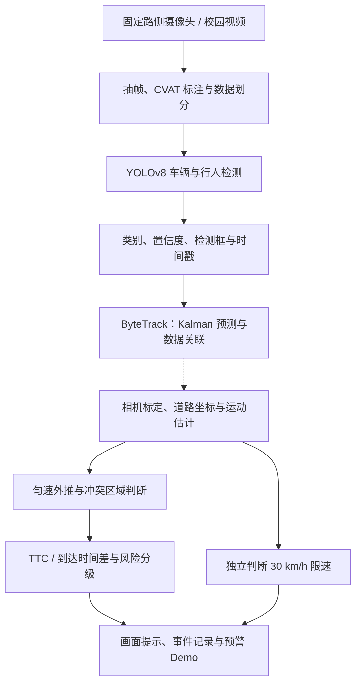

# 基于视觉目标检测与多目标跟踪的校园道路行人冲突感知与车速预警系统

面向校园道路固定路侧摄像头，研究车辆与行人的视觉感知、连续跟踪、实际速度估计和冲突风险预警。系统以 YOLOv8 与 PyTorch 为检测基础，通过 ByteTrack 维护连续目标身份，后续结合道路平面标定、轨迹预测及 TTC 分析，形成从视频输入到风险提示和事件记录的技术链路。

**当前阶段：车辆与行人检测、本地视频 ByteTrack 跟踪基线已实现；实际测速、冲突分析及预警展示按阶段推进。** 已在 CPU 环境验证检测训练评估、连续 ID、短暂漏检恢复和跨视频会话重置；尚未完成校园实景精度、测速误差或实时性评估。

**源码学习入口：[模块原理笔记与阅读索引](docs/modules/README.md)。** 已覆盖检测（含数据审计、训练评估）、跟踪（含导出、可视化、批处理）以及原有分类学习实验；源码关键步骤配有中文解释。后续完成大模块时，按索引中的约定同步补充注释、原理笔记及实际验证记录，可使用[笔记模板](docs/modules/_模块原理笔记模板.md)。

## 1. 研究目标与实现状态

| 模块 | 方法与工具 | 预期输出 | 当前状态 |
|---|---|---|---|
| 视频采集与数据集构建 | 固定路侧摄像头、校园自采视频；OpenCV、FFmpeg、CVAT | 视频片段、图像与标注、数据划分 | 支持本地输入；校园数据待提供 |
| 车辆与行人检测 | YOLOv8n、PyTorch、Ultralytics | 类别、置信度、原图检测框 | **已实现基线** |
| 多目标跟踪 | ByteTrack、Kalman Filter、基于 IoU 的数据关联与 LAPJV 线性分配 | 目标 ID、连续观测位置、有限历史轨迹 | **已实现视频跟踪基线**；校园场景待验证 |
| 标定与运动状态估计 | OpenCV、畸变校正、单应性变换、位移/时间与轨迹滤波 | 道路坐标、运动方向、估计速度 | 规划阶段 |
| 轨迹预测与冲突分析 | 匀速模型、速度向量外推、冲突区域几何判断 | 预测位置、冲突区域占用时段 | 规划阶段 |
| TTC 与风险决策 | 适用条件下的 TTC、到达时间差、风险分级、独立限速判定 | 正常 / 注意 / 高风险，以及超速提醒 | 规划阶段 |
| 实时预警与展示 | OpenCV；可选 Streamlit 或 FastAPI | 实时画面、驾驶员及路旁学生提示、危险事件记录 | 已实现检测/跟踪可视化；桌面窗口待实测，完整预警 Demo 待开发 |
| 实验评价 | 检测、跟踪、测速、延迟与事件级评价；计划使用 Pandas、Matplotlib 等汇总结果 | 实验报告、论文图表和答辩材料 | 已提供检测评估入口；完整实验待开展 |

研究重点是**道路标定与实际测速、车辆—行人时空冲突分析，以及 TTC 与风险决策**。YOLOv8 和 ByteTrack 分别提供检测与跟踪结果，后续模块据此估计运动状态并判断风险。

## 2. 技术流程



跟踪模块后的虚线连接表示尚待集成的后续阶段。实时预警是项目目标，实际吞吐量和端到端延迟需要在完整系统与目标硬件上测量。

## 3. 核心算法

### 3.1 YOLOv8 目标检测：已接入

当前采用 Ultralytics 标准 **YOLOv8n** 检测模型和 COCO 预训练权重，通过 PyTorch 执行推理与训练。主要组成包括：

- **特征提取**：C2f 模块和 SPPF 空间金字塔池化。
- **多尺度融合**：FPN/PAN 式结构融合 P3、P4、P5 三个尺度的特征。
- **检测头**：Anchor-Free 设计，分类与边界框回归采用解耦分支。
- **训练机制**：Task-Aligned Assigner 进行标签分配，BCE 用于分类，CIoU 与 Distribution Focal Loss（DFL）用于边界框回归。
- **推理后处理**：图像缩放与填充、置信度筛选、非极大值抑制（NMS）及类别筛选。当前标准 YOLOv8 路径使用 NMS。

本仓库围绕该模型提供输入处理、道路类别筛选、原图坐标导出、数据检查及训练评估入口。YOLOv8s 可作为后续精度与计算成本对比的候选模型。

默认类别为 `person`、`bicycle`、`car`、`motorcycle`、`bus`、`truck`。导出保留模型细分类，同时将 `person` 归为 `pedestrian`，其余道路类别归为 `vehicle`；自行车、摩托车可在后续阶段单独分析。

### 3.2 ByteTrack 多目标跟踪：已接入

通过 Ultralytics `model.track()` 使用 ByteTrack 的高、低置信度检测框分阶段关联机制，利用 Kalman Filter 预测目标状态，以 IoU 等关联代价构建匹配矩阵，通过 `lap.lapjv()` 求解线性分配，并管理轨迹的建立、丢失和终止。

同一视频保持 `persist=True`；每个新视频创建独立会话和模型包装实例，清空历史，避免继承前一段视频的 ID。参数放在 `configs/bytetrack.yaml`，默认检测 conf 跟随低分关联阈值。短暂漏检恢复已作功能验证，真实遮挡和交叉通行下的稳定性仍需校园数据评估。

### 3.3 摄像机标定与实际测速：核心研究阶段

固定机位下，计划通过道路上已知尺寸的参考点建立图像平面与近似道路平面的映射，使用 OpenCV 单应性变换获得道路坐标。目标的地面接触位置可先用检测框底边中心近似，再结合轨迹滤波和时间窗口计算速度：

$$
v_{\mathrm{m/s}}=\frac{\|\mathbf{p}(t)-\mathbf{p}(t-\Delta t)\|}{\Delta t},\qquad
v_{\mathrm{km/h}}=3.6v_{\mathrm{m/s}}.
$$

其中位置使用标定后的米制坐标，时间来自源视频时间戳。需要评估镜头畸变、道路非平面、遮挡及框位置抖动对测速的影响，并用具有参考速度或已知距离与时间的独立视频验证误差。

### 3.4 冲突分析、TTC 与预警：核心研究阶段

第一版计划采用短时匀速外推，结合车辆与行人进入同一冲突区域的预计时间、占用时段、相对距离和运动不确定性进行风险判断。判断同时考虑空间接近与时间重叠。

简化关系 `TTC = 距离 / 接近速度` 适用于距离、接近速度和冲突方向可解释的特定运动场景；对校园道路横穿行人，重点分析冲突区域的到达时间差，并结合目标尺寸、预测时域和轨迹不确定性设置预警规则。

**限速提醒与碰撞风险分级独立输出。** 初始限速参数采用 **30 km/h**：未超速车辆也可能因接近横穿行人而产生高风险。风险阈值、限速判定容差与报警抖动控制需要通过场景实验确定，当前未实现这些决策模块。

## 4. 当前功能

- 本地单张图片、图片目录和视频检测；按名称筛选道路目标类别。
- 保存带框图片或 MP4，以及逐帧 `detections.jsonl` 和运行汇总 `summary.json`。
- 为没有目标的帧保留记录，导出原图像素坐标、帧号及源时间信息。
- 本地 YOLO 标注数据检查：类别映射、标签格式、缺少标签及训练/验证文件路径重叠。
- 自定义数据训练、验证与测试入口，导出整体及有标注类别的检测指标。
- ByteTrack 连续视频跟踪，显示类别、置信度、ID、分组颜色、轨迹、源 FPS、处理 FPS、帧号和当前各类数量。
- 跟踪结果流式导出 JSONL、CSV、丢失/恢复事件及逐轨迹汇总；可选桌面 `--show` 模式支持 Space/P 暂停继续、Q/Esc 退出，默认无窗口保存视频。
- 目录顺序批量跟踪，每段新建会话；单个文件失败继续处理，其错误写入批次清单。
- 推理异常或 Ctrl+C 时尝试保存已完成视频与错误汇总；提供不需要数据集的构造样例生成器。

当前输入入口为本地文件和目录，摄像头、网络流和网页预警端尚未接入。检测入口的 `track_id` 仍为 `null`；跟踪入口输出有效 ID，未获得 ID 的返回框保留 null。当前云机器没有桌面，按键控制已通过模拟事件测试，实际窗口仍需本地验证。

## 5. 安装与快速使用

已验证环境：Python 3.12、PyTorch 2.11.0+cpu、torchvision 0.26.0+cpu、Ultralytics 8.4.182、opencv-python 5.0.0.93。模型版本由 `yolov8n.pt` 指定，Ultralytics 包版本不代表 YOLO 模型版本。

跟踪新增依赖 `lap==0.5.12`，已加入 `requirements-yolo.txt`，用于 ByteTrack 的线性分配。

```bash
git clone https://github.com/blckgum/jszx-.git
cd jszx-
python -m venv .venv
source .venv/bin/activate

# CPU 安装示例；使用 GPU 时先按硬件安装匹配的 CUDA 版 PyTorch
python -m pip install torch==2.11.0 torchvision==0.26.0 --index-url https://download.pytorch.org/whl/cpu
python -m pip install -r requirements-yolo.txt
python -m pip check
```

Windows PowerShell 使用 `.\.venv\Scripts\Activate.ps1` 激活虚拟环境。计划在 RTX 5060 上开展 GPU 训练和推理实验，应按 PyTorch 官方支持情况选择对应 CUDA 构建；当前云环境的验证使用 CPU。

将下面的 `--source` 替换为实际文件或目录。首次运行需要联网下载官方权重，默认保存到 `checkpoints/yolo/yolov8n.pt`；也可以通过 `--weights` 指定已有权重。

```bash
python -m detection detect --source path/to/image.jpg --device cpu
python -m detection detect --source path/to/image_folder --device cpu
python -m detection detect --source path/to/video.mp4 --device cpu

# 按类别筛选，仅处理前 100 帧
python -m detection detect --source path/to/video.mp4 --classes person car bus truck --max-frames 100 --device cpu

# 跟踪：默认无窗口保存视频和逐帧数据
python -m tracking --source path/to/video.mp4 --tracker configs/bytetrack.yaml --device cpu

# 目录批量跟踪：每段独立输出，目录只读取一层
python -m tracking --source path/to/videos --device cpu

# 尚无实拍视频时：生成非实拍功能样例，再运行真实模型和跟踪器
python -m tracking.demo --output runs/tracking-fixtures/sample_01
python -m tracking --source runs/tracking-fixtures/sample_01 --device cpu --output runs/yolo/track-batch/sample_01
```

| 参数 | 用途 | 默认值 |
|---|---|---|
| `--weights` | 检测模型权重 | `checkpoints/yolo/yolov8n.pt` |
| `--conf` | 检测置信度阈值 | `0.25` |
| `--iou` | NMS 的 IoU 阈值 | `0.7` |
| `--imgsz` | 模型输入尺寸 | `640` |
| `--device` | `cpu` 或 GPU 编号，如 `0` | 自动选择 |
| `--output` | 指定一个尚不存在的输出目录 | 自动创建独立目录 |
| `--fps` | 显式覆盖视频 FPS 及固定间隔时间戳 | 优先使用视频元数据 |

上述参数表描述检测入口。跟踪入口的 `--conf` 默认取 `configs/bytetrack.yaml` 中的 `track_low_thresh=0.1`，并拒绝更高值，保留低分关联候选。跟踪可追加 `--show` 启用桌面窗口，当前默认无界面。

## 6. 数据集与训练评估

数据来源计划采用 **校园固定路侧自采视频为主、公开道路数据为补充**。BDD100K 可作为候选公开数据，但其车载视角与固定路侧视角存在差异，需要通过校园数据适配与独立评估验证效果。抽帧、片段筛选、CVAT 标注及 FFmpeg 处理属于数据准备流程。

当前入口接受本地 YOLO 检测标注。COCO 或 BDD100K 的原始标注需先转换，不能直接把其 JSON 文件传入本入口。

```text
data/traffic/
├── images/
│   ├── train/
│   ├── val/
│   └── test/
└── labels/
    ├── train/
    ├── val/
    └── test/
```

图片与标签同名，每个目标占一行：`class_id x_center y_center width height`，四个坐标值按图像宽高归一化。无目标图片提供空标签文件。默认自定义六类顺序为 `0 person / 1 bicycle / 2 car / 3 motorcycle / 4 bus / 5 truck`；它与 COCO 原始类别 ID 不同，转换时必须重新映射。

使用 [数据集配置模板](configs/traffic.example.yaml) 修改 `path` 后运行。相对 `path` 以 YAML 所在目录为基准；`train/val/test` 以该 `path` 为基准。同一视频及其相邻帧按视频、时间段或机位划分，避免跨集合泄漏。

```bash
# 训练；GPU 可将 --device cpu 改为 --device 0
python -m detection train --data configs/traffic.example.yaml --epochs 50 --batch 8 --imgsz 640 --device cpu

# 将 run-xxxx 替换为实际训练输出目录
python -m detection val --data configs/traffic.example.yaml --weights runs/yolo/train/run-xxxx/weights/best.pt --split val --device cpu
python -m detection val --data configs/traffic.example.yaml --weights runs/yolo/train/run-xxxx/weights/best.pt --split test --device cpu
```

训练权重保存为 `weights/best.pt` 和 `weights/last.pt`，指标写入 `metrics.json`。评估时要求模型与数据集的 `names` 完全一致。验证集用于选参数，测试集用于最终报告。

## 7. 输出与实验依据

检测结果默认写入 `runs/yolo/detect/run-*`。JSONL 每帧包含输入来源、原图宽高、`frame_index`、`timestamp_s`、时间戳来源和目标列表；每个目标包含 `class_id`、`class_name`、`category`、`confidence`、`bbox_xyxy`、`track_id`。

独立图片没有时间戳；视频在源时间戳不可用时使用 FPS 估计，并记录 `fps_estimate`。标注 MP4 使用固定帧率，后续运动计算以逐帧数据中的源时间信息为准。检测框累计数量不能直接作为独立目标数量。

跟踪输出位于 `runs/yolo/track/run-*`，包含 `annotated.mp4`、`tracks.jsonl`、`observations.csv`、`events.jsonl`、`tracklets.jsonl`、`summary.json` 和 `tracker.resolved.yaml`。目录输入默认输出到 `runs/yolo/track-batch/run-*`，根目录另有 `batch_summary.json`，每段视频放在独立子目录。逐帧目标还提供 ID、框底边中心像素点和观测标记，使用 `(session_id, track_id)` 区分不同视频；当前不输出实际速度或 TTC。

| 评价对象 | 指标与验证方法 | 状态 |
|---|---|---|
| 检测 | Precision、Recall、mAP50、mAP50-95；分目标类别及难例场景统计 | 已实现指标导出，校园数据结果待测 |
| 跟踪 | IDF1、HOTA、ID 切换数 | 已完成功能验证；定量指标待实拍视频和连续 ID 标注 |
| 测速 | MAE、RMSE；对比参考速度及不同标定位置 | 待道路标定与参考数据 |
| 冲突预警 | 事件级召回率、误报率、预警提前量与端到端延迟 | 待冲突事件标注与完整系统 |

已完成的功能验证：官方样例检出行人、公交车、汽车、自行车和卡车；3 帧拼接视频验证空帧保留、时间戳和输出解码；COCO128 重映射小样本按 4/4/2 张划分，完成单轮训练及 val/test 入口验证；6 项回归测试通过。小样本单轮微调后的指标较低，仅用于检查流程，不能代表校园检测效果。GPU 性能、真实道路动态视频及完整预警效果尚未验证。

跟踪新增验证：3 帧视频中的公交车在空白帧前后保持 ID；两段各 18 帧的构造视频中，多车多人同时关联，公交车在两个空白帧后恢复原 ID；同进程处理第二段视频时正确新建会话并重新分配 ID。当前总测试数为 **30 项，全部通过、无跳过**，包含真实网络集成、长时间丢失与临界恢复、生命周期和 CSV、坏视频批量处理、异常/中断保存及模拟按键测试。命令行已实际完成两段各 18 帧构造样例的 CPU 批量处理与输出核对。构造视频不是校园实拍基准，未据此报告 IDF1/HOTA 或承诺实时性能。

```bash
python -m unittest discover -s tests -v
```

## 8. 仓库结构

```text
jszx-/
├── detection/                    # 当前目标检测模块
│   ├── __main__.py                # detect / train / val 入口
│   ├── core.py                    # 推理、可视化、逐帧导出
│   └── dataset.py                 # 数据集与标签检查
├── configs/traffic.example.yaml   # YOLO 数据配置模板
├── configs/bytetrack.yaml         # 独立 ByteTrack 参数
├── tracking/                      # 独立会话、轨迹记录、批处理、构造样例及可视化
├── tests/                         # 检测、跟踪机制与真实网络集成测试
├── requirements-yolo.txt          # 检测模块依赖
├── docs/modules/                 # 模块索引、检测/跟踪/分类原理笔记与模板
├── docs/                         # 课题需求、技术路线及检测实施说明
├── common.py / config.py          # 原有分类实验工具与配置
├── model.py / dataset.py          # 原有 SimpleCNN / ResNet18 分类实验
└── train.py / predict.py          # 原有分类训练与推理入口
```

检测、训练和评估使用 `python -m detection`，视频跟踪使用 `python -m tracking`。`data/`、`checkpoints/`、`runs/` 为本地数据、权重和生成结果，不随 Git 提交。

## 9. 开发路线与参考资料

实施顺序：**检测基线及场景数据 → ByteTrack 跟踪 → 道路标定和测速 → 冲突预测与 TTC 风险分级 → 实时 Demo 与实验评价**。第一版优先形成可验证的完整流程，后续再按性能需求考虑部署优化。

- [课题需求与技术路线](docs/课题需求与技术路线.md)
- [模块原理笔记与源码阅读索引](docs/modules/README.md)
- [原有图像分类实验原理笔记](docs/modules/03_图像分类实验_原理笔记.md)
- [检测模块实施说明](docs/车辆行人检测方案.md)
- [目标检测 YOLOv8 与 PyTorch 解释文档](docs/modules/01_目标检测_YOLOv8与PyTorch_解释文档.md)
- [多目标跟踪 ByteTrack 解释文档](docs/modules/02_多目标跟踪_ByteTrack_解释文档.md)
- [Ultralytics YOLOv8 文档](https://docs.ultralytics.com/models/yolov8/)
- [PyTorch 安装说明](https://pytorch.org/get-started/locally/)
- [ByteTrack 项目](https://github.com/FoundationVision/ByteTrack)
