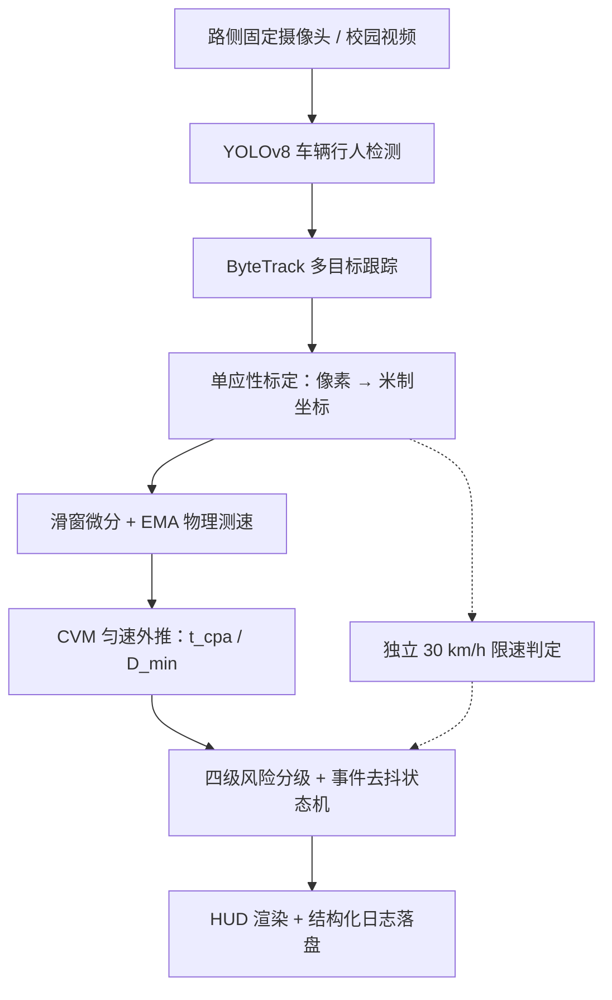

# 基于视觉目标检测与多目标跟踪的校园道路行人冲突感知与车速预警系统

面向校园道路固定路侧摄像头，研究车辆与行人的视觉感知、连续跟踪、实际速度估计和冲突风险预警。系统以 YOLOv8 + ByteTrack 提供检测与连续轨迹，`analysis` 模块完成道路标定、物理测速、TTC 冲突研判、事件去抖与四级预警，形成从视频输入到风险提示和事件记录的完整技术链路。

**当前阶段：全链路已实现**（检测 → 跟踪 → 标定测速 → 冲突分析 → 预警）。CPU 环境下 151 项测试全部通过；校园实景标定、测速精度与实时性尚未评估——本机 CPU 实测约 2.6~15 FPS，定位离线分析，不承诺实时。

## 技术链路



## 实现状态

| 模块 | 方法 | 状态 |
|---|---|---|
| 车辆与行人检测 | YOLOv8n、PyTorch、Ultralytics | 已实现基线 |
| 多目标跟踪 | ByteTrack：Kalman 预测 + 高/低分检测分阶段关联 | 已实现；校园场景待验证 |
| 图像轨迹与运动记录 | 时间自适应位置/速度 EMA、像素位移、方向、px/s | 已实现；独立配置、有界缓存、漏检分段 |
| 独立道路坐标映射 | 四点/多点 Homography、RANSAC、镜头点校正、独立位置检查 | 已实现算法组件；实景标定待验证 |
| 标定与测速 | 4 点单应性标定、滑窗两端微分、EMA 滤波 | 已实现；精度待实景验证 |
| 冲突分析与 TTC | CVM 匀速外推、t_cpa/D_min 闭式解、四级风险 | 已实现；阈值待实景调优 |
| 告警事件去抖 | N 帧确认 + 等级滞回 + 冷却合并 | 已实现；confirmed/provisional 分流 |
| 实验评价 | 检测/跟踪/测速/事件级指标 | 框架已备；校园数据与标注待开展 |

测速核心：`v(m/s) = ‖p(t) − p(t−Δt)‖ / Δt`（滑窗两端差分），`v(km/h) = 3.6 × v(m/s)`。超限 35 m、背向远离、持续静止且速度已收敛的目标不参与碰撞研判；超速与轨迹冲突独立判定，未超速也可能触发高级别 TTC 预警。

## 快速使用

```bash
# 先安装匹配硬件的 torch/torchvision，再装本文件
python -m pip install -r requirements-yolo.txt

# 检测 / 跟踪
python -m detection detect --source path/to/video.mp4 --device cpu
python -m tracking --source path/to/video.mp4 --tracker configs/bytetrack.yaml --motion-config configs/motion.yaml --device cpu

# 无数据集标定演示；仅合成几何验证，非实景测量
python -m calibration demo --output runs/calibration/demo_01

# 独立求解与报告（示例配置明确标为 synthetic）
python -m calibration solve --config configs/road_mapping.example.yaml --output runs/calibration/rectangle_01

# 原有路面标定：在含已知尺寸参照物的图像/首帧上取 4 个角点
python -m analysis.interactive_calibrator --source path/to/road.jpg --width 6.0 --length 15.0

# 端到端冲突感知与预警（默认读 configs/calibration.yaml）
python -m analysis --source path/to/video.mp4 --device cpu --show

# 无实测标定时的流程演示（内存合成标定，物理量不可信）
python -m analysis --source path/to/video.mp4 --demo
```

本次 CPU 验证环境：Python 3.12、PyTorch 2.11.0+cpu、torchvision 0.26.0、Ultralytics 8.4.182、opencv-python 5.0.0.93、lap 0.5.12。依赖中不存在的 lap 0.10.0 已修正。

`python -m analysis` 主要参数：`--speed-limit`（30 km/h）、`--ema-alpha`（0.35）、`--window`/`--window-s`（测速窗）、`--ttc-critical`/`--ttc-caution`/`--horizon`（1.8/3.5/3.5 s）、`--parked-seconds`（3.0 s 静止确认）、`--alert-confirm`/`--alert-confirm-s`、`--alert-cooldown`/`--alert-cooldown-s`（去抖窗口）、`--reliable-span-s`（0.2 s 可信度跨度）、`--fps`（无源 FPS 时显式指定）、`--max-frames`、`--demo`、`--show`。**帧数/秒数成对参数一律秒级覆盖帧级。** 训练与检测评估入口 `python -m detection train|val` 见[检测模块实施说明](docs/车辆行人检测方案.md)。

## 输出产物

`python -m tracking` 默认写入 `runs/yolo/track/run-*`，保存带 ID、轨迹、方向和 **px/s** 标签的 `annotated.mp4`，原有跟踪 JSONL/CSV、生命周期记录，以及新增的 `motion.jsonl`、`motion.csv` 和 `motion.resolved.yaml`。运动数据保留框、类别、置信度、输入/平滑接地点、源时间及有效性；漏检不补造观测，恢复首帧速度为空。`--source` 也可传入视频目录，`--trail-length` 覆盖配置中的历史长度。像素速度不表示实际 km/h，详见[运动模块解释文档](docs/modules/03_目标轨迹与图像运动状态_解释文档.md)。

`runs/analysis/run-*`（或 `--output` 指定目录）：

| 文件 | 内容 |
|---|---|
| `annotated_conflict.mp4` | HUD/徽章/预测轨迹渲染；`[PROVISIONAL]` 瞬时量与 `[EVT#n CONFIRMED]` 已确认事件区分 |
| `conflicts.jsonl` | 逐帧原始冲突评估（确认后回填 `event_id`） |
| `events.jsonl` | 生命周期告警事件：首末帧/时间戳、峰值等级、最小 TTC、结束原因 |
| `speeds.csv` | 逐目标位置、速度、风险、事件关联与可靠度标记 |
| `summary.json` | 事件计数与运行摘要；异常退出同样落盘并带 `status`/`stop_reason`/`error` |

`python -m calibration` 输出 H/逆矩阵、内点掩码、独立位置检查报告和网格图；`map-tracks` 将已有轨迹映射为 `ground_tracks.jsonl/CSV`，保留源时间、ID、像素位置、米制位置及有效标记，不重跑网络或新增测速/TTC。合成模式需明确允许，始终不作为实测标定有效。详见[标定模块解释文档](docs/modules/04_摄像头标定与道路坐标映射_解释文档.md)。

## 已知边界

- 纯视觉路侧预警，不做底盘控制；摄像机/网络流接入尚未实现
- ByteTrack 换 ID 会把同一物理事件拆成多条记录（日志保留 track_id 供事后归并）
- 停车区/行车道分区豁免、非机动车细分：待真实校园素材后定案
- 夜间/雨天、遮挡鲁棒性与实景精度未经评估

## 仓库结构

```text
detection/   YOLOv8 检测、训练与评估入口
tracking/    ByteTrack 会话、轨迹与 px/s 运动记录、平滑、可视化、批处理
calibration/ 独立道路映射、镜头参数、独立检查、轨迹映射与合成演示
analysis/    标定 · 测速 · 冲突研判 · 事件去抖 · 渲染 · 端到端管线
configs/     检测/跟踪/运动参数、原有 calibration.yaml、新道路映射模板
tests/       单元、集成与异常路径测试（151 项）
docs/        课题需求、研究蓝图（含数学推导）与模块解释文档
```

## 文档与参考

- [课题需求与技术路线](docs/课题需求与技术路线.md) · [课题全景蓝图与数学推导](docs/MASTER_RESEARCH_PROMPT.md)
- [检测模块实施说明](docs/车辆行人检测方案.md) · [YOLOv8 解释文档](docs/modules/01_目标检测_YOLOv8与PyTorch_解释文档.md) · [ByteTrack 解释文档](docs/modules/02_多目标跟踪_ByteTrack_解释文档.md)
- [目标轨迹与图像运动状态解释文档](docs/modules/03_目标轨迹与图像运动状态_解释文档.md)
- [摄像头标定与道路坐标映射解释文档](docs/modules/04_摄像头标定与道路坐标映射_解释文档.md) · [单应性矩阵数学推导与算例](docs/algorithms/单应性矩阵_数学推导与算例_解释文档.md)
- [BDD100K 与 TrackEval 选择及准备说明](docs/数据集与跟踪评测工具选择_BDD100K与TrackEval.md)
- [Ultralytics YOLOv8](https://docs.ultralytics.com/models/yolov8/) · [ByteTrack 项目](https://github.com/FoundationVision/ByteTrack)
