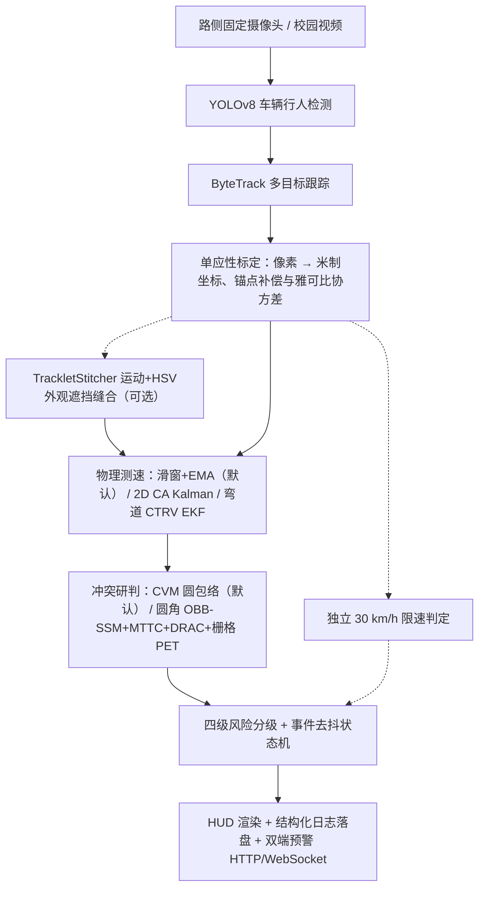

# 基于视觉目标检测与多目标跟踪的校园道路行人冲突感知与车速预警系统

面向校园道路固定路侧摄像头，研究车辆与行人的视觉感知、连续跟踪、实际速度估计和冲突风险预警。系统以 YOLOv8 + ByteTrack 提供检测与连续轨迹，`analysis` 模块完成道路标定、物理测速、TTC 冲突研判、事件去抖与四级预警，形成从视频输入到风险提示和事件记录的完整技术链路。

**当前阶段：全链路已实现**（检测 → 跟踪 → 短时遮挡缝合 → 标定测速 → 冲突分析 → 预警与双端推送服务）。仓库共含 306 项单元与集成测试（在含 `lap 0.5.12` 与基础权重的验证环境下 306/306 全部通过、0 跳过；其中 `test_io_hardening.py`、`test_tracking.py`、`test_tracking_exports.py`、`test_tracking_integration.py` 共 4 个依赖 ByteTrack/`lap` 的 I/O 加固与跟踪测试模块需配合 `lap` 运行）；校园实景标定、测速精度与实时性尚未评估——本机 CPU 实测约 2.6~15 FPS，定位离线分析，不承诺实时。

## 技术链路



## 实现状态

| 模块 | 方法 | 状态 |
|---|---|---|
| 车辆与行人检测 | YOLOv8n、PyTorch、Ultralytics | 已实现基线 |
| 多目标跟踪 | ByteTrack：Kalman 预测 + 高/低分检测分阶段关联 | 已实现；校园场景待验证 |
| 图像轨迹与运动记录 | 时间自适应位置/速度 EMA、像素位移、方向、px/s | 已实现；独立配置、有界缓存、漏检分段 |
| 断轨缝合 | `TrackletStitcher`：阻尼二阶外推、马氏门控、航向一致性与轻量 HSV 外观直方图 | 已实现；通过 `--enable-stitching` 开启 |
| 标定与测速 | 4 点/多点 RANSAC 单应性、去畸变、2D 锚点偏置补偿、雅可比协方差、EMA / CA Kalman / CTRV EKF | 已实现；精度待实景验证 |
| 类别策略 | bicycle/motorcycle/car/bus/truck 几何尺寸与安全半径策略 | 已实现；参数可在策略模块调整 |
| 冲突分析与 TTC | CVM 等速圆包络或圆角 OBB 扫掠 TTC + MTTC + DRAC + 整车栅格 PET + 碰撞概率 | 已实现；阈值待实景调优 |
| 告警事件去抖 | N 帧确认 + 等级滞回 + 冷却合并 | 已实现；confirmed/provisional 分流 |
| 实时流与双端服务 | `LatestFrameCapture` 丢旧帧、驾驶员/行人双端预警、`ThreadingHTTPServer` 默认后端与可选 FastAPI/WebSocket | 已实现；实景网络压测待开展 |
| 实验评价与图表 | 检测/跟踪/测速/事件级指标、弯道消融、分阶段耗时基准与离线实验出图 | 框架已备；校园数据与标注待开展 |

测速核心：`v(m/s) = ‖p(t) − p(t−Δt)‖ / Δt`（滑窗两端差分），`v(km/h) = 3.6 × v(m/s)`。超限 35 m、背向远离、持续静止且速度已收敛的目标不参与碰撞研判；超速与轨迹冲突独立判定，未超速也可能触发高级别 TTC 预警。

## 快速使用

```bash
# 先安装匹配硬件的 torch/torchvision，再装本文件
python -m pip install -r requirements-yolo.txt

# 检测 / 跟踪
python -m detection detect --source path/to/video.mp4 --device cpu
python -m tracking --source path/to/video.mp4 --tracker configs/bytetrack.yaml --motion-config configs/motion.yaml --device cpu

# 路面标定：在含已知尺寸参照物的图像/首帧上取 4 个角点
python -m analysis.interactive_calibrator --source path/to/road.jpg --width 6.0 --length 15.0

# 端到端冲突感知与预警（默认读 configs/calibration.yaml；支持本地视频、目录、摄像头索引或 rtsp://）
python -m analysis --source path/to/video.mp4 --device cpu --show
python -m analysis --source 0 --device cpu --show
python -m analysis --source path/to/video_dir --device cpu
# 基于已有 tracks.jsonl 离线复盘测速与 TTC（不重跑检测跟踪）
python -m analysis --tracks runs/yolo/track/run-*/tracks.jsonl --calib configs/calibration.yaml
# 启用 2D CA Kalman 测速、OBB+SSM 冲突研判与短时遮挡断轨缝合
python -m analysis --tracks runs/yolo/track/run-*/tracks.jsonl --calib configs/calibration.yaml --speed-model kalman --conflict-model obb_ssm --enable-stitching

# 无实测标定时的流程演示（内存合成标定，物理量不可信）
python -m analysis --source path/to/video.mp4 --demo

# 无视频的合成轨迹参数消融、场景回归、分阶段耗时基准与实验图表
python -m analysis.ablation --output runs/analysis/ablation.json
python -m analysis.scenarios --output runs/analysis/scenarios.json
python -m analysis.benchmark --source path/to/video.mp4 --demo --max-frames 30 --output runs/analysis/benchmark.json
python -m analysis.charts --ablation runs/analysis/ablation.json --run runs/analysis/run-<timestamp> --benchmark runs/analysis/benchmark.json --output-dir runs/analysis/charts
python -m analysis.evaluate --run runs/analysis/run-<timestamp> --ground-truth configs/ground_truth.example.yaml --markdown --output runs/analysis/evaluation.md
python -m analysis.schema --run runs/analysis/run-<timestamp>

# 启动实时双端预警与历史运行查询后端（默认标准库 ThreadingHTTPServer，零额外 Web 依赖）
python -m analysis.service --runs-root runs/analysis --host 127.0.0.1 --port 8000 --backend stdlib
```

本次 CPU 验证环境：Python 3.12、PyTorch 2.11.0+cpu、torchvision 0.26.0、Ultralytics 8.4.182、opencv-python 5.0.0.93、lap 0.5.12。依赖中不存在的 lap 0.10.0 已修正。

`python -m analysis` 主要参数：`--speed-limit`（30 km/h）、`--object-policy`（类别策略 YAML）、`--speed-model`（`ema` 默认 / `kalman` / `ctrv`）、`--conflict-model`（`cvm_circle` 默认 / `obb_ssm`）、`--enable-stitching`（开启遮挡断轨缝合）、`--include-cyclist-vru`（将自行车与摩托车骑行者纳入 VRU 冲突研判）、`--compensate-anchor-bias`（开启车辆 2D 锚点至几何中心视线偏置补偿）、`--live-drop-stale-frames`（实时流开启后台抓帧丢旧帧）、`--live-reconnect-attempts`/`--live-reconnect-delay`（实时流断流重连次数与等待间隔，默认 3 次 / 1.0 s）、`--ema-alpha`（0.35）、`--window`/`--window-s`（测速窗）、`--ttc-critical`/`--ttc-caution`/`--horizon`（1.8/3.5/3.5 s）、`--parked-seconds`（3.0 s 静止确认）、`--alert-confirm`/`--alert-confirm-s`、`--alert-cooldown`/`--alert-cooldown-s`（去抖窗口）、`--reliable-span-s`（0.2 s 可信度跨度）、`--fps`（无源 FPS 时显式指定）、`--max-frames`、`--demo`、`--show`。**帧数/秒数成对参数一律秒级覆盖帧级。** 配套工具链包含 `python -m analysis.mot_eval`（基于 `tracks.jsonl` 或 MOTChallenge 标注计算 MOTA/IDF1/HOTA/IDSW）、`python -m analysis.benchmark` / `python -m analysis.charts`（分阶段耗时与论文离线图表）、`python -m analysis.service`（历史查询、MJPEG 与双端告警推送服务）及 `python -m analysis.interactive_calibrator` 扩展（支持 `--ground-points` 多点 RANSAC 与无 `--points` 交互点击、`--parking-zone` 与窗口内 `'P'`/`'N'` 停车区框选、`--chessboard-dir` 棋盘格相机内参标定与 `--intrinsics-yaml` 注入）。训练与检测评估入口 `python -m detection train|val` 见[检测模块实施说明](docs/车辆行人检测方案.md)。

## 输出产物

`python -m tracking` 默认写入 `runs/yolo/track/run-*`，保存带 ID、轨迹、方向和 **px/s** 标签的 `annotated.mp4`，原有跟踪 JSONL/CSV、生命周期记录，以及新增的 `motion.jsonl`、`motion.csv` 和 `motion.resolved.yaml`。运动数据保留框、类别、置信度、输入/平滑接地点、源时间及有效性；漏检不补造观测，恢复首帧速度为空。`--source` 也可传入视频目录，`--trail-length` 覆盖配置中的历史长度。像素速度不表示实际 km/h，详见[运动模块解释文档](docs/modules/03_目标轨迹与图像运动状态_解释文档.md)。

`runs/analysis/run-*`（或 `--output` 指定目录）：

| 文件 | 内容 |
|---|---|
| `annotated_conflict.mp4` | HUD/徽章/预测轨迹渲染；`[PROVISIONAL]` 瞬时量与 `[EVT#n CONFIRMED]` 已确认事件区分 |
| `conflicts.jsonl` | 逐帧原始冲突评估（确认后回填 `event_id`，含可选 `mttc_seconds`/`drac_ms2`/`pet_seconds`/`collision_prob`/`conflict_model`） |
| `events.jsonl` | 生命周期告警事件：首末帧/时间戳、峰值等级、最小 TTC、结束原因 |
| `speeds.csv` | 逐目标位置、速度、风险、事件关联与可靠度标记 |
| `configuration.json` | 参数快照（含 `speed_model`/`conflict_model`/`enable_stitching`/`compensate_anchor_bias`/`live_drop_stale_frames`）、Git 状态、依赖版本与 SHA256 指纹 |
| `summary.json` | 事件计数、断轨缝合计数（`stitched_track_count`）、实时重连与丢旧帧计数及运行摘要；异常退出同样落盘 |

## 已知边界

- 纯视觉路侧预警，不做底盘控制；本地摄像头 / RTSP 流接入已实现，但实景网络丢包与端到端延迟未经现场压测
- 默认关闭 `--enable-stitching` 时，ByteTrack 换 ID 会把同一物理事件拆成多条记录；开启 `--enable-stitching` 可在短时遮挡下缝合恢复同一 `canonical_id`
- 路侧停车区多边形豁免与真值 MAE/F1 评测工具已实现，具体校园参数阈值待实拍素材验证后定案
- 夜间/雨天、遮挡鲁棒性与实景精度未经评估

## 仓库结构

```text
detection/   YOLOv8 检测、训练与评估入口
tracking/    ByteTrack 会话、轨迹与 px/s 运动记录、平滑、可视化、批处理
analysis/    标定与偏置补偿 · EMA/CA/CTRV 测速 · CVM/圆角OBB-SSM 冲突研判 · 断轨缝合 · 事件去抖 · 真值评测 · 实时服务 · 基准与出图
configs/     bytetrack.yaml、motion.yaml、object_policy.yaml、calibration.yaml、真值与数据配置模板
tests/       单元、集成与异常路径测试（306 项）
docs/        课题需求、研究蓝图（含数学推导）与模块解释文档
```

## 文档与参考

- [课题需求与技术路线](docs/课题需求与技术路线.md) · [课题全景蓝图与数学推导](docs/MASTER_RESEARCH_PROMPT.md)
- [检测模块实施说明](docs/车辆行人检测方案.md) · [YOLOv8 解释文档](docs/modules/01_目标检测_YOLOv8与PyTorch_解释文档.md) · [ByteTrack 解释文档](docs/modules/02_多目标跟踪_ByteTrack_解释文档.md)
- [目标轨迹与图像运动状态解释文档](docs/modules/03_目标轨迹与图像运动状态_解释文档.md)
- [Ultralytics YOLOv8](https://docs.ultralytics.com/models/yolov8/) · [ByteTrack 项目](https://github.com/FoundationVision/ByteTrack)

GitHub Actions 在 push/PR 时执行完整 unittest 与 compileall。`analysis.schema` 通过只表示输出格式满足当前契约，不代表检测、跟踪、测速或预警精度通过。
