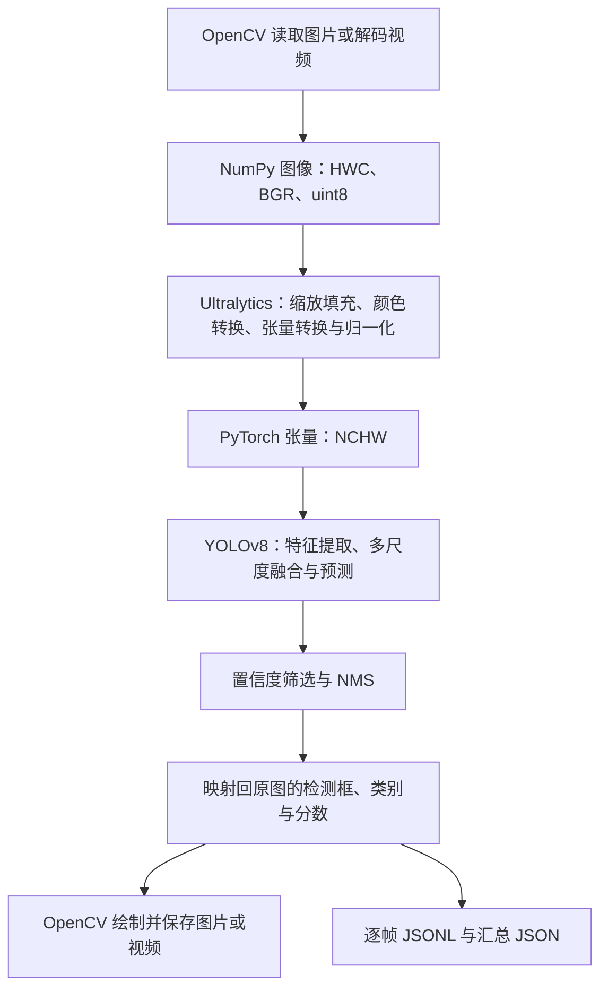

# 目标检测模块解释文档：YOLOv8 与 PyTorch

**文档类型：模块解释文档。** 本文件配合源码讲解概念、算法和库函数，项目概览仍以仓库根目录的 README 为准。

适合读者：掌握 Python 基础，刚开始接触计算机视觉与深度学习。本文依据检测代码版本 `1ed4291` 编写，先理解数据如何流动，再阅读具体函数。

当前检测模块完成图片、图片目录和本地视频检测，以及标注数据的训练和评估。ByteTrack 已通过独立的 tracking 模块接入，详见 [多目标跟踪解释文档](02_多目标跟踪_ByteTrack_解释文档.md)；实际测速、TTC 和完整预警仍属于后续阶段。

## 1. 先理解三个角色

| 名称 | 在项目中的角色 | 可以怎样理解 |
|---|---|---|
| YOLOv8 | 目标检测模型及配套方法 | 根据一张图片预测“有哪些目标、在哪里” |
| PyTorch | 深度学习计算框架 | 提供张量计算、神经网络、自动求导及 CPU/GPU 执行能力 |
| Ultralytics | YOLO 模型的实现与使用接口 | 将网络、预处理、训练、推理、后处理封装成 `YOLO` 对象 |
| OpenCV | 图像与视频工具 | 负责读图、视频解码、绘制检测框和写出结果 |

因此，“使用 YOLOv8 + PyTorch”不是连续运行两个独立识别算法：YOLOv8 网络通过 PyTorch 运算，本项目通过 Ultralytics 调用它，OpenCV 则负责输入和可视化。

当前默认权重为 `checkpoints/yolo/yolov8n.pt`。`n` 表示 Nano 规模，适合先建立计算成本较低的基线。Ultralytics 包版本 `8.4.182` 与模型名称中的 `v8` 是两种不同的版本标识。

### 1.1 分类、检测和跟踪有什么区别

| 任务 | 典型问题 | 输出 |
|---|---|---|
| 图像分类 | 这张图属于什么类别？ | 整图的类别或类别分数 |
| 目标检测 | 图里有哪些人和车，各在哪里？ | 0～多个目标的类别、分数与检测框 |
| 多目标跟踪 | 这一帧的人是不是上一帧那个人？ | 跨帧目标 ID 与连续轨迹 |

本模块解决第二行。单帧检测出的第一个框，不表示它在下一帧仍是同一个目标；也不能根据框序号直接计算同一目标的位移。

## 2. 文件职责与推荐阅读顺序

所有链接均相对于本解释文档，可在 GitHub 中直接跳转。

| 顺序 | 文件或函数 | 阅读重点 |
|---|---|---|
| 1 | [`detection/__init__.py`](../../detection/__init__.py) | 模块定位与阅读提示 |
| 2 | [`main()`](../../detection/__main__.py#L103) | 命令参数如何分派到 detect、train 和 val |
| 3 | [`load_model()`](../../detection/core.py#L42) | 权重加载与模型任务检查 |
| 4 | [`select_classes()`](../../detection/core.py#L63) | 模型类别 ID 与道路类别筛选 |
| 5 | [`detect()`](../../detection/core.py#L99) | 一帧从读取到预测、绘图和导出的全过程 |
| 6 | [`audit_dataset()`](../../detection/dataset.py#L17) | 标注格式、目录配对、数据划分检查 |
| 7 | [`run_training_or_validation()`](../../detection/__main__.py#L34) | 训练、评估及指标保存 |
| 8 | [`tests/test_detection.py`](../../tests/test_detection.py) | 哪些错误需要在运行模型前发现 |

仓库根目录的 `model.py`、`dataset.py`、`train.py` 和 `predict.py` 保留了原有分类实验。当前目标检测统一使用 `python -m detection`，其数据集审计代码是 `detection/dataset.py`。

## 3. 一帧图像经历了什么



### 3.1 图像为什么是数组

OpenCV 读取的彩色图像通常是 `numpy.ndarray`：

```text
frame.shape = (480, 640, 3)
frame.dtype = uint8
```

这里表示图像高 480、宽 640，有 3 个颜色通道；常见像素分量范围为 0～255。OpenCV 的通道顺序通常是 BGR，许多深度学习接口则使用 RGB。

`frame[y, x]` 访问第 y 行、第 x 列的像素。图像坐标原点在左上角，x 向右增大，y 向下增大。

### 3.2 NumPy 数组怎样进入 PyTorch

网络通常使用 `[N, C, H, W]` 格式：

- `N`：批次中的图片数量；逐帧检测时通常为 1。
- `C`：颜色通道数；普通 RGB 图像为 3。
- `H / W`：预处理后的高和宽。

对当前传入 OpenCV 图像的调用，Ultralytics 内部完成颜色顺序调整、维度调整、张量转换、设备转移和像素归一化。默认常见计算类型为 `float32`，像素值除以 255 后进入 0～1 范围。

本项目直接把原始 `frame` 传给 `model.predict()`。不要再随意叠加一次 BGR/RGB 转换或 `/255`，否则可能导致重复预处理。

### 3.3 `imgsz=640` 是否一定得到 640×640

Ultralytics 通常按比例缩放图像，并按需要填充边缘，称为 LetterBox。实际输入形状还受矩形推理和模型步长约束，不能始终假定为 640×640。

预处理可能改变图像尺寸，但返回的 `result.boxes.xyxy` 已映射回原图。当前导出的坐标应与原视频帧宽高配套使用。

## 4. 检测框、类别与置信度

### 4.1 两种框坐标必须区分

**推理输出：原图像素 `xyxy`**

```text
[x1, y1, x2, y2] = [240, 120, 400, 360]
```

表示左上角 `(240,120)`、右下角 `(400,360)`。框宽为 160 像素，高为 240 像素。

**训练标签：归一化中心点与宽高**

对一张宽 640、高 480 的图片，上述框写为：

```text
0 0.5 0.5 0.25 0.5
```

第一列 0 是类别 ID；其余四列分别为中心 x、中心 y、框宽、框高的归一化值：

$$
x_c=\frac{x_1+x_2}{2W},\quad
y_c=\frac{y_1+y_2}{2H},\quad
w=\frac{x_2-x_1}{W},\quad
h=\frac{y_2-y_1}{H}.
$$

像素框用于原图绘制与后续几何处理，归一化框用于标签存储。二者都没有经过道路标定，不表示米制距离。

### 4.2 类别名称与 ID 的对应关系

`model.names` 描述当前权重的类别语义，例如 `{0: 'person', ...}`。同一个数字在不同模型中可能代表不同目标。

| 类别 | COCO 预训练模型 ID | 本项目六类模板 ID |
|---|---|---|
| person | 0 | 0 |
| bicycle | 1 | 1 |
| car | 2 | 2 |
| motorcycle | 3 | 3 |
| bus | 5 | 4 |
| truck | 7 | 5 |

`select_classes()` 按名称查找实际 ID，避免把 COCO 的 `bus=5` 套到自定义模型的 `truck=5`。

`--classes person car` 只是筛选模型返回的类别，不会把 80 类检测头训练成两类。训练新类别需要图片、标签与一致的数据配置。

当前导出还增加了业务分组：`person -> pedestrian`，其他支持的道路类别归为 `vehicle`；原始细分类仍保留。自定义二分类模型也支持 `person / vehicle`。

### 4.3 置信度不是实际准确率

`box.conf` 是模型为本次检测给出的分数。`--conf 0.25` 表示过滤分数低于该阈值的候选，不表示模型整体准确率为 25%，也不表示保留下来的目标至少有某个已验证的正确率。

提高阈值可能减少误检，也可能漏掉遮挡、远距离或暗光目标。遇到与训练集不同的校园场景时，高分检测仍可能出错，因此需要人工标注的独立数据评价效果。

## 5. YOLOv8 的算法组成

以下网络和损失函数由 Ultralytics 实现，本项目通过其接口调用，没有在 `detection/core.py` 中重新实现卷积网络。

### 5.1 Backbone：提取图像特征

卷积网络逐层把像素转换成更适合识别目标的特征。YOLOv8 的 Backbone 使用卷积、C2f 和 SPPF 等模块：

- **C2f**：通过分支、瓶颈单元与特征拼接组织信息流，兼顾特征表达与计算成本。
- **SPPF**：通过池化聚合不同感受范围的信息，增强对周围上下文的利用。

特征图的通道不是原图中的 RGB 颜色通道，而是网络学习得到的响应。

### 5.2 Neck：融合不同尺度的信息

YOLOv8 使用 FPN/PAN 式多尺度融合结构。P3、P4、P5 的空间分辨率与语义信息不同，检测头结合这些尺度处理不同大小的目标。

较高分辨率特征通常对小目标的位置细节有帮助，较低分辨率特征可以提供更大范围的语义信息。是否能有效识别远处行人，仍取决于图像质量、分辨率、标注和训练结果。

### 5.3 Head：预测类别与位置

当前标准 YOLOv8 检测模型采用 Anchor-Free 设计，并将分类与边界框回归分支解耦。

Anchor-Free 表示不依赖预先设定的一组固定宽高锚框；预测仍基于特征图中的参考位置。分类分支判断目标类别，回归分支预测目标边界。

### 5.4 训练损失与标签分配

训练需要把网络预测与人工真值比较，并计算损失：

$$
L=\lambda_{box}L_{CIoU}+\lambda_{cls}L_{BCE}+\lambda_{dfl}L_{DFL}.
$$

| 方法 | 解决的问题 | 入门理解 |
|---|---|---|
| BCEWithLogitsLoss | 分类分数是否合理 | 对类别分支计算二元交叉熵；不是照搬整图分类的 Softmax 输出 |
| CIoU | 框的位置与形状是否接近真值 | 综合重叠、中心距离与宽高比等因素评价定位误差 |
| DFL | 边界距离如何更细致地学习 | 学习参考位置到框边距离的离散分布，再解码成位置 |
| Task-Aligned Assigner | 哪些预测位置负责哪个真值目标 | 结合分类分数与定位质量，为训练选择合适的预测位置 |

DFL 名称中包含 Focal，但这里用于框回归距离分布。不要据此把本模型的分类损失直接写成 Focal Loss。

当前版本可在 Ultralytics 的 `utils/loss.py` 中找到 `v8DetectionLoss`、`BboxLoss` 和 DFL 实现，标签分配位于 `utils/tal.py`。

### 5.5 IoU 与 NMS

两个框的交并比为：

$$
IoU(A,B)=\frac{|A\cap B|}{|A\cup B|}.
$$

同一个人可能在网络预测中对应多个高重叠候选框。标准 NMS 先保留高分候选，再抑制与其高度重叠的同类候选，从而减少重复框。

下面仅为算法示意，不是实测结果：同一行人的框 A 分数为 0.90，框 B 为 0.80，二者 IoU 为 0.85；当 NMS 阈值为 0.70 时，B 可能因与 A 高度重叠而被抑制。

`--conf` 控制候选分数过滤，`--iou` 控制 NMS 重叠抑制。降低当前 NMS 阈值通常会更积极地抑制重叠框，但在密集人群中也可能误抑制不同的人。这里的 NMS IoU 阈值与评估 AP 时的真值匹配阈值是不同用途。

## 6. PyTorch 在训练与推理中做什么

### 6.1 张量、设备与模型参数

`torch.Tensor` 可以理解为支持自动求导和设备运算的多维数组。网络参数也是张量，训练通过优化参数使预测逐步接近标注。

CPU 和 CUDA GPU 使用不同的设备内存。模型和参与运算的张量需要位于兼容设备；`--device cpu` 和 `--device 0` 分别选择 CPU 与第一张可用 GPU。GPU 不可用时，指定 `0` 不会自动创造 GPU 能力。

`.pt` 文件保存模型参数及相关结构或元数据，并不包含本项目全部数据集，也不意味着模型已经针对校园机位完成训练。

### 6.2 一次参数更新的逻辑

训练的基本过程是：

1. 从数据集中组成一个 batch，读取图片及真值框。
2. 网络前向传播，产生预测。
3. 损失函数比较预测与真值。
4. 自动求导反向计算各参数的梯度。
5. 优化器根据梯度更新参数。

本项目调用 `YOLO.train()`，实际循环由 Ultralytics 的 PyTorch 训练器完成。代码中没有手写 `loss.backward()`，不代表训练没有反向传播。

| PyTorch 概念或接口 | 作用 | 与本模块的关系 |
|---|---|---|
| `torch.Tensor` | 保存输入、特征、参数和检测数值 | 通过模型及结果对象使用 |
| `torch.from_numpy()` | 将 NumPy 数据转换为张量 | 图像预处理内部使用 |
| `Tensor.to()` | 转移设备或调整类型 | 由模型预处理和训练流程管理 |
| `loss.backward()` | 计算梯度 | 训练器内部执行 |
| `optimizer.step()` | 更新模型参数 | 训练器内部执行 |
| `nn.Module.eval()` | 切换推理相关层的行为 | 推理接口内部管理，例如 BatchNorm 的运行统计 |
| 关闭梯度记录 | 减少推理时不必要的计算与内存占用 | 推理接口内部管理；仅调用 eval 本身不等于关闭自动求导 |
| `Tensor.item()` / `tolist()` | 提取 Python 数字或列表 | 本项目直接用于结果导出 |

表中前几项主要用于解释底层原理，不表示本仓库逐项显式调用了这些函数。

### 6.3 两种 `train()` 不能混淆

`YOLO` 包装对象的 `model.train(...)` 会启动训练任务。原生 `torch.nn.Module` 的 `network.train()` 则主要设置训练模式，单独调用它不会自动读取数据、计算损失或更新参数。

训练后的验证与独立 `val` 命令都不更新模型参数。读取同一视频执行检测，也不会自动让模型“越看越聪明”。

## 7. 关键库函数怎样对应到源码

### 7.1 模型与结果接口

| 接口 | 参数或返回值 | 本项目中的用途与注意点 |
|---|---|---|
| `YOLO(weights)` | 输入检测权重路径 | 由 `load_model()` 加载；缺失的标准 YOLOv8 权重可触发官方下载 |
| `model.names` | ID 到类别名称的映射 | 按名称筛选类别，评估时核对映射 |
| `model.predict()` | `source/classes/conf/iou/imgsz/device` | 执行预处理、网络推理和后处理 |
| `model.train()` | `data/epochs/batch/seed` 等 | 调用完整训练流程；新数据可能需要调整类别检测头 |
| `model.val()` | `data/split/batch` 等 | 对有标注的所选集合计算检测指标 |
| `result.boxes.xyxy` | 框数组，形状通常为 `[目标数,4]` | 原图像素坐标 |
| `result.boxes.cls` | 每个框的类别 ID | 结合 `model.names` 解读 |
| `result.boxes.conf` | 每个框的置信分数 | 用于显示、导出和阈值分析 |
| `metrics.results_dict` | 整体评价结果 | 保存到 `metrics.json` 的 `metrics` 字段 |
| `metrics.box.ap_class_index` | 指标对应的实际类别 ID | 与指标数组位置区分，避免缺失类别造成错位 |

`model.predict()` 返回每张输入图片对应的 `Results` 列表。当前每次传一帧，所以源码取 `[0]`，表示取这一帧的结果；这一帧的全部目标仍保存在 `result.boxes` 中。

`box.cls`、`box.conf`、`box.xyxy` 是张量数据。源码通过 `.item()` 和 `.tolist()` 转成 Python 类型，随后写入 JSON。绘图时坐标取整，导出仍保留浮点值。

### 7.2 OpenCV 视频与绘图接口

| 接口 | 返回值或参数 | 用途与常见误区 |
|---|---|---|
| `cv2.imread(path)` | BGR 图像数组，失败时为 None | 文件存在不代表图像一定可以解码 |
| `cv2.imwrite(path, frame)` | 写入是否成功 | 当前保存带框图片 |
| `cv2.VideoCapture(path)` | 视频读取对象 | 打开压缩视频并解码 |
| `capture.read()` | `(ok, frame)` | 每次读取下一帧；不自动执行检测 |
| `capture.get(CAP_PROP_FPS)` | 源视频 FPS 元数据 | 描述采样时间，不是模型性能 |
| `capture.get(CAP_PROP_POS_MSEC)` | 当前帧时间位置，单位毫秒 | 源码除以 1000 转成秒 |
| `cv2.VideoWriter(...)` | 视频写入对象 | 尺寸参数为 `(宽,高)`，与数组 shape 的前两维顺序相反 |
| `writer.write(frame)` | 写入一帧 | 输入尺寸需与创建时一致 |
| `cv2.rectangle()` / `putText()` | 修改图像内容 | 使用 BGR 颜色值绘制框与标签 |
| `release()` | 释放资源、结束视频写入 | finally 中调用，保证异常时也能完成资源清理 |

当前检测入口保存结果文件，没有调用交互窗口或提供暂停按键；这些操作由独立的 tracking 入口提供，不改变本模块的检测行为。

### 7.3 配置与导出

| 接口 | 用途 |
|---|---|
| `yaml.safe_load()` | 把用户 YAML 解析为 Python 配置 |
| `yaml.safe_dump()` | 保存解析后的实验数据配置 |
| `json.dumps()` | 将检测或指标数据序列化；`allow_nan=False` 拒绝非标准数值 |
| `new_run()` | 为每次任务创建独立目录，显式指定的目录必须尚不存在 |
| `write_json()` | 保存运行汇总、数据审计或评价结果 |

## 8. 标注、训练、验证与测试

### 8.1 数据配置描述什么

[`configs/traffic.example.yaml`](../../configs/traffic.example.yaml) 描述数据位置与类别定义，不是 YOLOv8 的网络结构文件。

项目约定图片与标签配对：

```text
data/traffic/images/train/a.jpg
data/traffic/labels/train/a.txt
```

每行标签是一个目标。没有目标的图片提供空 txt；缺少文件可能表示漏交标注，因此当前审计会报错。整个所选集合没有任何目标标注时，也会拒绝作为有效的检测训练或 AP 评估输入。

`audit_dataset()` 检查格式、数字范围、类别与文件配对，不负责判断框是否真的框住目标。图像解码、增强和训练批处理由 Ultralytics 完成。

### 8.2 为什么拆成三个集合

| 集合 | 作用 | 是否参与更新参数 |
|---|---|---|
| train | 学习模型参数 | 是 |
| val | 观察训练进展、选择模型和调参数 | 否 |
| test | 最终独立评估 | 否 |

同一视频的相邻帧往往非常相似，随机拆帧可能让验证集出现近似的训练画面。应按视频、时间段或机位分组划分。

程序只检查本次审计的集合是否存在相同解析路径的图片；复制文件和同一视频相邻帧的泄漏仍需在数据准备阶段排除。独立评估入口只审计所选集合，不会重新全面检查所有集合之间的关系。

### 8.3 当前训练参数的含义

| 参数或设置 | 当前默认值 | 含义 |
|---|---|---|
| `epochs` | 50 | 计划完整遍历训练集的轮数；框架仍可能因其训练策略提前结束 |
| `batch` | 8 | 每批图片数；会影响计算与内存需求 |
| `imgsz` | 640 | 目标输入尺寸；更大尺寸通常增加计算量，效果需实测 |
| `seed` | 42 | 减少实验随机差异，不能保证跨平台逐位复现 |
| `workers` | 0 | 当前固定为主进程加载数据 |
| `amp` | False | 当前固定关闭自动混合精度 |
| `plots` | False | 当前不额外请求训练图表；保留数值指标与日志 |

新数据的类别数不同时，框架按数据配置建立适配的检测头并加载兼容预训练参数。仅跑很少图片和一轮训练，不能假定已得到有效的校园检测模型。

训练过程保存 `weights/best.pt` 与 `weights/last.pt`。`best.pt` 按框架的验证适应度选取，不应简单等同于“最后一轮”或“训练集 loss 最低”。

### 8.4 Precision、Recall 与 mAP

计算指标需要人工真值，并按类别和框的重叠程度进行匹配：

- TP：匹配到真值的正确检测。
- FP：没有正确匹配的预测，例如误检或重复框。
- FN：没有被检测到的真值目标。

$$
Precision=\frac{TP}{TP+FP},\qquad Recall=\frac{TP}{TP+FN}.
$$

AP 综合不同置信阈值下的 Precision–Recall 曲线；mAP 再对参与评价的类别取平均。AP50 使用 IoU=0.50 的匹配条件；AP50:95 对 0.50、0.55、…、0.95 的多个条件取平均，对定位精度要求更全面。

`metrics.json` 的整体结果位于 `metrics`。`per_class` 中只列出所选评估集有目标标注的类别；其中字段沿用 `mAP50/mAP50_95` 命名，但每一行实际表示该单类的 AP。没有标注到 bus 时，不能根据其他类别的指标声称公交车效果已验证。

## 9. 怎样使用与读懂输出

以下命令在仓库根目录、激活依赖环境后执行。`path/to/...` 与 `run-xxxx` 都是占位路径，需要替换；命令示例不代表已经执行了这些自定义数据实验。

### 9.1 安装和查看入口

新环境先安装匹配硬件的 PyTorch 与 torchvision，再安装 [`requirements-yolo.txt`](../../requirements-yolo.txt)。下面是 CPU 版本示例：

```bash
python -m venv .venv
source .venv/bin/activate
python -m pip install torch==2.11.0 torchvision==0.26.0 --index-url https://download.pytorch.org/whl/cpu
python -m pip install -r requirements-yolo.txt
python -m pip check
python -m detection --help
python -m detection detect --help
```

Windows PowerShell 用 `.\.venv\Scripts\Activate.ps1` 激活环境。当前云环境已有独立虚拟环境 `/workspace/venvs/jszx`；GPU 机器应选择匹配硬件的 CUDA 构建，不照搬 CPU 安装命令。

### 9.2 检测与评估示例

```bash
python -m detection detect --source path/to/image.jpg --device cpu
python -m detection detect --source path/to/video.mp4 --classes person car bus truck --max-frames 100 --device cpu

# 先按实际数据修改配置模板
python -m detection train --data configs/traffic.example.yaml --epochs 50 --batch 8 --device cpu

# 评估该数据集训练产生的权重，不能把类别顺序不一致的 COCO 权重直接套用
python -m detection val --data configs/traffic.example.yaml --weights runs/yolo/train/run-xxxx/weights/best.pt --split val --device cpu
python -m detection val --data configs/traffic.example.yaml --weights runs/yolo/train/run-xxxx/weights/best.pt --split test --device cpu
```

默认权重首次缺失时可能联网下载；自定义权重路径错误会报错。当前 `--source` 只接受本地图片、图片目录或视频，不接受 URL、摄像头编号或 RTSP 流。图片目录只扫描当前层；数据集审计则会递归检查子目录，两者用途不同。

### 9.3 生成文件分别是什么

| 文件 | 内容 |
|---|---|
| `runs/yolo/detect/run-*/detections.jsonl` | 每张图片或每个视频帧一行 JSON，包括空帧 |
| 同目录的带框 JPG 或 `annotated.mp4` | 便于人工观察的结果 |
| 同目录的 `summary.json` | 输入、模型、阈值、帧数、各类框累计数与处理速率 |
| 训练/评估目录的 `dataset.resolved.yaml` | 本次使用的数据配置，路径已解析 |
| 训练/评估目录的 `dataset_audit.json` | 所选集合的图片数和目标标注数 |
| 训练/评估目录的 `metrics.json` | 整体和分类别指标，以及权重路径 |

下面仅示意一行 JSONL 的结构，所有数值均为讲解举例，不是实测日志：

```json
{
  "source": "path/to/video.mp4",
  "frame_index": 12,
  "timestamp_s": 2.4,
  "timestamp_source": "video_pts",
  "width": 640,
  "height": 480,
  "detections": [
    {
      "class_id": 0,
      "class_name": "person",
      "category": "pedestrian",
      "confidence": 0.87,
      "bbox_xyxy": [240.0, 120.0, 400.0, 360.0],
      "track_id": null
    }
  ]
}
```

实际 JSONL 每条记录占一行；这里展开排版方便阅读。`track_id` 当前为 null，表示尚无跟踪身份；空帧的目标列表为 `[]`。

### 9.4 视频时间与处理速度

源 FPS 描述视频采样率，例如固定 25 FPS 时相邻帧约间隔 0.04 秒；模型处理 FPS 描述当前机器完成处理的速率。这两者不能互换。

当前优先读取解码时间位置，缺失或不递增时尝试按 `frame_index / fps` 估计，并标记 `fps_estimate`；若仍不递增则报错。`--fps` 显式覆盖为固定间隔时间轴，不会加速网络，也不能用未经核实的数字充当测速参考。

标注视频按固定 FPS 写出；可变帧率输入的原始时间信息以 JSONL 为准。独立图片的时间戳为 null，图片目录也不自动构成连续视频。

`summary.json` 的 `processing_fps` 来自处理循环的实测耗时，包含解码、推理、绘制、保存等开销，计时从模型初始加载之后开始。它不能代替完整系统的冷启动时间、输入采样 FPS 或未来预警链路延迟。

## 10. 常见问题与调试顺序

| 现象 | 先检查什么 |
|---|---|
| 找不到 ultralytics 或 cv2 | 当前 Python 是否属于已安装依赖的虚拟环境 |
| 没有 GPU 仍指定 device 0 | 当前环境实际 CUDA 可用性；CPU 验证使用 `--device cpu` |
| 模型下载失败 | 官方权重下载目的地的网络访问，或传入已有本地权重 |
| 图中有人却漏检 | 类别筛选、conf、图像质量、小目标、遮挡及场景差异 |
| 高分框仍识别错误 | 分数不等于真实准确率，检查训练与实际输入分布及标注 |
| 类别名或评估结果错位 | 权重 names、YAML names 和标签 ID 是否完全一致 |
| 报缺少 txt | 检查 images/labels 对应位置；明确的负样本提供空 txt |
| 标签格式错误 | 是否为五列检测框，坐标是否归一化，ID 是否有效 |
| 输出目录已存在 | 本项目避免覆盖旧实验；换目录或使用自动生成路径 |
| 视频打不开或写出失败 | 解码能力、实际帧尺寸与编码器可用性；查看具体错误 |
| 时间戳不连续 | 视频元数据和实际帧率，必要时经确认后使用 `--fps` |
| 希望统计独立车辆数 | 当前累计的是检测框；同一辆车出现多帧会重复计数，需要跟踪模块 |

排查时先确认文件和环境，再检查类别映射及阈值，最后分析场景数据与模型能力。训练数据格式正确只是起点，还要人工抽查标签位置、漏标和数据划分。

## 11. 已有验证、测试边界与下一步

此前已经执行的功能验证及可读取的本地结果包括：

- 官方 bus 图片检出 1 辆公交车和 4 个行人；另一些 COCO 样例检出汽车、自行车和卡车。
- 3 帧拼接视频完成检测、空帧导出、时间戳及输出视频解码检查；该视频不是实拍校园动态场景。
- COCO128 目标类别经重映射后，以 4 张训练图、4 张验证图、另 2 张测试图验证单轮训练与 val/test 入口。小样本微调指标较低，仅证明流程执行，默认检测继续使用官方预训练权重。
- 现有 6 项回归测试检查类别 ID 映射、已有输出保护、相对路径、缺少标签、非法标注和训练/验证相同路径。测试不运行神经网络，不能据此报告 mAP。

```bash
python -m unittest discover -s tests -v
```

本解释文档的检测实验记录来自此前已完成的验证，编写文档本身没有重新训练模型或测量检测性能。新增跟踪模块的测试单独记录在第二份解释文档中，不能将其或历史结果写成新的校园数据实验。

尚未完成：校园实景微调和独立检测评价、GPU 性能测试、真实连续道路视频验收；实际速度、冲突分析和 TTC 仍待实现。固定路侧机位的标定和时间尺度问题将放在后续对应解释文档中讨论。

## 12. 自查问题与参考入口

读完后，可以尝试回答：

1. 为什么一帧的检测框列表顺序不能作为下一帧的目标 ID？
2. `--conf 0.25`、`--iou 0.7` 和 `mAP50` 中的数值分别控制什么？
3. 为什么自定义六类的标签不能直接沿用 COCO 的全部原始类别 ID？
4. 一个 `[480,640,3]` 数组与 `[1,3,H,W]` 张量有什么关系？
5. 为什么在目录里放了许多图片，却仍不一定具备有效训练数据？
6. 为什么像素位移和模型处理 FPS 不能直接给出 km/h？

源码优先从本文件第 2 节的阅读顺序进入。进一步参考：

- [项目课题需求与技术路线](../课题需求与技术路线.md)
- [现有检测模块实施说明](../车辆行人检测方案.md)
- [Ultralytics YOLOv8 模型说明](https://docs.ultralytics.com/models/yolov8/)
- [Ultralytics Predict 接口](https://docs.ultralytics.com/modes/predict/)
- [PyTorch 张量基础](https://pytorch.org/tutorials/beginner/basics/tensorqs_tutorial.html)
- [PyTorch 自动求导基础](https://pytorch.org/tutorials/beginner/basics/autogradqs_tutorial.html)
