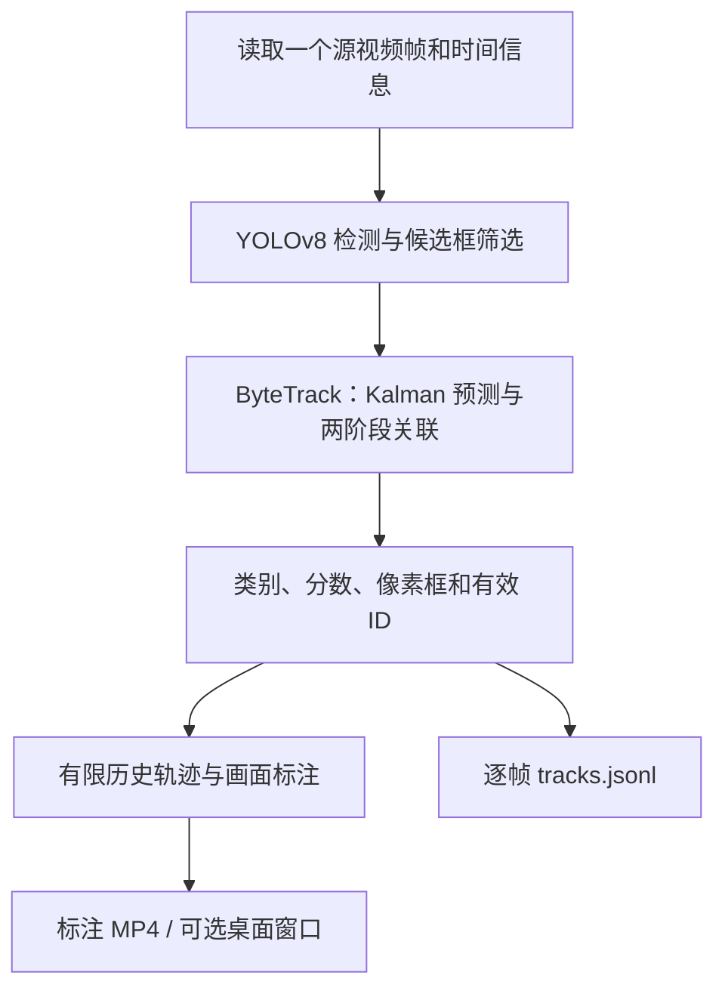

# 多目标跟踪模块解释文档：YOLOv8 + ByteTrack

**文档类型：模块解释文档。** 面向有 Python 基础、刚接触计算机视觉的读者。本文讲解已实现的本地视频跟踪、关键库函数、算法参数与验证边界；项目总体定位参见根目录 README。

当前通过 Ultralytics 的 `model.track()` 接入标准 ByteTrack，没有重新实现卡尔曼滤波或匹配算法。新增代码不训练模型，不修改原有数据集和模型权重。

## 1. 从检测走向跟踪

检测回答“这一帧有什么、在哪里”，跟踪回答“当前目标与历史哪条轨迹对应”。检测框列表可能每帧重新排序，不能直接把框下标当作身份。

一个 Track ID 表示跟踪器维护的一条轨迹，不保证永远对应同一真实目标。遮挡、交叉、误检或长时间消失都可能引起 ID 切换或轨迹中断。当前未引入外观重识别（ReID）。



检测结果在调用 `model.track()` 时由库内部产生，不会先调用一次本项目的 `detect()` 再重复运行网络。

## 2. 文件职责与阅读顺序

| 文件 | 重点 |
|---|---|
| [`tracking/__main__.py`](../../tracking/__main__.py) | 参数、启动、错误提示与结束状态 |
| [`tracking/core.py`](../../tracking/core.py) | 配置校验、视频时间轴、独立会话、逐帧处理与保存 |
| [`tracking/records.py`](../../tracking/records.py) | `FrameRecord`、`TargetRecord` 和模型结果转换 |
| [`tracking/visualization.py`](../../tracking/visualization.py) | 轨迹缓存、标签避让、统计显示和按键状态 |
| [`configs/bytetrack.yaml`](../../configs/bytetrack.yaml) | 可独立调试的 ByteTrack 参数 |
| [`tests/test_tracking.py`](../../tests/test_tracking.py) | 数据契约、真实跟踪器机制及状态重置测试 |
| [`tests/test_tracking_integration.py`](../../tests/test_tracking_integration.py) | 真实 YOLOv8 + ByteTrack 的构造视频验证 |

复用现有 `detection/core.py` 中的 `load_model()`、`select_classes()`、`new_run()` 和 `write_json()`。原有 `python -m detection` 命令及训练流程保持不变。

## 3. ByteTrack 内部做了什么

### 3.1 预测：Kalman Filter

当前实现使用图像空间的状态 `(x,y,a,h,vx,vy,va,vh)`，分别描述框中心、宽高比、高度和相应变化率。

每来一帧，跟踪器先根据上一帧状态预测位置；有合适检测观测时，再修正预测。没有观测时可以暂时保留轨迹，等待后续关联。

这些量属于图像空间的状态及逐帧变化。它们没有通过道路平面标定，不能当作 m/s 或 km/h。

### 3.2 关联：高分检测与低分检测分阶段参与

第一阶段将较高置信度的检测与已有轨迹关联；第二阶段利用剩余轨迹和低置信度检测，尝试维持已有目标。例如短暂遮挡可能降低检测分数，但位置仍与轨迹相符。

因此跟踪入口默认采用 `conf=track_low_thresh`，当前为 0.1。如果先按检测命令的 0.25 过滤，就会提前丢弃第二阶段需要的候选。本入口拒绝显式设置高于 `track_low_thresh` 的 conf，并给出原因。

低分检测并不会自动全部建立新轨迹；新轨迹还有独立的分数条件和确认机制。

### 3.3 匹配：IoU 代价与 LAPJV

跟踪器使用检测框与轨迹框的重叠等信息建立代价矩阵，通过 `lap.lapjv()` 求解线性分配。在每一轮关联中，一个检测与一条轨迹进行一对一匹配。

LAPJV 与匈牙利算法都是线性分配问题的求解方法；当前库实际使用 `lap` 提供的 LAPJV。源码调用发生在 Ultralytics 内部，本项目负责安装依赖和传入配置。

本版本的标准 ByteTrack 关联主要依赖运动和重叠信息，不保证严格的类别隔离。密集交叉、检测类别抖动和相似运动都需要在实际场景中检查。

## 4. 连续状态与跨视频重置

`TrackingSession` 为一个视频持有一个 YOLO 包装实例，连续帧执行：

```python
# 调用示意；实际会话还传入类别、设备和输入尺寸。
result = model.track(
    source=frame,
    persist=True,
    tracker="configs/bytetrack.yaml",
    conf=0.1,
)[0]
```

`persist=True` 让同一实例的不同调用保留跟踪状态。每个源帧只调用一次，包括没有检测到目标的帧。

新视频重新创建 `TrackingSession`、YOLO 包装实例和轨迹缓存，不继承上个视频的预测器与跟踪器。ID 可以重新从 1 开始，记录中的 `session_id` 则每次新建。因此后续模块使用 `(session_id, track_id)` 作为轨迹键。

首次出现或尚未确认的目标不一定有有效 ID。如果返回框没有 ID，导出 null、显示 pending，不使用框下标伪造 ID。库也可能暂不返回尚未确认的候选框。

## 5. 配置和调参

| YAML 参数 | 默认值 | 含义 |
|---|---|---|
| `tracker_type` | bytetrack | 当前入口仅支持 ByteTrack |
| `track_high_thresh` | 0.25 | 高分候选的划分阈值 |
| `track_low_thresh` | 0.1 | 低分关联候选的下界，同时作为默认检测 conf |
| `new_track_thresh` | 0.25 | 新轨迹建立的分数条件 |
| `track_buffer` | 30 | 保留丢失轨迹的处理帧数；具体恢复还取决于关联条件 |
| `match_thresh` | 0.8 | 关联代价上限，不等于最低 IoU 为 0.8 |
| `fuse_score` | true | 在相应关联阶段融合检测分数 |

上述参数依据当前固定的 Ultralytics 8.4.182 接口。`track_buffer=30` 不是 30 秒；对本模块逐帧处理的 10 FPS 固定帧率视频，30 帧约对应 3 秒。

配置先检查类型、阈值范围及低分阈值小于高分阈值，再复制到本次输出目录的 `tracker.resolved.yaml`。修改原始 YAML 不会改变此前运行保存的配置。

本入口的 `--iou` 是 YOLO 检测 NMS 参数，与 YAML 中的轨迹匹配代价阈值不同。

## 6. 轨迹、统计与窗口交互

### 6.1 轨迹是什么位置的历史

`TrailHistory` 保存有 ID 的检测框底边中心 `(x1+x2)/2,y2`，用于后续固定路侧机位标定的像素位置接口。它只是地面接触位置近似，不是真实道路坐标。

默认显示最近 60 个源帧范围内的观测，有界队列同时限制存储长度；长时间未出现的 ID 会清理。遇到缺失帧，绘图断开线段，不把一条跨越缺口的直线冒充连续真实观测。丢失目标的 Kalman 预测不会未经标记地导出成检测观测。

行人使用绿色、车辆使用橙色。标签包含类别、置信度及 ID，使用实色底并尝试避让相邻标签；画面过小或密度极高时仍可能存在显示空间限制。

### 6.2 FPS 与数量的口径

- `SourceFPS`：视频元数据中的源帧率，缺失时显示 unknown。
- `ProcessingFPS`：最近至多 30 个已完成帧的实际处理速率；首帧尚无样本时显示 `--`。
- `Frame`：画面显示从 1 开始的帧号；JSONL 的 `frame_index` 从 0 开始。
- 各类别数量：当前帧实际返回的目标数；包括没有 ID 的返回框。
- `Tracked`：当前帧有有效 ID 的数量 / 当前返回目标数量。

处理计时包含解码、检测跟踪、绘制及写入调用，不包含模型初始加载、按键等待和暂停；文件最终封装等开销不属于每帧计时。汇总同时保存包含模型加载和暂停的 wall 时间。短构造视频上的速率不能代表校园道路实时系统性能。

### 6.3 桌面模式的操作

追加 `--show` 后，Space 或 P 暂停/继续，Q 或 Esc 退出，也可关闭窗口。暂停期间仅刷新最后一帧，不读下一帧、不更新跟踪器、不写出重复帧。提前退出仍会关闭视频写入器，保存已经处理的部分。

默认无窗口模式适合云环境，直接处理并保存结果；处理中 Ctrl+C 会尝试保存已完成部分并以退出码 130 结束。显示窗口需要可用桌面及支持 GUI 的 OpenCV。

本云机器没有桌面，真实窗口及物理键盘交互尚未实测。自动测试模拟了暂停/继续/退出按键事件，使用真实模型和跟踪器检查没有重复导出帧；这不等于桌面实测。

## 7. 关键库函数与本项目接口

| 接口 | 作用与返回值 |
|---|---|
| `model.track()` | 返回每帧 Results，内部执行检测及注册的跟踪回调 |
| `result.boxes.is_track` | 框数据是否带跟踪 ID；读取 id 前先区分 |
| `result.boxes.id` | ID 张量，可能为 None |
| `boxes.xyxy / conf / cls` | 原图框、检测分数、类别 ID |
| `boxes.cpu()` | 将结果一次转到 CPU，便于结构化导出 |
| `BYTETracker.update()` | 库内部推进一帧；机制测试直接调用真实实现 |
| `BYTETracker.reset()` | 清除跟踪状态和 ID 计数；机制测试验证其行为 |
| `lap.lapjv()` | 库内部的线性分配求解 |
| `cv2.VideoCapture.read()` | 顺序解码源帧 |
| `cv2.VideoWriter.write()` | 保存标注帧，finally 中 release 完成封装 |
| `cv2.imshow() / waitKey()` | 桌面显示与按键读取，默认无窗口时不调用 |
| `cv2.polylines()` | 绘制轨迹片段，输入为整数点数组 |
| `collections.deque` | 保存有限观测历史和处理耗时窗口 |
| `FrameRecord / TargetRecord` | 本项目的数据契约，便于后续独立消费 |

ByteTrack 的标准 Kalman 与 LAP 逻辑没有在项目内另写一套；`TrackingSession` 负责会话生命周期与数据整理。

## 8. 启动、输出与后续读取

先激活已有环境。依赖文件已补充 `lap==0.5.12`，其他 PyTorch 与 Ultralytics 版本保持原样。

```bash
python -m pip install -r requirements-yolo.txt
python -m tracking --help

# 本地视频；将路径换成实际文件，输出目录必须尚不存在
python -m tracking --source path/to/campus.mp4 --weights checkpoints/yolo/yolov8n.pt --tracker configs/bytetrack.yaml --device cpu --output runs/yolo/track/campus_01

# GPU 桌面示例；本机实际有 GPU 和可用桌面时才使用
python -m tracking --source path/to/campus.mp4 --device 0 --show
```

可使用 `--classes person car bus truck` 筛选类别，`--trail-length 60` 调整历史范围，`--max-frames 100` 只处理前 100 帧。视频元数据缺少有效 FPS 时，需要先确认帧率，再用 `--fps` 覆盖；该选项同时改变输出固定帧率和估计时间轴。

```text
runs/yolo/track/run-*/
├── annotated.mp4
├── tracks.jsonl
├── summary.json
└── tracker.resolved.yaml
```

`tracks.jsonl` 每帧一行，即使没有目标也保存。帧记录包括 schema_version、session_id、source、frame_index、timestamp_s、timestamp_source、width、height、tracks。每个目标包括：

```text
track_id / class_id / class_name / category / confidence
bbox_xyxy / anchor_xy / anchor_type / observation
```

其中 `observation` 为 detected，`anchor_type` 为 bbox_bottom_center；没有输出实际速度或 TTC。检测命令仍使用 `detections.jsonl`，跟踪命令使用含会话 ID 的 `tracks.jsonl`。

下面是后续模块的读取示意，不是测速实现：

```python
import json

with open("path/to/tracks.jsonl", encoding="utf-8") as stream:
    for line in stream:
        frame = json.loads(line)
        for target in frame["tracks"]:
            if target["track_id"] is None:
                continue
            key = (frame["session_id"], target["track_id"])
            print(key, frame["timestamp_s"], target["anchor_xy"])
```

`summary.json` 记录源/输出 FPS、处理帧数、处理速度、参数、已出现 ID 和停止原因。`observations_per_class` 累计的是观测次数，同一目标会重复计数；出现过的 ID 数量也不等于真实物理目标数，因为可能换 ID。

`stop_reason` 可能为 eof、max_frames、user_quit 或 interrupted。如果读到无更多可解码帧时，实际帧数与元数据不一致，记录 `reported_frame_count_mismatch` 并提示核对；不能仅凭一次 read 返回 False 判断源文件完整。

## 9. 实际验证与限制

本次已安装并导入 lap 0.5.12。测试通过 `python -m unittest discover -s tests -v` 执行，**共 17 项，全部通过，无跳过**：原有检测 6 项、跟踪契约及机制 9 项、真实网络集成 2 项。

| 验证 | 实际结果 | 边界 |
|---|---|---|
| 已有 3 帧视频 | 全部处理，空白帧保留；公交车空白帧前后均为 ID 1，三个行人 ID 延续 | 静态样例拼接 |
| 受控高低分检测与漏检 | 使用真实 BYTETracker，低分关联和短暂丢失后保持原 ID | 控制输入框，独立验证跟踪机制 |
| 两段 18 帧构造视频 | 每段全帧输出；首帧各有 2 辆公交车、6 个行人获得 ID；公交车在两个空白帧后保持 ID 1/2 | 公共 bus 图片拼接、镜像和平移，非校园实拍 |
| 同进程连续处理不同视频 | 新 session_id；第二段 ID 从自己的空间重新开始 | 运行真实 YOLOv8 与 ByteTrack |
| 输出检查 | JSONL 时间戳、框坐标、空帧和标注视频解码通过 | 未计算 HOTA 或 IDF1 |
| 暂停/继续/退出 | 模拟窗口按键事件，暂停不产生重复帧，退出保存部分视频 | 真实桌面窗口未验证 |

个别弱行人目标仍可能丢失，不能由公交车测试推断所有目标 ID 始终稳定。权重文件在验证前后的 SHA-256 一致，模型没有被训练或覆写。

当前云环境为 CPU，无可用 CUDA GPU。处理 FPS 保存在各次实际运行汇总中，没有据此承诺校园场景实时性能。新机器缺少本地权重或官方样例时，两个集成测试会明确跳过，测试汇报时必须区分跳过与通过。

仍需校园实拍视频验证多人多车交叉、真实遮挡及类别抖动。需要带连续 ID 的参考标注才能报告 IDF1/HOTA；真实桌面操作、GPU 性能也需在对应环境实测。标定、实际速度、冲突判断、TTC 和网页预警不属于本次实现。

## 10. 常见问题

| 问题 | 排查 |
|---|---|
| 缺少 lap | 在实际运行的虚拟环境执行依赖安装；本入口不在处理中自动安装 |
| 检测 conf 太高被拒绝 | 检查与 track_low_thresh 的关系，避免丢弃第二阶段候选 |
| 空帧后目标暂不显示 | 丢失轨迹不作为真实检测框输出；观察后续能否恢复，检查缓冲与匹配条件 |
| 频繁产生新 ID | 检测质量、遮挡、交叉、阈值与缓冲帧数；不把增大 buffer 当作万能修复 |
| 云机器无法 --show | 去掉该参数保存视频，在有桌面的机器测试交互 |
| 输出目录存在 | 使用新目录或自动生成路径，避免覆盖旧实验 |
| 显示 FPS 与视频 FPS 不同 | 一个是处理性能，一个是采样率；处理快慢不会改变源观测时间 |
| 轨迹看起来断开 | 当前有意保留漏检缺口，不伪造中间观测 |
| 希望直接得到车速 | 先建立可靠的道路标定和时间尺度，Track ID 本身不提供米制距离 |

继续阅读：[目标检测解释文档](01_目标检测_YOLOv8与PyTorch_解释文档.md)、[Ultralytics 跟踪接口](https://docs.ultralytics.com/modes/track/)、[ByteTrack 项目](https://github.com/FoundationVision/ByteTrack)。
