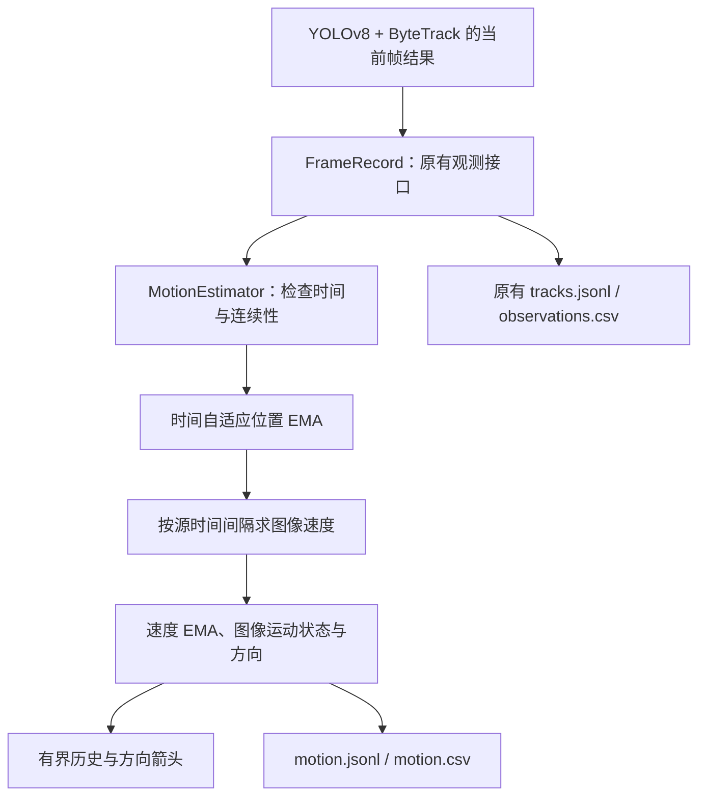

# 目标轨迹与图像运动状态：模块解释文档

**这是解释文档，不是项目 README。** 面向有 Python 基础、刚接触计算机视觉的读者，说明跟踪结果怎样变成可供后续模块使用的轨迹与图像运动记录。

本模块只输出原图像素坐标、位移、方向和 **px/s**。没有新增标定、米制车速、TTC 或风险规则。仓库主线已有的 `analysis/` 功能独立保留，本次没有修改其实现。

## 1. 输入与输出

输入复用 `tracking.records.FrameRecord`：每个视频帧包含会话、源文件、帧号、源时间戳、时间戳来源、图像宽高和目标列表。每个目标已有 ID、类别、置信度、框、接地点近似及观测类型。

接地点近似使用检测框底边中心：

```text
anchor_x = (x1 + x2) / 2
anchor_y = y2
```

它只是图像中接近地面的位置近似。车辆遮挡、框抖动、透视和目标尺寸都会影响该点，不能直接当作道路上的米制位置。



`anchor_xy`、`bbox_xyxy` 和 raw 前缀表示**本模块 EMA 之前**的跟踪输入。Ultralytics 返回的跟踪框本身可能已经过 ByteTrack 的 Kalman 更新，不能将其称为未经任何处理的 YOLO 原始输出。只有本帧真实关联返回的观测才参与估计，丢失期间的预测框不补进记录。

## 2. 文件与阅读顺序

| 文件 | 职责 |
|---|---|
| [`tracking/motion.py`](../../tracking/motion.py) | 配置、运动数据结构、校验、EMA、位移速度与有界历史；不导入 OpenCV 或神经网络 |
| [`tracking/motion_visualization.py`](../../tracking/motion_visualization.py) | 读取已算好的运动量，绘制箭头和 px/s 标签 |
| [`configs/motion.yaml`](../../configs/motion.yaml) | 历史长度、平滑和异常间隔配置 |
| [`tracking/core.py`](../../tracking/core.py) | 每帧依次执行一次跟踪、一次运动更新与一次导出 |
| [`tracking/visualization.py`](../../tracking/visualization.py) | 复用框、类别、ID、HUD 和轨迹绘制，接入运动叠加层 |
| [`tracking/export.py`](../../tracking/export.py) | 保留原始跟踪导出，新增运动 JSONL/CSV |
| [`tests/test_motion.py`](../../tests/test_motion.py) | 已知坐标和时间的数学、异常、缓存及绘图测试 |
| [`tests/test_tracking_integration.py`](../../tests/test_tracking_integration.py) | 真实 YOLOv8 + ByteTrack 的 CPU 构造视频集成检查 |

原有 `FrameRecord` 与 `TargetRecord` 不改字段；逐帧 tracking JSONL 仍为版本 1。运动数据单独使用版本 1 的格式，避免要求既有消费者突然改用新结构。

## 3. 图像运动怎样计算

### 3.1 时间来自源视频

对前后两次连续有效观测，使用：

```text
dt_s = current.timestamp_s - previous.timestamp_s
```

不以网络处理耗时作为视频时间，也不直接假定每帧都相隔 1/30 秒。相邻观测可以有不同的时间间隔。

`video_pts` 表示读取到的视频时间信息；`fps_estimate` 表示 `VideoClock` 根据帧号和已知 FPS 估算，或用户用 `--fps` 明确覆盖了固定时间轴。估算来源会保留，不能称为已核实的实际采集时刻。原始 PTS 无效时沿用现有回退策略；若无法构成递增时间轴则报错并保存已完成部分。

### 3.2 位移与速度的单位

```text
raw_displacement_xy_px = current.anchor_xy - previous.anchor_xy
raw_velocity_xy_px_s = raw_displacement_xy_px / dt_s

displacement_xy_px = current.smoothed_anchor_xy - previous.smoothed_anchor_xy
displacement_px = hypot(dx_px, dy_px)
velocity_candidate = displacement_xy_px / dt_s
```

最终 `velocity_xy_px_s` 是再经过速度平滑的向量，`speed_px_s = hypot(vx_px_s, vy_px_s)`。位移长度单位为 px，速度单位为 px/s。

例如从 `(100,100)` 移动到 `(103,104)`，间隔 0.5 秒，关闭平滑时：位移为 `(3,4)` px，长度为 5 px，速度向量为 `(6,8)` px/s，速度大小为 10 px/s。若下一段相同位移用了 1 秒，则速度大小为 5 px/s。这一关系已用测试验证。

### 3.3 位置和速度平滑

使用指数移动平均 EMA，分别配置位置和速度的时间常数：

```text
alpha = 1 - exp(-dt_s / tau_s)
filtered = previous_filtered + alpha * (current_input - previous_filtered)
```

`tau_s` 越大，输出越平滑，同时变化响应更慢。它的单位是秒；alpha 随观测间隔变化。实现使用 `-math.expm1(-dt_s/tau_s)`，改善较小参数下的数值精度。

`position_tau_s=0` 关闭位置平滑；`velocity_tau_s=0` 关闭速度平滑。两者分别设置。第一个可计算速度的观测对直接初始化速度滤波器，随后才进行递推，不用虚构的零速度初始化。

平滑会产生滞后，首次运动、转向和停止阶段尤其明显。输出同时保留本模块输入点、平滑点和 raw 速度，便于比较；滤波不是精度保证，也不自动消除错误 ID。

### 3.4 方向与基础运动状态

OpenCV 图像坐标的 x 向右、y 向下，因此：

```text
direction_deg = degrees(atan2(vy, vx)) mod 360
direction_xy = velocity_xy_px_s / speed_px_s
```

0° 向右、90° 向下、180° 向左、270° 向上，是图像坐标下顺时针角度，不是地理方位。

| image_motion_state | 含义 |
|---|---|
| `untracked` | 本帧有观测，但没有有效 ID；不建立轨迹或速度 |
| `initializing` | 新片段首个观测，速度无效，值为 null/空单元格 |
| `stationary` | 有效像素速度不超过配置阈值；仅表示图像上的低运动状态 |
| `moving` | 有效像素速度超过配置阈值，可以显示方向 |

`stationary` 时保留实际算出的速度大小，不强行归零；方向置空，避免极小噪声产生随机方向。它不代表车辆物理静止，远处缓慢移动的目标也可能低于像素阈值。

## 4. 连续性、丢失和 ID 切换

一个轨迹键是 `(session_id, track_id)`。显式 reset 后开始新视频时应同时使用新的 session_id；常规视频入口会自动完成。运动片段还有 `segment_id`，在同一会话内全局递增；同一个 ID 发生断点后会获得新片段编号。

| 情况 | 处理 |
|---|---|
| 首次出现有效 ID | 新片段，保存位置，速度无效 |
| 本帧没有该目标 | 不导出预测观测、不添加历史点；缓存按源帧范围清理 |
| 漏检后原 ID 恢复 | 新片段，位置滤波重新初始化，恢复首帧不算速度；下一对连续观测再计算 |
| 新 ID 出现 | 独立记录，不继承其他 ID 的速度或轨迹 |
| 同 ID 类别、接地点类型变化 | 分段并重新建立基准，记录 reset_reason |
| PTS/估算时间来源切换 | 分段，避免混用两个时间基准求导 |
| 正间隔过小、过大或同 ID 明显跳变 | 保留当前真实位置，分段，导数无效 |
| NaN、负值、重复或倒退时间戳；重复/倒退帧号 | 整帧拒绝，运动缓存不更新；不除以零，不静默改时间 |
| 未确认检测或尚无 ID 的返回框 | 保留观测与 null ID，速度无效，不伪造 ID |
| ID 从 ByteTrack 关联池移除 | 清理该 ID 的运动缓存，原有生命周期导出继续记录关闭原因 |
| 视频结束或提前退出 | 流式输出已完成部分；清理本次运动状态 |
| 新视频 | 新建跟踪与运动实例；直接 API 也支持新 session_id 自动重置 |

`gap_frames` 表示距该 ID 上次观测之间缺失的源帧数。`reset_reason` 可能为 new_track、observation_gap、class_changed、anchor_type_changed、timestamp_source_changed、dt_too_small、dt_too_large、position_jump、untracked。

没有真实身份标注或外观重识别，不能可靠判断“同一个 ID 是否已被分给另一个真实目标”。本模块通过新 ID 隔离、缺口分段和像素跳变阈值限制明显异常，不能保证解决所有 ID switch；即使像素运动看起来连续，也可能存在身份错误。

## 5. 有界历史与绘图

`MotionEstimator` 同时提供 `history_for(track_id)` 和 `segments(track_id)`，视频循环不再额外维护一份重复的轨迹位置缓存。

- `history_length` 限制最近多少个**源帧**范围，deque 同时限制最多保存的观测点数。
- 每个历史点保留源帧号、时间、时间来源、片段号、本模块输入点和平滑点。
- 长时间不再出现或已移出关联池的 ID 会清理；不同片段之间不连线。
- 原有运行汇总的累计 ID 集合仍随总 ID 数量增长，因此不宣称整个进程内存严格恒定；新增位置历史不会无限积累。

行人保持绿色、车辆保持橙色，轨迹采用平滑接地点。黄色箭头表示有效运动方向，接地点旁明确显示 `px/s`；初始化显示 `-- px/s init`，没有把无效速度画成 0。

箭头长度按照速度乘以显示时域计算，为可读性至少显示 8 px，同时不超过配置上限；长度经过显示限制，准确速度应读取数值。暂停期间只重新绘制已有运动量，不再次更新轨迹或速度。密集目标仍可能产生文字遮挡，需要在真实画面上检查布局。

## 6. 配置与启动

| motion.yaml 字段 | 默认值 | 单位与作用 |
|---|---:|---|
| history_length | 60 | 最近源帧范围及点数上限 |
| position_tau_s | 0.15 | 秒，位置 EMA 时间常数；0 关闭 |
| velocity_tau_s | 0.30 | 秒，速度 EMA 时间常数；0 关闭 |
| min_dt_s | 0.001 | 秒，允许求导的最小正间隔 |
| max_dt_s | 1.0 | 秒，允许求导的最大间隔 |
| stationary_speed_px_s | 2.0 | px/s，图像低运动阈值 |
| max_step_speed_px_s | 2000.0 | px/s，本模块输入点的跳变阈值；null 关闭 |
| arrow_horizon_s | 0.5 | 秒，仅控制显示箭头长度 |
| arrow_max_length_px | 60 | px，仅控制最长显示箭头 |

像素阈值与画面尺寸、透视、帧率、目标尺度相关，当前默认值不是校园道路实测结论。低帧率片段可能需要调整 max_dt_s。通过复制配置到新文件调参，每次运行保存 `motion.resolved.yaml`，便于复现。

```bash
python -m pip install -r requirements-yolo.txt
python -m tracking --help

# 真实视频：默认无界面；输出目录必须尚不存在
python -m tracking --source path/to/video.mp4 --device cpu --motion-config configs/motion.yaml --output runs/yolo/track/motion_01

# --trail-length 可以覆盖 YAML 中的 history_length
python -m tracking --source path/to/videos --device cpu --trail-length 90 --motion-config configs/motion.yaml

# 没有实拍素材时生成构造样例，再执行真实 YOLOv8 + ByteTrack
python -m tracking.demo --output runs/tracking-fixtures/motion_sample_01
python -m tracking --source runs/tracking-fixtures/motion_sample_01 --device cpu --output runs/yolo/track-batch/motion_sample_01
```

本次不需要新增第三方库。同步主线时发现 requirements 中的 `lap==0.10.0` 无法安装；核对官方 PyPI 后，修正为当前环境已经验证的 `lap==0.5.12`。算法仍使用 Ultralytics 自带 ByteTrack，不重写 Kalman 或 LAPJV。

## 7. 导出字段与后续接口

原有 annotated.mp4、tracks.jsonl、observations.csv、events.jsonl、tracklets.jsonl、summary.json 和 tracker.resolved.yaml 保留。新增：

| 文件 | 内容 |
|---|---|
| `motion.jsonl` | 每个源帧一行，空帧也保留；元数据与逐目标运动 |
| `motion.csv` | 每个当前返回目标一行；无 ID 目标也保留，导数为空 |
| `motion.resolved.yaml` | 实际配置，包含 CLI 覆盖后的历史长度 |

JSONL 元数据包含 schema_version、session_id、source、frame_index、timestamp_s、timestamp_source、width、height、coordinate_space=image、position_unit=px、speed_unit=px/s、方向约定和 tracks。

每个 tracks 项首先保留原有 TargetRecord 字段，再增加：

| 字段 | 含义 |
|---|---|
| smoothed_anchor_xy | 本模块平滑后的原图像素位置 |
| segment_id / dt_s / gap_frames | 运动片段、距上次观测的时间与缺失帧数 |
| raw_displacement_xy_px / raw_velocity_xy_px_s | 本模块输入点的差分及其除以 dt 的结果；无效时为空 |
| displacement_xy_px / displacement_px | 平滑点差分及长度，单位 px |
| velocity_xy_px_s / speed_px_s | 速度滤波后的向量及大小，单位 px/s |
| direction_xy / direction_deg | 单位方向向量和图像顺时针角度；不可解释时为空 |
| velocity_valid | 导数是否有效；调用方必须先检查 |
| image_motion_state / reset_reason | 图像运动状态及本次重新建立片段的原因 |

CSV 将向量拆为独立列，例如 smoothed_anchor_x_px/y_px、raw_dx_px/dy_px、dx_px/dy_px、raw_vx_px_s/vy_px_s、vx_px_s/vy_px_s、direction_dx/dy。原始框、类别、置信度、接地点和逐目标时间仍在同一行，None 用空单元格表示。完整空帧时间轴请读取 JSONL。

summary.json 新增 motion 段，记录实际配置、单位、状态计数、重新分段原因计数与有效速度观测数。该计数不是独立物理目标数量，也不是跟踪精度指标。

直接消费现有跟踪输出：

```python
from tracking.motion import MotionEstimator, read_motion_config

motion_estimator = MotionEstimator(read_motion_config("configs/motion.yaml"))

def consume_tracking_frame(frame_record, retained_ids):
    # retained_ids 可来自 TrackingSession.retained_ids()，只读关联池，不再推进跟踪。
    motion_frame = motion_estimator.update(frame_record, retained_ids)
    for item in motion_frame.tracks:
        if item.velocity_valid:
            key = (frame_record.session_id, item.target.track_id, item.segment_id)
            print(key, item.speed_px_s, "px/s")
    return motion_frame
```

后续标定可使用带时间的原始或平滑接地点，独立转换到道路坐标。不要把像素速度直接乘 3.6 作为 km/h，也不要把箭头、Track ID 或单一像素速度直接用作 TTC。

## 8. 关键库函数与算法职责

| 函数或结构 | 在本模块的职责 |
|---|---|
| dataclass / asdict | 明确数据字段，转成可导出的普通结构 |
| deque(maxlen=...) | 限制每条轨迹历史长度，配合源帧裁剪与过期删除 |
| math.expm1 | 稳定计算 EMA 的时间自适应系数 |
| math.hypot | 计算二维位移长度、速度大小 |
| math.atan2 / degrees | 保留方向象限，将弧度转角度 |
| yaml.safe_load | 读取独立运动配置并严格检查范围和类型 |
| csv.writer / json.dumps | 流式写入，不将全视频记录堆入内存 |
| cv2.polylines | 绘制已经分段的历史平滑轨迹 |
| cv2.arrowedLine / putText | 绘制已计算方向与 px/s 文本 |

EMA 每目标递推计算量为常数；缓存清理扫描活动与暂时保留的轨迹，绘图只扫描配置内的历史点。本模块不额外调用检测网络，不做重复目标关联。

## 9. 验证结果与限制

本次在 Python 3.12、PyTorch 2.11.0+cpu、Ultralytics 8.4.182、OpenCV 5.0.0、NumPy 2.5.2、lap 0.5.12 环境验证，无可用 CUDA GPU。

```bash
python -m unittest discover -s tests -v
```

当前共 **147 项测试全部通过、无跳过**，其中运动单元测试 18 项，同时覆盖 analysis 输出 Schema、环境指纹与 CI 契约。原有检测、跟踪和 analysis 回归检查均通过。

| 验证内容 | 方法与结论 |
|---|---|
| 正确时间与单位 | 已知 3/4 px 位移、0.5/1 秒非等间隔，核对 10/5 px/s |
| 方向 | 四个轴向、零速度和低运动状态；零速不伪造方向 |
| 平滑 | 对照 EMA 阶跃解析值与固定位置抖动输入，检查数值和噪声衰减 |
| 连续性 | 漏检恢复、无 ID、新 ID、类别变化、时间来源切换、异常 dt 和明显跳变 |
| 时间异常 | 非有限、重复、倒退时间和帧号拒绝，原缓存不变 |
| 有界缓存 | 1000 帧受控输入、源帧历史裁剪、关联池移除及 session 重置 |
| 导出与绘图 | CSV 列及单位、无效导数空值、原始观测保留、箭头方向与绘图不推进状态 |
| 真实模型集成 | 两段各 18 帧构造视频，核对空帧、源时间、运动导出、恢复首帧无速度、配置覆盖和视频解码 |
| 异常退出 | 真实模型处理后注入推理异常或中断，核对已完成 motion.jsonl 与视频保存 |

本次命令行对两段样例各处理 18 帧，每段导出 120 条目标运动记录，其中 105 条有有效速度；空白帧无目标记录，公交车漏检恢复首帧速度为空，两个视频会话独立。标注视频全帧解码通过，权重 SHA-256 前后一致。

单独测量 20 个受控目标的运动更新（900 个计时帧）时，中位耗时约 0.155 ms、P95 约 0.173 ms；不含造数据、YOLO、解码、绘图或导出。这只说明本机这次微基准中的算法开销，不能用于承诺端到端实时性。

构造素材来自官方 bus 图片的拼接、镜像、平移和黑帧，不是校园实拍视频，不能据此报告真实 ID 稳定性、速度误差或部署实时性。CPU 端到端吞吐量受检测、解码、绘图和写盘共同影响；缓存有界和递推计算不等于已经证明目标硬件实时运行。

仍需实际素材检验密集目标文字遮挡、远近尺度差异、相机抖动、交叉遮挡与身份切换。像素跳变阈值、低运动阈值和时间常数需要依据场景调节。磁盘故障或进程硬终止不保证文件完整，异常处理只尝试保留已完成部分。

继续阅读：[ByteTrack 解释文档](02_多目标跟踪_ByteTrack_解释文档.md)、[YOLOv8 与 PyTorch 解释文档](01_目标检测_YOLOv8与PyTorch_解释文档.md)。
