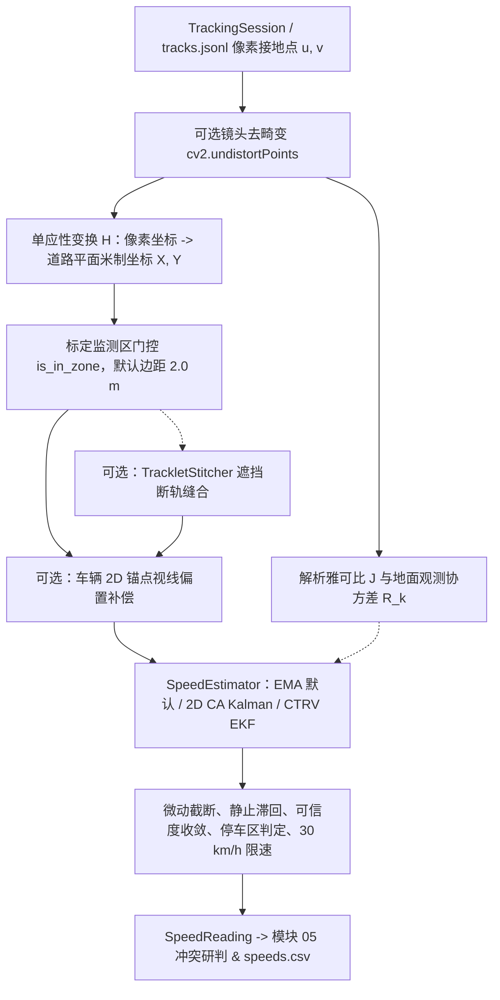

# 单应性标定与多模型物理测速：模块解释文档

**这是解释文档，不是项目 README。** 面向有 Python 基础、刚接触计算机视觉与状态估计的读者，说明跟踪模块输出的图像接地点如何经由相机标定、畸变矫正、锚点偏置补偿与多模型运动滤波，转换为道路平面米制坐标、物理车速（m/s、km/h）、加速度估计及 30 km/h 限速判定结果。本文依据仓库主线代码 `316602d` 编写。

模块 03（[目标轨迹与图像运动状态解释文档](03_目标轨迹与图像运动状态_解释文档.md)）仅输出图像空间的 `px/s`，不涉及实际物理距离；本模块负责建立像素平面到道路地面的米制映射，并为后续模块 05（[时空冲突研判与四级预警解释文档](05_时空冲突研判与四级预警_解释文档.md)）提供带可信度、静止标记、停车区标记与位置协方差的运动状态读数 `SpeedReading`。

## 1. 输入、输出与端到端数据流

本模块的上游输入来自 `tracking.core.TrackingSession` 实时帧或离线 `tracks.jsonl`，核心字段包括目标唯一标识 `track_id`、粗类别 `category`（`vehicle` / `pedestrian`）、细分类别 `class_name`、单调递增源时间戳 `timestamp_s` 以及检测框底边中心像素接地点 `anchor_xy = ((x1 + x2) / 2, y2)`。

在主线管道 `ConflictPerceptionPipeline._process_single_frame()` 中，单帧目标依次经过以下标定与测速步骤：



关键工程约束：

- **先区域门控、后进入滤波**：若像素点位于地平线附近（投影齐次分量 `|w| < 1e-8` 返回 `NaN`）或投影后落在标定地面包络外推边距之外（`is_in_zone(..., margin_m=2.0)` 为假），该目标在本帧直接跳过，不写入测速历史或滤波器，避免透视发散的极端坐标污染速度状态。
- **严格单调时间基准**：测速滤波器只接受严格递增的 `timestamp_s`，重复或倒退时间戳直接抛出 `ValueError`，拒绝静默计算失真速度。
- **离线/实时统一接口**：无论输入来自本地视频、实时摄像头/RTSP 流还是离线 `tracks.jsonl`，标定投影与物理测速共享完全一致的 `_process_single_frame()` 计算路径。

## 2. 文件职责与核心符号映射

所有路径链接均相对于本文件，便于对照源码阅读。

| 文件 | 核心符号 | 职责 |
|---|---|---|
| [`analysis/calibration.py`](../../analysis/calibration.py) | `CalibrationConfig`、`RoadCalibrator`、`_homography_jacobian`、`_point_in_polygon` | 4 点/多点 RANSAC 单应性求解、去畸变正逆投影、雅可比协方差传播、相机地面光心估算与 2D 锚点偏置补偿、停车区多边形登记、独立检查点误差评测 |
| [`analysis/interactive_calibrator.py`](../../analysis/interactive_calibrator.py) | `calibrate_camera_chessboard`、`load_intrinsics_yaml`、`run_interactive_calibration`、`_collect_points_via_gui`、`main` | 棋盘格相机内参标定 CLI、OpenCV 交互点选地面角点与停车区、多点对应非交互标定与检查点 JSON 报告导出 |
| [`analysis/kalman.py`](../../analysis/kalman.py) | `ConstantAccelerationKalman2D`、`ConstantTurnRateKalman2D`、`_transition_matrix`、`_process_noise_matrix`、`_ctrv_predict_and_jacobian`、`_joseph_update_state` | 6 维二维匀加速线性卡尔曼滤波（CA KF）与 5 维恒定转率扩展卡尔曼滤波（CTRV EKF），含马氏距离门控、Joseph 协方差更新与物理限幅 |
| [`analysis/speed.py`](../../analysis/speed.py) | `SpeedReading`、`TrackMotionTracker`、`SpeedEstimator` | 统一封装 `ema` / `kalman` / `ctrv` 三种测速后端，维护类别确认滞回、持续静止计数、微动截断、收敛可信度、30 km/h 限速与轨迹状态迁移/清理 |
| [`analysis/pipeline.py`](../../analysis/pipeline.py) | `ConflictPerceptionPipeline`、`_process_single_frame`、`_configure_speed_estimator` | 按实际视频 FPS 换算秒级窗长、衔接锚点偏置补偿与雅可比协方差计算、写入 `speeds.csv` 与 `configuration.json` |
| [`analysis/__main__.py`](../../analysis/__main__.py) | `main` | 命令行参数校验、合成标定安全门（`--demo` / `--allow-legacy-calib`）及秒级覆盖帧级参数解析 |
| [`configs/calibration.yaml`](../../configs/calibration.yaml) | 标定配置示例 | 仓库自带合成占位标定模板（`synthetic: true`），供流程演示与字段结构参考 |
| [`tests/test_kalman_calib.py`](../../tests/test_kalman_calib.py) 等 | 单元与回归测试 | 覆盖 4 点/RANSAC 标定、棋盘格内参、雅可比协方差、CA KF、CTRV EKF、锚点偏置补偿与几何边界异常路径（另见 `test_ctrv_and_anchor.py`、`test_mot_and_calib_tools.py`、`test_geom_hardening.py`） |

## 3. 单应性标定与地面几何映射

路侧摄像头以俯视斜角拍摄路面。假设道路在监测区段近似为刚性平面 `Z = 0`，图像去畸变像素齐次坐标 `[u', v', 1]^T` 与地面物理米制齐次坐标 `[X, Y, 1]^T` 之间存在唯一的 3x3 射影单应性矩阵 `H`（8 个自由度）：

```text
[ X_h ]       [ u' ]
[ Y_h ] = H * [ v' ] ,    X = X_h / w ,    Y = Y_h / w
[  w  ]       [ 1  ]
```

### 3.1 4 点矩形标定与多点 RANSAC 标定

`RoadCalibrator` 提供两种构造路径，均在求解后执行可逆性、条件数与相机前方（cheirality）一致性检查：

1. **4 点标准矩形标定（`RoadCalibrator.__init__`）**：
   - 输入 4 个按顺时针（左上 -> 右上 -> 右下 -> 左下）选取的图像角点 `image_points` 以及实测矩形路面的物理宽 `width_m`、长 `length_m`（均须为有限正数）。
   - 地面目标点自动映射为 `[(0, 0), (width_m, 0), (width_m, length_m), (0, length_m)]`。
   - **退化几何拦截**：依次计算 4 组连续相邻边的二维叉积，要求全部 `> 1e-3` 或全部 `< -1e-3`（严格凸四边形，自动拦截共线、重合、凹陷与蝴蝶自交叉），并校验鞋带公式像素面积 `>= 1.0`。
   - 对图像角点执行可选去畸变后，调用 `cv2.getPerspectiveTransform`（`float32`）求解 `H`，再校验全部 4 个角点的地面往返投影误差严格小于 `1e-2 m`，记录 `reprojection_rmse_m` 与 `inlier_count = 4`。

2. **多点对应标定与 RANSAC 抗外点（`RoadCalibrator.from_correspondences`）**：
   - 输入 `N >= 4` 组任意非共线像素—地面对应点 `(image_points, ground_points)`，校验地面包络跨度 `width_m > 1e-6` 且 `length_m > 1e-6`。
   - 当 `use_ransac=True` 且 `N > 4` 时，调用 `cv2.findHomography(..., method=cv2.RANSAC, ransacReprojThreshold=ransac_reproj_threshold_m)`（默认重投影阈值 `0.5 m`），要求留存内点数 `>= 4`；否则（`use_ransac=False` 或 `N == 4`）使用 `method=0` 执行全量最小二乘（DLT）拟合。
   - **内点边界隔离**：RANSAC 完成后，仅依据内点子集重算 `width_m`、`length_m` 及区域包络 `_zone_bounds = (min_x, max_x, min_y, max_y)`，避免异常外点撑大 `is_in_zone()` 范围。
   - 当 `N == 4` 时仍强制每个角点重投影误差 `< 1e-2 m`；最终在内点集上统计 `reprojection_rmse_m` 与 `inlier_count`。

3. **数值稳定性与相机前方可见性（Cheirality）校验（`_finalize_homography`）**：
   - 校验 `H` 与 `H_inv = inv(H)` 有限可逆，且矩阵条件数 `cond(H) < 1e12`（拦截极狭长或近奇异选区）。
   - 对所有拟合/内点地面坐标计算逆投影齐次尺度 `w = (H_inv @ [gx, gy, 1]^T)[2]`，要求 `|w| >= 1e-6` 且所有角点符号一致，记录为相机前方参考符号 `_front_w_sign`。
   - 逆投影 `ground_to_pixel_checked(x, y)` 据此过滤近地平线（`|w| < 1e-6`）、落到相机主平面后方（`w * _front_w_sign <= 0`）以及绝对值超过 `1_000_000 px` 的坐标，避免向 OpenCV 绘图接口传入溢出整数或折返到天空的伪影点；兼容接口 `ground_to_pixel(x, y)` 对无效点与负像素统一返回 `(-1, -1)`。

4. **溯源安全门与独立检查点验证**：
   - `RoadCalibrator.to_yaml()` 持久化 `synthetic` 布尔溯源标记。`python -m analysis` 默认**拒绝**加载 `synthetic: true` 的占位文件（除非显式加 `--demo`），也默认拒绝缺失 `synthetic` 字段的旧版标定文件（除非显式加 `--allow-legacy-calib`）。
   - `--demo` 且指定标定文件不存在时，仅在内存中生成 `6.0 m x 15.0 m` 合成标定（像素角点 `(400,300), (880,300), (1150,680), (130,680)`），运行成功后仅留档到输出目录 `<output>/calibration.synthetic.yaml`，绝不覆写正式配置路径。
   - `evaluate_check_points(check_image_points, check_ground_points)` 严格拒绝与拟合角点距离 `< 1e-6` 的点以及检查点自身重复，确保报告的 `mean_error_m`、`rmse_m`、`max_error_m` 反映真实泛化投影精度而非训练点拟合残差。

### 3.2 棋盘格相机内参标定与镜头去畸变

广角或变焦路侧镜头在画面边缘会产生明显的径向与切向畸变，若直接拟合平面单应性，画面边缘车辆会出现非线性尺度拉伸。

- **内参标定（`calibrate_camera_chessboard`）**：
  - 默认棋盘格内角点尺寸 `board_size=(9, 6)`（要求行列均 `>= 3`），单格物理边长 `square_size_m=0.025 m`。
  - 要求输入目录中所有标定图片分辨率完全一致，且至少 `3` 帧成功检测到角点。
  - 使用 `cv2.findChessboardCorners`（标志 `CALIB_CB_ADAPTIVE_THRESH | CALIB_CB_NORMALIZE_IMAGE`）配合 `cv2.cornerSubPix`（搜索窗口 `(11, 11)`，终止条件 `30` 次迭代或 `1e-3` 精度）精化亚像素角点，再调用 `cv2.calibrateCamera` 求解 3x3 内参矩阵 `camera_matrix`（`K`）与畸变系数 `dist_coeffs`（OpenCV 标准 `4/5/8/12/14` 维有限向量），返回 `reprojection_rms_px`、`used_images`、`total_images` 和 `image_size`。
  - Windows 下图片读取采用 `np.fromfile` + `cv2.imdecode`，避免 `cv2.imread` 在含中文目录路径下返回 `None`。
- **前向/逆向去畸变**：
  - 提供 `camera_matrix` 与 `dist_coeffs` 时，`pixel_to_ground` 先调用 `cv2.undistortPoints(..., P=K, criteria=(COUNT|EPS, 50, 1e-13))` 将原始畸变像素映射为针孔像素 `(u', v')`，再乘以单应性矩阵 `H`。
  - 逆向渲染 `ground_to_pixel_checked` 先经 `H_inv` 得到针孔像素，再通过 `K^-1` 转为归一化相机射线并调用 `cv2.projectPoints` 叠回镜头畸变，确保绘制在原始畸变视频帧上的网格、OBB 与轨迹严格贴合画面。

### 3.3 2D 底边锚点至车体几何中心的视线偏置补偿

YOLOv8 仅输出 2D 轴对齐检测框，接地点近似 `anchor_xy = ((x1 + x2) / 2, y2)` 对应的是车体**面向摄像头一侧的底部外轮廓**（如前保险杠下沿或侧裙投影），而非车辆占地矩形的几何中心。对于长达 4.5 m 的轿车或 10.0 m 的公交车，这会在距离估算与 OBB 包络中心引入米级系统偏置。

通过 `--compensate-anchor-bias` 开启后，`RoadCalibrator.compensate_vehicle_anchor()` 在测速滤波前沿相机视线方向向车体内部推进一阶有效半纵深：

1. **相机地面投影点估算（`estimate_camera_ground_xy`）**：
   - **优先路径（已配置内参 `K`）**：对地面单应性矩阵执行外参分解 `M = K^-1 @ H_inv = lambda * [r1, r2, t]`。仅当 `scale_ratio = max(||m1||, ||m2||) / min(||m1||, ||m2||) <= 1.8` 且正交性 `|cos(m1, m2)| <= 0.35`（内参与单应性物理自洽）时采用；按标定区中心深度符号校正 `Z_c > 0`，对 `[r1, r2, r1 x r2]` 做 SVD 正交化并确保 `det(R) = +1`，反算相机世界光心 `C_w = -R^T @ t`，确认光心高度 `|C_w[2]| > 1e-4` 后取 `(C_w[0], C_w[1])`。
   - **回退路径（无内参或内参失配）**：取去畸变标定区底边中点 `(u_bot, v_bot)`，以 `step_v = max(span_v, 0.25 * span_u)` 沿图像正下方按比例 `k in (2.0, 1.5, 1.0, 0.5, 0.25)` 外推 `(u_bot, v_bot + k * step_v)` 并投影至地面，选取首个满足相机前方可见性（cheirality）条件（`w_inv * _front_w_sign > 1e-8`）且不与标定中心重合的点作为相机侧地面原点。

2. **沿视线推进半支撑投影**：
   - 计算由相机地面点指向观测点 `(x_m, y_m)` 的单位视线向量 `u = (ux, uy)`。
   - 若上游已有可靠速度方向（在 `pipeline.py` 中，当同一轨迹 `has_valid_velocity` 为真且滤波速率 `> 0.3 m/s` 时，取上一帧平滑航向 `psi`），按车体矩形长 `L`、宽 `W` 沿视线方向的半支撑函数计算推进量：

```text
有航向时: proj_half = 0.5 * L * |ux*cos(psi) + uy*sin(psi)|
                    + 0.5 * W * |-ux*sin(psi) + uy*cos(psi)|
无航向时: proj_half = 0.5 * W
限幅后:   offset_m  = min(proj_half, 0.5 * max(L, W))
补偿坐标: (x_comp, y_comp) = (x_m + offset_m * ux, y_m + offset_m * uy)
```

该补偿仅作用于 `category == "vehicle"` 且解析策略 `kind != "pedestrian"` 的目标，不改变行人接地点。

### 3.4 解析雅可比与各向异性地面观测协方差传播

在透视投影下，远景区域 1 像素垂直抖动对应的道路纵向误差可能是近景区域的数倍甚至十余倍。如果对所有目标一律使用固定的各向同性观测噪声，远景框抖动会导致测速发散。

`RoadCalibrator.pixel_to_ground_jacobian(u, v)` 给出 `pixel_to_ground` 关于像素输入的解析 2x2 雅可比矩阵：

```text
设 [X_h, Y_h, w]^T = H * [u', v', 1]^T，X = X_h / w，Y = Y_h / w，则：

      1   [ H_00 - X * H_20 ,  H_01 - X * H_21 ]
J_H = - * [                                    ]
      w   [ H_10 - Y * H_20 ,  H_11 - Y * H_21 ]
```

若配置了镜头畸变参数，利用反函数定理结合 `cv2.projectPoints` 关于归一化射线坐标（`Z = 1` 时平移列 `3:5`）的解析雅可比 `J_dist_ray`，计算：

```text
J_fwd    = J_dist_ray * J_(K^-1)(u', v')
J_undist = inv(J_fwd)          # 要求 |det(J_fwd)| >= 1e-12
J_total  = J_H * J_undist
```

随后 `ground_covariance_from_pixel(u, v, sigma_u_px=2.0, sigma_v_px=3.0, min_var_m2=1e-4)` 按一阶误差传播输出对称正定 2x2 地面观测协方差矩阵 `R_k`：

```text
R_k = J * diag(sigma_u_px^2, sigma_v_px^2) * J^T + min_var_m2 * I_2
R_k = 0.5 * (R_k + R_k^T)
```

默认值设定 `sigma_v_px = 3.0 > sigma_u_px = 2.0`，反映 2D 检测框底边 `y2` 通常比水平中心抖动更大；`min_var_m2 = 1e-4 m^2` 保证数值下界与严格正定性。当 `--speed-model` 设为 `kalman` 或 `ctrv` 时，主线每帧将该 `R_k` 传入 `SpeedEstimator.update(..., obs_cov_m2=obs_cov_m2)`。

## 4. 多模型物理测速引擎

`SpeedEstimator` 为每条轨迹维护独立的 `TrackMotionTracker`，支持三种测速后端（通过 `--speed-model` 切换）。

### 4.1 滑窗两端差分 + EMA（`--speed-model ema`，默认基线）

每条轨迹维护定长双端队列 `history: deque[(t, x, y)]`（默认 `window_size = 8` 帧；若设置 `--window-s`，则按 `max(3, round(fps * window_s))` 覆盖帧数）。

```text
1. 预热阶段: len(history) < 3 时，输出速度 0，is_reliable = False
2. 窗口端点差分:
   dt = t_last - t_first
   若 dt <= 1e-4 s: raw_vx = raw_vy = 0.0
   否则:            raw_vx = (x_last - x_first) / dt
                    raw_vy = (y_last - y_first) / dt
3. 超现实跳变抑制:
   若 hypot(raw_vx, raw_vy) > 33.3 m/s (约 120 km/h):
       回退沿用上一帧 (smoothed_vx, smoothed_vy)
4. 指数移动平均 (默认 ema_alpha = 0.35):
   首次有效速度: smoothed = raw
   后续各帧:     smoothed = alpha * raw + (1 - alpha) * smoothed_prev
```

该模式计算开销极低、无非线性奇异问题，但不估计加速度（`ax_ms2 = ay_ms2 = 0`）、不维护位置协方差（`pos_std_m = None`, `pos_cov_m2 = None`），且在急加减速或大曲率转向时存在一定相位滞后。

### 4.2 二维匀加速卡尔曼滤波（`--speed-model kalman`）

`ConstantAccelerationKalman2D` 建立 6 维笛卡尔运动状态 `x = [x, y, vx, vy, ax, ay]^T`，观测矩阵仅观测平面位置 `H = [I_2, 0_{2x4}]`。

- **变步长状态转移矩阵 `F(dt)`**：按实际帧间时间间隔 `dt = t_k - t_{k-1}` 实时构造：

```text
x_{k|k-1} = x_{k-1} + vx * dt + 0.5 * ax * dt^2
vx_{k|k-1} = vx_{k-1} + ax * dt
ax_{k|k-1} = ax_{k-1}
(Y 方向对称)
```

- **连续白噪声加加速度（CWNA）过程噪声 `Q(dt)`**：设加加速度标准差为 `sigma_j = jerk_std_ms3`，`q = sigma_j^2`，对 X 分量索引 `(0, 2, 4)` 与 Y 分量索引 `(1, 3, 5)` 分别填充：

```text
            [ dt^5 / 20 ,  dt^4 / 8 ,  dt^3 / 6 ]
Q_1D(dt) = q [ dt^4 / 8  ,  dt^3 / 3 ,  dt^2 / 2 ]
            [ dt^3 / 6  ,  dt^2 / 2 ,  dt       ]
```

- **类别差异化默认先验**：

| 参数 | 行人（`pedestrian`/`person`） | 车辆（其他类别） | 说明 |
|---|---:|---:|---|
| `jerk_std_ms3` | `1.5` m/s^3 | `2.5` m/s^3 | 白噪声加加速度过程噪声标准差 |
| `max_accel_ms2` | `4.0` m/s^2 | `8.0` m/s^2 | 加速度矢量模长软限幅 |
| `init_vel_std_ms` | `4.0` m/s | `10.0` m/s | 初始速度标准差 |
| `init_accel_std_ms2` | `2.0` m/s^2 | `4.0` m/s^2 | 初始加速度标准差 |
| `default_pos_std_m` | `0.35` m | `0.35` m | 未传入有效 `obs_cov_m2` 时的各向同性默认位置标准差 |
| `max_speed_ms` | `33.3` m/s | `33.3` m/s | 速度矢量模长软限幅（约 120 km/h） |
| `gate_chi2` | `25.0` | `25.0` | 2 自由度马氏距离平方门控阈值 |
| `min_updates_for_gate` | `3` | `3` | 启用新息门控前的最少有效更新次数 |
| `max_consecutive_rejects` | `3` | `3` | 触发自动重置前的最大连续拒收次数 |

- **观测协方差合法性与马氏门控**：
  - `_resolve_obs_cov_2x2` 检查外部传入 `R_k` 为有限、对称、正定且尺度位于 `(1e-12, 1e12]`，不合格时自动回退至 `default_pos_std_m^2 * I_2`。
  - 计算新息 `y = z - x_pred[:2]`、新息协方差 `S = 0.5 * ((P_pred[:2,:2] + R) + (P_pred[:2,:2] + R)^T)` 及马氏距离平方 `d^2 = y^T S^-1 y`。
  - 当 `update_count >= 3` 且 `d^2 > 25.0`（或非有限）时拒收离群检测点，仅输出限幅后的预测状态；若连续拒收达 `3` 帧（说明目标发生了真实剧烈机动或跟踪重定位而非单帧毛刺），自动将位置重置至当前观测，并利用最近两次被拒观测的安全差分 `_safe_diff_velocity` 初始化速度（`update_count = 2`），防止滤波器锁死。
- **Joseph 形式协方差更新与方向保持限幅**：
  - 使用 `P = (I - K H) P_pred (I - K H)^T + K R K^T` 并显式对称化，抑制浮点舍入导致的协方差失正定。
  - 更新后按矢量模长对 `(vx, vy)` 和 `(ax, ay)` 执行软限幅，保持运动方向角不变。
  - 输出 `pos_std_m = hypot(sqrt(P_xx), sqrt(P_yy))` 与 2x2 位置协方差 `pos_cov_m2`，同时支持无副作用前向预测 `predict_at(dt_s)`。

### 4.3 恒定转率与速度扩展卡尔曼滤波（`--speed-model ctrv`）

在校园弯道、环岛或路口左/右转场景下，笛卡尔 CA 模型难以准确分离切向加减速与法向向心转弯。`ConstantTurnRateKalman2D` 采用 5 维极坐标运动状态 `x = [x, y, v, psi, omega]^T`（位置、标量速率、航向角 `psi in [-pi, pi]`、横摆角速度 `omega`），观测矩阵仍为位置抽取 `H = [I_2, 0_{2x3}]`。

- **三段数值稳定非线性状态转移与解析 5x5 雅可比（`_ctrv_predict_and_jacobian`）**：
  1. **近直线极小转率区（`|omega| < 1e-5 rad/s`）**：使用一阶泰勒极限避免除以 `omega`，同时保留对 `omega` 的非零解析导数（`d(nx)/d(omega) = -0.5 * v * dt^2 * sin(psi)`，`d(ny)/d(omega) = 0.5 * v * dt^2 * cos(psi)`）。
  2. **小转角区（`|omega| >= 1e-5` 且 `|delta| = |omega * dt| < 1e-2`）**：采用五阶泰勒展开（`f1 = 1 - d^2/6 + d^4/120`、`f2 = d/2 - d^3/24 + d^5/720` 等）计算位移和雅可比，消除 `(sin(psi + delta) - sin(psi)) / omega^2` 的有效数字相消。
  3. **常规圆弧转弯区（`|delta| >= 1e-2`）**：精确解析圆弧公式：

```text
nx   = x + (v / omega) * (sin(psi + omega * dt) - sin(psi))
ny   = y + (v / omega) * (-cos(psi + omega * dt) + cos(psi))
npsi = wrap_angle(psi + omega * dt)
```

- **过程噪声 `Q_k`（`_ctrv_process_noise`）**：
  - 由纵向加速度噪声 `accel_std_ms2`（行人 `1.5 m/s^2`，车辆 `2.0 m/s^2`）与横摆角加速度噪声 `yaw_accel_std_rad_s2`（默认均为 `0.8 rad/s^2`）通过噪声输入矩阵 `G(dt, psi)` 映射得到 `G @ diag(sigma_a^2, sigma_alpha^2) @ G^T`，并叠加微小对角正定底噪 `diag(1e-3, 1e-3, 1e-6, 1e-4, 1e-6) * dt`，防止零侧向方差退化。
- **奇异性与边界保护**：
  - **首帧后航向不可观破缺**：第 2 帧观测到达时（`update_count == 1`），通过相邻两点安全差分直接初始化 `(v0, psi0)`，并收缩初始速度/航向方差（`vel_std = min(init_vel_std_ms, 4.0)`，`psi_std = 0.6 rad`）。
  - **静止重启对齐**：当速率 `|v| < 1e-3` 且新观测产生有效有限位移（`dist > 1e-3` 且不超 `max_speed_ms`）时，先将工作航向对齐位移方向，使雅可比方向与真实起步方向一致。
  - **状态规范化（`_clamp_ctrv_state`）**：若更新后 `v < 0`，自动反转 `v = -v` 并使 `psi = psi + pi`（保持速度矢量一致）；航向归一化至 `[-pi, pi]`；速率限幅 `<= 33.3 m/s`，横摆角速度限幅至 `[-3.0, 3.0] rad/s`（`max_yaw_rate_rad_s = 3.0`）。
- **下游导出运动学量**：
  - 笛卡尔速度：`velocity_xy = (v * cos(psi), v * sin(psi))`
  - 平面向心加速度：`accel_xy = (-v * omega * sin(psi), v * omega * cos(psi))`
  - 当滤波速率几乎为零（`<= 1e-9`）且 `update_count >= 2` 时，`TrackMotionTracker` 直接沿用 CTRV 内部 `heading_deg`，避免 `atan2(0, 0)` 将驻车航向错误重置为 `0°`。

### 4.4 三种物理测速模型对比

| 维度 | 滑窗 EMA（`ema`，默认） | 2D CA 卡尔曼（`kalman`） | 弯道 CTRV EKF（`ctrv`） |
|---|---|---|---|
| 状态维度 | 滑窗队列 + 2D 平滑速度 | 6 维 `[x, y, vx, vy, ax, ay]` | 5 维 `[x, y, v, psi, omega]` |
| 利用单应性雅可比协方差 `R_k` | 否 | 是 | 是 |
| 输出加速度 `(ax, ay)` | 恒为 `(0, 0)` | 估计二维匀加速分量 | 输出向心加速度分量 |
| 输出位置协方差 `pos_cov_m2` | 无（`None`） | 2x2 滤波后验协方差 | 2x2 滤波后验协方差 |
| 输出横摆角速度 `yaw_rate_rad_s` | 恒为 `0.0` | 恒为 `0.0` | 估计 `omega` (rad/s) |
| 适用场景 | 轻量离线基线、直道匀速 | 直线加减速、急刹、OBB-SSM 碰撞概率 | 校园弯道、路口转向、环岛通行 |

## 5. 可信度收敛、静止确认、停车区豁免与 30 km/h 限速

`TrackMotionTracker._finalize_kinematics_reading()` 对三种后端统一执行以下业务判定逻辑：

1. **微动速度显示截断（`_apply_micro_truncation`）**：
   - 行人 `speed_kmh < 0.8 km/h` 或车辆 `speed_kmh < 1.0 km/h` 时，展示标量 `speed_ms` 与 `speed_kmh` 归零，消除静止目标框抖动造成的虚高小车速显示。
   - **关键不变量**：速度矢量 `(vx_ms, vy_ms)` 保持截断前平滑值不变，且静止连续计数必须基于**截断前**幅值 `smoothed_mag = hypot(vx_ms, vy_ms)` 计算，防止 `0.2 m/s`（`0.72 km/h`）缓慢蠕行车辆因截断为 `0` 而被误豁免为泊车导致碰撞漏报。

2. **持续静止确认（`is_stationary`）**：
   - 在轨迹至少积累 `3` 个点后，每帧检查 `smoothed_mag < stationary_speed_ms`（默认 `0.1 m/s`）；满足则 `_stationary_streak += 1`，否则清零。
   - 达到 `_stationary_streak >= stationary_min_frames` 时置位 `is_stationary = True`。
   - **默认时长差异说明**：`TrackMotionTracker` / `SpeedEstimator` 类构造默认 `stationary_min_frames = 8`；而在命令行 `python -m analysis` 中，若未显式传入 `--parked-frames` 与 `--parked-seconds`，默认按 **`stationary_seconds = 3.0 s`** 生效（经 `max(1, round(fps * 3.0))` 换算，25 FPS 下为 75 帧），避免把路口礼让或排队短暂停顿误判为长期泊车。

3. **速度收敛可信度（`is_reliable`）**：
   - 必须同时满足 `len(history) >= min(4, window_size)` 且窗口时间跨度 `dt_span_s >= reliable_min_span_s`（默认 `0.2 s`）。
   - 非有限观测（`NaN`/`Inf`）不写入 `history`，返回最后有效位置且强制 `is_reliable = False`、`is_speeding = False`。

4. **类别滞回确认（`observe_category`）**：
   - 同一个 `track_id` 的检测类别可能因短暂遮挡出现 `car <-> person` 抖动。新类别需连续出现 `category_confirm_frames = 3` 帧才正式切换 `tracker.category`，同步更新卡尔曼先验与细分子类 `object_kind`，避免单帧误检提前缩减车辆碰撞包络半径。

5. **路侧停车区多边形登记与豁免（`parking_zones`）**：
   - 路侧停车区既可在 `interactive_calibrator` 交互窗口按 `'P'`/`'N'` 框选，也可通过 `--parking-zone` 重复传入像素多边形。调用 `add_parking_zone_pixels()` 时立即经 `H` 投影为地面米制多边形并写入标定 YAML，使几何判定与渲染分辨率解耦。
   - 点在多边形内判定 `_point_in_polygon()` 先以 `1e-9 m` 容差执行边段距离检查（边界点一律判在区内），再执行标准射线法。
   - 在下游 `ConflictAnalyzer._is_vehicle_exempt()` 中，车辆仅当满足 `(is_stationary and is_reliable)` 或 `(in_parking_zone and is_reliable and speed_kmh <= parking_zone_max_speed_kmh)`（默认 `5.0 km/h`）时才豁免冲突研判；速度尚未收敛（`is_reliable == False`）的目标一律不豁免。

6. **独立 30 km/h 限速判定（`is_speeding`）**：
   - 判定公式：`len(history) >= 3 and category == "vehicle" and speed_kmh > speed_limit_kmh`（默认 `30.0 km/h`）。
   - 限速判定与行人是否存在完全解耦：无行人冲突但超速的目标会触发 L1 超速（`LEVEL_1_SPEEDING`）；未超速但轨迹与行人快速汇聚的车辆同样会触发 L2 注意（`LEVEL_2_CAUTION`）或 L3 紧急（`LEVEL_3_CRITICAL`）。

## 6. 参数默认值、命令行使用与导出字段

### 6.1 标定工具 `python -m analysis.interactive_calibrator` 参数表

| 参数 | 默认值 | 作用说明 |
|---|---:|---|
| `--source` | 未指定（`None`） | 道路底图或视频路径（自动抽取首帧）；与 `--chessboard-dir` 至少指定其一 |
| `--width` / `--length` | `6.0` / `15.0` | 4 点矩形模式下的物理宽度与纵向长度（米） |
| `--output` | `configs/calibration.yaml` | 标定结果（或单独棋盘格内参）YAML 输出路径 |
| `--points` | 未指定（`None`） | 非交互模式像素坐标序列 `u1,v1,u2,v2,...`（默认 4 对；配合 `--ground-points` 支持 `>= 4` 对） |
| `--ground-points` | 未指定（`None`） | 多点地面米制坐标序列 `x1,y1,x2,y2,...`（`>= 4` 对）；省略 `--points` 进入交互多点点击 |
| `--no-ransac` | 关闭（`False`） | 多点对应标定时关闭 RANSAC，改为全量最小二乘拟合（RANSAC 默认开启，内点阈值 `0.5 m`） |
| `--parking-zone` | 未指定（`None`） | 可重复传入的路侧停车区像素多边形 `u1,v1,u2,v2,u3,v3,...`（`>= 3` 顶点） |
| `--chessboard-dir` | 未指定（`None`） | 棋盘格标定图片目录；不传 `--source` 时仅输出相机内参 YAML |
| `--board-size` / `--square-size` | `9,6` / `0.025` | 棋盘格内角点 `cols,rows` 与单格物理边长（米） |
| `--intrinsics-yaml` | 未指定（`None`） | 载入已有相机内参 YAML 注入地面标定（与 `--chessboard-dir` 互斥） |
| `--check-image-points` / `--check-ground-points` | 未指定（`None`） | 成对提供的独立检查点像素与地面坐标；校验通过后才写盘 |
| `--validation-output` | 未指定（`None`） | 将独立检查点误差报告导出为 JSON（禁止与 `--output` 指向同一文件） |

### 6.2 主分析入口 `python -m analysis` 标定与测速参数表

| 参数 | 默认值 | 作用说明 |
|---|---:|---|
| `--calib` | `configs/calibration.yaml` | 地面单应性标定 YAML 路径 |
| `--demo` / `--allow-legacy-calib` | 关闭（`False`） / 关闭（`False`） | 允许占位合成标定 / 允许加载缺少 `synthetic` 溯源字段的旧版标定文件 |
| `--speed-model` | `ema` | 测速模型：`ema` / `kalman` / `ctrv` |
| `--compensate-anchor-bias` | 关闭（`False`） | 开启车辆 2D 底边锚点至车体几何中心的视线偏置补偿 |
| `--speed-limit` | `30.0` | 校园道路限速阈值（km/h） |
| `--ema-alpha` | `0.35` | EMA 速度平滑系数，范围 `(0, 1]` |
| `--window` / `--window-s` | `8` / 未指定（`None`） | 测速滑窗帧数 / 秒级窗长（设 `--window-s` 后覆盖 `--window`） |
| `--parked-speed` | `0.1` | 持续静止速度阈值（m/s） |
| `--parked-frames` / `--parked-seconds` | 未指定（`None`） / 未指定（`None`） | 静止确认帧数 / 时长（均未指定时 CLI 默认按 `3.0 s` 换算；秒级覆盖帧级） |
| `--parking-speed` | `5.0` | 停车区多边形内豁免冲突的最大车速（km/h） |
| `--reliable-span-s` | `0.2` | 判定 `is_reliable = True` 所需的最小观测时间跨度（秒） |
| `--fps` | 未指定（`None`） | 强制指定帧率（离线视频容器缺少有效 FPS 时必填） |

### 6.3 常用命令行示例

```bash
# 1. 4 点交互式地面标定（窗口内按 'P'/'N' 可同步框选路侧停车区）
python -m analysis.interactive_calibrator --source path/to/road.jpg --width 6.0 --length 15.0 --output configs/campus_gate.yaml

# 2. 先标定棋盘格相机内参，再结合多点 RANSAC 标定地面并输出独立检查点报告
python -m analysis.interactive_calibrator --chessboard-dir data/chessboard --board-size 9,6 --square-size 0.025 --output configs/camera_intrinsics.yaml
python -m analysis.interactive_calibrator --source path/to/road.jpg --intrinsics-yaml configs/camera_intrinsics.yaml \
  --points 400,300,880,300,1150,680,130,680,640,460 \
  --ground-points 0,0,6,0,6,15,0,15,3,6 \
  --check-image-points 520,380,760,520 --check-ground-points 1.5,3.5,4.2,9.0 \
  --validation-output runs/analysis/calib_check.json --output configs/campus_gate.yaml

# 3. 启用 2D CA Kalman 测速与 2D 锚点偏置补偿
python -m analysis --source path/to/video.mp4 --calib configs/campus_gate.yaml --speed-model kalman --compensate-anchor-bias

# 4. 弯道场景启用 CTRV EKF 测速（基于已有 tracks.jsonl 离线复盘）
python -m analysis --tracks runs/yolo/track/run-01/tracks.jsonl --calib configs/campus_gate.yaml --speed-model ctrv
```

### 6.4 导出产物与核心字段

`speeds.csv` 逐帧、逐目标输出 17 列结构化记录：

`schema_version, frame_idx, timestamp_s, track_id, category, x_m, y_m, speed_kmh, is_speeding, risk_level, ttc_s, event_id, is_reliable, is_stationary, object_kind, length_m, width_m`

其中：

- `x_m`、`y_m` 保留 2 位小数（`kalman`/`ctrv` 模式下为滤波后位置，`ema` 模式下为当前观测或偏置补偿后的投影位置）；
- `speed_kmh` 保留 1 位小数，受微动截断影响；`is_speeding`、`is_reliable`、`is_stationary` 以 `0`/`1` 记录；
- `configuration.json` 完整冻结本次标定摘要（名称、`synthetic` 标记、`width_m`/`length_m`、`parking_zones_count`）、`fps_used`、`speed_model`、`compensate_anchor_bias`、按 FPS 换算后的 `window_size_frames` / `stationary_min_frames` 以及代码与配置文件 SHA-256 指纹。

## 7. 已知边界与工程限制

- **道路平面假设**：单应性变换严格依赖地面共面假设（`Z = 0`）。若校园路段存在明显坡度变化、减速带起伏或摄像头低角度侧拍，远离标定矩形区域的投影误差会显著放大，因此主线通过 `zone_margin_m = 2.0 m` 主动截断区外外推点。
- **2D 锚点与遮挡局限**：`compensate_vehicle_anchor()` 提供的是基于类别先验尺寸 `(L, W)` 与视线方向的一阶几何补偿，不能替代真正的 3D 目标检测。当车底被护栏、路缘石或前车部分遮挡导致检测框 `y2` 上移时，投影点会出现向远处跳变的假位移。
- **模型适用边界**：EMA 存在固定窗滞后；CA KF 在急弯中会将法向向心加速度混入笛卡尔匀加速状态；CTRV EKF 假设恒定速率与恒定转率，在“边急刹边猛打方向”复合机动下需要依赖过程噪声吸收模型失配。
- **实景精度待标定验证**：当前参数默认值（如 `sigma_u_px=2.0`、`sigma_v_px=3.0`、`jerk_std_ms3`、`reliable_min_span_s=0.2 s`）均已在单元测试与合成轨迹基准上验证数值稳定性，但校园真实道路的测速 MAE 仍需在现场采集带测速雷达或已知标尺计时的实拍视频后完成实证标定。

继续阅读：[时空冲突研判与四级预警解释文档](05_时空冲突研判与四级预警_解释文档.md)、[目标轨迹与图像运动状态解释文档](03_目标轨迹与图像运动状态_解释文档.md)。
