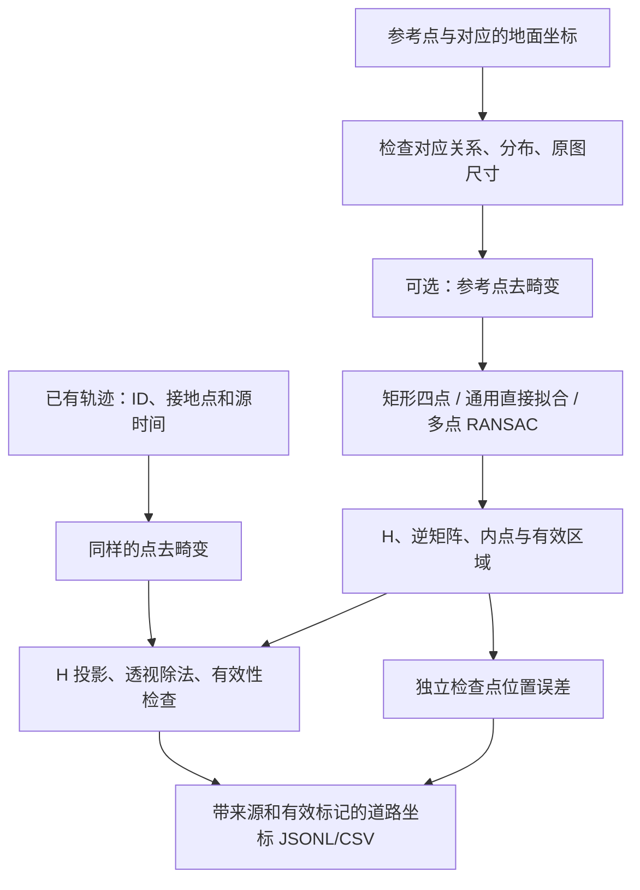

# 摄像头标定与道路坐标映射：模块解释文档

**这是模块解释文档，不是 README。** 本文说明如何运行、如何配置和如何检查结果。重点数学推导单独放在[单应性矩阵数学解释文档](../algorithms/单应性矩阵_数学推导与算例_解释文档.md)，包括 Tensor/PyTorch/TensorRT 的区别、DLT、RANSAC、畸变与手算示例。

## 1. 本轮完成范围

新增 `calibration/` 独立组件，完成四点矩形/通用多点求解、可选针孔镜头点去畸变、原图像素到道路平面的映射、独立位置检查、原图网格预览、旧配置适配和已有轨迹文件的流式映射。

本轮不增加测速、TTC、PET 或报警算法，不重跑检测网络。原有 `analysis/` 中朋友调试过的代码与旧四点配置保持不变，rectangle 路径复用 `RoadCalibrator`。

没有实拍道路和真实尺寸时，可以验证算法与数据接口；不能认定完成实景标定。相机内参采用已有参数接入，本轮没有凭空标定你的实际摄像头。

## 2. 文件职责

| 文件 | 职责 |
|---|---|
| [`geometry.py`](../../calibration/geometry.py) | 点集检查、H 求解、内点掩码、批量齐次投影 |
| [`lens.py`](../../calibration/lens.py) | 可选内参 K、畸变参数 D 与原图/去畸变像素转换 |
| [`core.py`](../../calibration/core.py) | MappingConfig、RoadMapper、MappedPoint、ROI 与机位约束 |
| [`validation.py`](../../calibration/validation.py) | 拟合残差与独立检查点位置误差，区分合成/实测状态 |
| [`io.py`](../../calibration/io.py) | 配置、求解产物、来源字段与旧四点适配 |
| [`pipeline.py`](../../calibration/pipeline.py) | 流式映射 tracks.jsonl / motion.jsonl，不改变源文件 |
| [`visualization.py`](../../calibration/visualization.py) | 地面等距网格、内外点、独立检查点及合成标识 |
| [`demo.py`](../../calibration/demo.py) | 已知几何关系生成的数据和位置真值，仅用于功能验证 |
| [`__main__.py`](../../calibration/__main__.py) | 无窗口命令行入口 |
| [`road_mapping.example.yaml`](../../configs/road_mapping.example.yaml) | 带单位和来源的合成模板 |
| [`test_calibration_mapping.py`](../../tests/test_calibration_mapping.py) | 数学、来源、镜头、兼容性与轨迹文件测试 |

## 3. 核心算法流程



参考点、目标点都来自原图像素；H 在一致的去畸变像素系或未校正像素系中求解和应用。镜头为空时，状态为 uncorrected；有参数时表示已应用参数，不代表代码认证了这些参数的测量质量。

默认目标输入点是跟踪结果 `anchor_xy`，即框底边中心近似。它是本次模块输入，ByteTrack 返回框本身可能已受 Kalman 更新影响。`--position-source smoothed` 才使用 `motion.jsonl` 的 `smoothed_anchor_xy`；不会自动叠加多层平滑。

## 4. 三种拟合方式

| method | 用途 | 约束 |
|---|---|---|
| rectangle | 复用旧四点矩形算法 | 四角按同一边界顺序对应 `(0,0)、(W,0)、(W,L)、(0,L)` |
| direct | 通用四点或多点拟合 | 至少四组非退化、一一对应的像素/米制点 |
| ransac | 多点中存在少数错误对应时 | 至少五组点；建议更多均匀覆盖道路的点 |

通用模式允许地面原点不在左上角、坐标有负值，不能再把所有地面点都强行当成一个给定长宽的矩形。配置使用显式 `ground_points_m`。

整体共线、重复点、四点情形三点共线、不可逆 H 和道路有效区域跨过投影无穷远等情况会报错。多点 RANSAC 的阈值 `ransac_threshold_m` 是米；内点少于四个不接受。

默认 ROI 为拟合内点的原图凸包。自定义 ROI 必须是按边界顺序排列的原图内凸多边形，且不能扩大到内点覆盖范围之外，避免将离群点或未覆盖区域的外推当成已验证道路。

## 5. 最小运行方法

使用项目已有环境，不需要 GPU 或桌面。OpenCV、NumPy、PyYAML 已在仓库依赖中；完整回归测试还需要现有 YOLO/PyTorch 环境及本地权重。

```bash
python -m calibration --help

# 没有数据集也能运行的已知几何关系样例；输出目录必须尚不存在
python -m calibration demo --output runs/calibration/demo_01

# 从合成矩形模板求解；source_type=synthetic，不会得到真实标定有效标记
python -m calibration solve --config configs/road_mapping.example.yaml --output runs/calibration/rectangle_01

# 重新计算独立检查点报告，不直接相信保存的 validation=true
python -m calibration validate --calibration runs/calibration/rectangle_01/mapping.json --output runs/calibration/rectangle_check_01

# 映射构造轨迹；必须明确允许合成模式
python -m calibration map-tracks --tracks runs/calibration/demo_01/tracks.synthetic.jsonl --calibration runs/calibration/demo_01/mapping.json --camera-id synthetic_fixed_camera --allow-synthetic --output runs/calibration/ground_tracks_01

# 适配原有四点模板，保留旧文件，不改写 configs/calibration.yaml
python -m calibration import-legacy --config configs/calibration.yaml --camera-id legacy_demo --image-size 1280 720 --output runs/calibration/legacy_01
```

重复运行请使用新的输出目录。`solve --image path/to/frame.jpg` 可以把网格画在真实参考图上；底图尺寸必须与配置一致，不开启窗口。图片是否看起来“像鸟瞰图”不能替代实测检查点验证。

demo 会生成 12 帧、每帧 2 个合成目标，源时间按 0.1 秒构造并标为 fps_estimate。地面位置真值由预设场景给出，与估计结果分开保存；没有把推理结果倒抄成参考答案。

## 6. 取得实拍画面后如何填写配置

复制模板到新的文件，保留原来的合成配置：

1. 固定相机位置、焦距、分辨率和裁剪方式，取清晰参考帧。
2. 给机位设置明确 camera_id，填写 `[width,height]`。
3. 在同一近似平坦地面上选择参考点，测量它们在选定道路坐标系中的位置，单位 m。
4. 分别填写原图 `image_points` 和对应 `ground_points_m`，严格一一对应。
5. 另选至少三个分布展开、未参与拟合的检查位置，测量并填写两组 check 点。
6. 真实测量数据使用 source_type=measured，在 measurement_reference 写清记录、机位和尺寸来源。
7. 有真实 K/D 时填写 lens；没有时保留 null，并在报告中保留未校正状态。
8. 根据课题验收目标确定位置误差阈值，求解、查看网格与检查报告。

不应只把模板的 synthetic 改成 measured。代码依赖你提供真实数据，不能自动确认尺子测量、点选记录或镜头参数的真实性。三组检查点也只是最低规则，实景评估应覆盖近远处和整个有效区域。

| 配置项 | 含义 |
|---|---|
| schema_version | 当前为整数 1 |
| camera_id / image_size | 机位与原图像素尺寸；视频改变后要重新核对 |
| source_type / measurement_reference | 明确 synthetic/measured 与生成/测量来源 |
| image_points / ground_points_m | 拟合参考点；原图 px 与地面 m |
| method / ransac_threshold_m | 拟合方法与米制内点阈值 |
| roi_image_points | 可选更小的有效区域，原图像素凸多边形 |
| check_image_points / check_ground_points_m | 独立检查点，不能重复拟合点 |
| max_check_rmse_m / max_check_error_m | 本次位置检查的通过阈值，不是实测结果 |
| lens | null 或明确的 opencv_pinhole K/D 参数 |

当前镜头接口只接受零倾斜针孔 K 和 OpenCV 支持的有限系数列表。鱼眼、其他相机模型需要单独接入，本轮未假定它们与针孔模型相同。

## 7. 两种有效性不要混淆

| 字段 | 含义 |
|---|---|
| mapping_valid | 该点机位/尺寸匹配、位于有效区域、投影数值有效 |
| calibration_valid | 配置声明实测，且当前独立检查规则通过 |
| synthetic | 标定或输入明确为合成来源 |
| invalid_reason | 此点为什么没有有效道路位置 |

一个合成点可以 mapping_valid=true，但 calibration_valid=false。一个已通过检查的标定也可能遇到 ROI 外目标，该点仍是 mapping_valid=false。后续可信物理运动计算必须同时检查两种有效性，并检查 ID、连续片段和源时间。

invalid_reason 包括 camera_mismatch、image_size_mismatch、nonfinite_input、outside_image、invalid_projection、outside_roi。无效地面位置为 null/CSV 空单元格，不用零点占位。

源时间、帧号、Track ID 不参与空间矩阵乘法，但会完整保留，供下一阶段滑动时间窗口测速。映射入口仍拒绝倒退/重复时间、重复 ID 和预测框；不通过丢弃异常帧后拼接轨迹来隐藏问题。

## 8. 输出文件与 API

`solve / validate / import-legacy` 输出：

```text
mapping.json          # 输入配置、ID、H、逆矩阵、内点掩码与报告
validation.json       # 拟合残差、独立检查点误差、来源及通过状态
ground_grid.png       # 原图网格、拟合内外点和独立检查点
```

读取 mapping.json 时重新求解并计算检查结论；配置 ID、保存的 H 不一致时要求重新 solve。保存文件中的派生 true 标记不能替代检查逻辑。旧版 `RoadCalibrator.from_yaml` 的行为与朋友的严格来源检查没有被修改。

`map-tracks` 输出：

```text
mapping.resolved.json # 本次使用的标定快照
ground_tracks.jsonl   # 每源帧一行，空帧也保留
ground_tracks.csv     # 每个当前观测一行
summary.json          # 已处理帧、映射点数、可信点数与异常原因
```

输入原有目标字段保留，新增 image_position_px、rectified_position_px、ground_position_m、mapping_valid、calibration_valid、invalid_reason、calibration_id、synthetic。帧级还记录 camera_id、position_source、image_unit=px、ground_unit=m 和 distortion_status。输入里的 px/s 字段可以保留，但本模块不生成 m/s、km/h 或 TTC。

CSV 保留 ID、类别、分数、框、源时间及片段号，把像素/去畸变像素/道路位置拆成独立列。空帧没有目标 CSV 行；完整时间轴读取 JSONL。

直接调用接口：

```python
from calibration.io import load_mapping

mapper = load_mapping("runs/calibration/rectangle_01/mapping.json")
point = mapper.map_point(
    400, 300,
    camera_id="synthetic_rectangle",
    image_size=[800, 600],
)
print(point.ground_position_m)  # 合成例子约为 (3, 10)
print(point.mapping_valid, point.calibration_valid)  # True, False
```

`map_points` 接收 N×2 点集返回 MappedPoint 列表，内部对点集统一去畸变、投影；`ground_to_image` 提供浮点反向投影用于网格和正反检查，不提前取整损失精度。

一个轨迹输入文件只允许一个视频会话。不同视频分别运行，避免 ID 重用或时间重置混入同一时间轴。输入 JSON 非有限值、分辨率变化、缺字段等会报告行号；可捕获异常和 Ctrl+C 会尝试关闭文件、保存已完成部分及错误汇总，硬终止或磁盘故障仍可能留下不完整文件。

## 9. 关键库函数

| 函数 | 数据形状、用途与单位 |
|---|---|
| cv2.getPerspectiveTransform | 两组 4×2 点求解四点 H；旧矩形路径复用 |
| cv2.findHomography | 两组 N×2 点求解 3×3 H，返回 N 个内点标记 |
| cv2.perspectiveTransform | N×1×2 浮点点集经过 H 批量投影 |
| cv2.undistortPoints | 原图像素去畸变；指定 P=K 保持像素单位 |
| cv2.projectPoints | 将理想相机射线应用 K/D，恢复原图畸变位置 |
| numpy.linalg.inv | 得到逆矩阵用于地面网格反投影 |
| cv2.convexHull / pointPolygonTest | 确定参考内点覆盖区域并检查目标是否在区内 |
| numpy.linalg.norm | 计算米制二维位置误差，而非车速 |
| json / csv | 流式记录与空值；JSON 不允许 NaN 假值 |

## 10. 验证与当前限制

2026-10-23 在 Python 3.12.14、PyTorch 2.11.0+cpu、OpenCV 5.0.0.93 环境运行 `python -m unittest discover -s tests -v`，151 项测试全部通过，没有跳过项。其中原有检测、跟踪、motion 与 analysis 回归测试 125 项，新增标定测试 26 项；覆盖已知矩阵、尺度不变性、透视正反映射、退化点、错误对应顺序、RANSAC、镜头坐标一致性、独立检查、来源标记、旧配置、流式导出与中断保存。

实际运行了 demo、solve、validate、map-tracks 和 import-legacy 五个命令入口。合成 demo 导出 12 帧、24 个目标观测，与独立保存的预设地面位置比较，最大位置误差约为 `4.62e-7 m`；全部观测的 calibration_valid 均为 false，符合合成来源约束。检查了网格图与 CSV/JSONL 输出；没有实拍视频，因此这不是实景精度或运行 FPS 报告。

代码测试里的 measured 夹具只测试状态判定，不是校园实测数据。合成位置误差的数值只说明预设投影关系下的数值正确性；没有真实速度参考，不生成 speed_validation.csv 的假数据，不报告实景速度 MAE/RMSE。

相机晃动、道路坡度/非平面、畸变、框底边与接地点差异、光照遮挡、远距离误差放大都需实景检查。本轮不对固定机位测量精度或整体实时性作承诺。BDD100K 与 TrackEval 的用途见[数据集与评测工具说明](../数据集与跟踪评测工具选择_BDD100K与TrackEval.md)。
