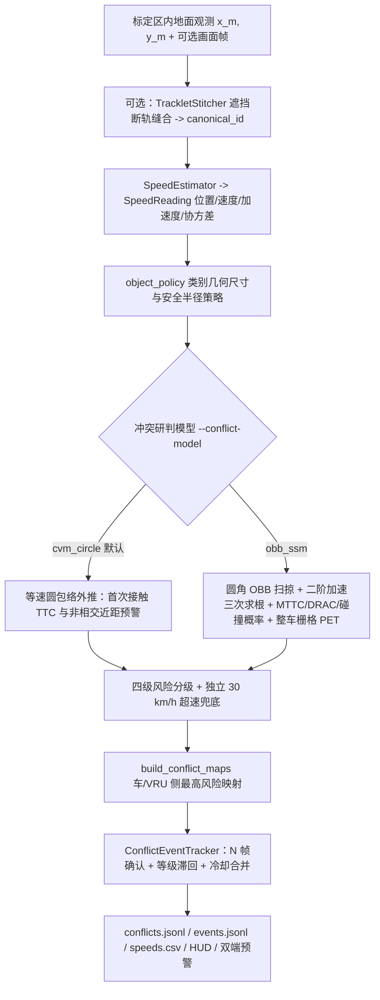
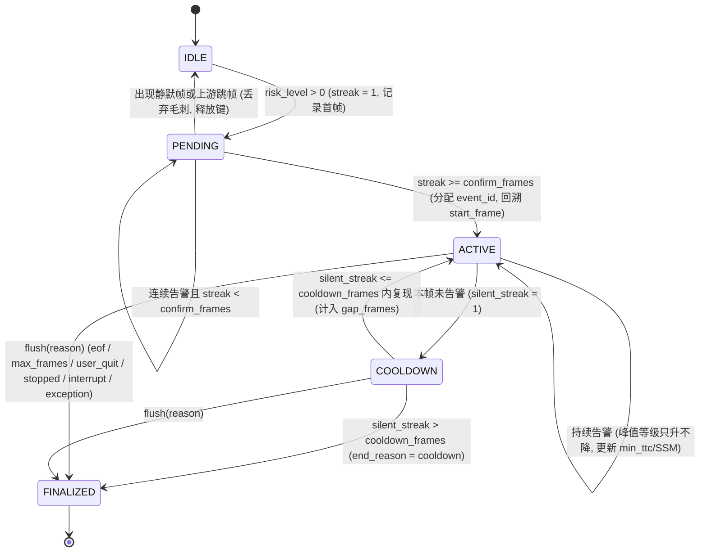

# 时空冲突研判与四级预警：模块解释文档

**这是解释文档，不是项目 README。** 面向有 Python 基础、刚接触智能交通冲突分析的读者，说明物理测速结果如何经由短时遮挡断轨缝合、类别几何包络策略、双模式时空冲突研判（CVM 圆包络 / 圆角 OBB-SSM 多维替代安全指标）以及事件去抖状态机，收敛为可审计的四级风险预警与生命周期事件记录。本文依据仓库主线代码 `b2a4e59` 编写。

本模块承接模块 04（[单应性标定与多模型物理测速解释文档](04_单应性标定与多模型物理测速_解释文档.md)）产出的地面坐标、速度、加速度与协方差读数，输出逐帧 `ConflictAssessment` 与生命周期 `AlertEvent`，并驱动 HUD 渲染、结构化日志落盘与双端预警推送。

## 1. 输入、输出与研判链路

在 `ConflictPerceptionPipeline._process_single_frame()` 中，已通过监测区门控的目标依次进入断轨缝合（可选）、物理测速、全场景多目标冲突分析、冲突映射归并与事件去抖状态机：



关键设计原则：

- **瞬时评估与确认事件分离**：`ConflictAnalyzer` 产出逐帧瞬时研判 `ConflictAssessment`；`ConflictEventTracker` 将连续告警收敛为生命周期完整的 `AlertEvent`。未达确认帧数前，画面标注 `[PROVISIONAL]` 且 `conflicts.jsonl` 的 `event_id` 为 `null`；确认后标注 `[EVT#n CONFIRMED]` 并回填 `event_id`，且事件 `start_frame` 回溯至挂起首帧。
- **超速与碰撞冲突解耦**：事件键定义为 `(veh_track_id, ped_track_id)`。纯超速事件的 `ped_track_id = None`，车—人/车—骑行者冲突事件的 `ped_track_id` 为对应弱势交通参与者（VRU）的跟踪 ID，同一车辆先超速后冲突互不吞并。

## 2. 文件职责与核心符号映射

| 文件 | 核心符号 | 职责 |
|---|---|---|
| [`analysis/stitching.py`](../../analysis/stitching.py) | `TrackletStitcher`、`TrackObservation`、`StitchEvent`、`extract_appearance_histogram`、`appearance_bhattacharyya_distance` | 短时遮挡跨 ID 缝合：阻尼二阶运动外推、马氏门控、航向一致性、16x8 HSV 外观 Bhattacharyya 距离融合及最大基数最小代价匈牙利匹配 |
| [`analysis/policy.py`](../../analysis/policy.py) | `ObjectPolicy`、`POLICIES`、`read_object_policy_config`、`object_policy` | 定义行人、自行车、摩托车、汽车、公交车、卡车的物理长宽与安全半径策略及 YAML 严格校验 |
| [`analysis/ssm.py`](../../analysis/ssm.py) | `OBBCollisionResult`、`compute_obb_swept_ttc`、`compute_obb_accel_entry_time`、`compute_mttc`、`compute_drac`、`estimate_collision_probability`、`PETTracker` | 纯标准库 + NumPy（零 SciPy）实现圆角 OBB 射线扫掠、二阶加速三次方程求根、MTTC、DRAC、48 节点高斯-勒让德碰撞概率积分与 SAT 整车占地栅格 PET |
| [`analysis/conflict.py`](../../analysis/conflict.py) | `RiskLevel`、`ConflictAssessment`、`ConflictAnalyzer`、`build_conflict_maps`、`VRU_CYCLIST_KINDS` | 封装 `cvm_circle` 与 `obb_ssm` 双冲突模型、骑行者 VRU 角色调度、安全制动降级、PET 险情叠加及四级风险分级 |
| [`analysis/events.py`](../../analysis/events.py) | `AlertEvent`、`ConflictEventTracker`、`EventKey` | N 帧连续确认、峰值等级单调滞回、冷却窗吸收闪断、跳帧推进与多原因落盘收尾 |
| [`configs/object_policy.yaml`](../../configs/object_policy.yaml) | 策略配置表 | 默认类别安全半径与外包矩形尺寸先验配置（`schema_version: 1`） |
| [`analysis/pipeline.py`](../../analysis/pipeline.py) | `ConflictPerceptionPipeline._process_single_frame`、`_configure_conflict_and_stitcher`、`_configure_event_tracker` | 编排缝合器保活、冲突分析、事件去抖、双端告警分发及 JSONL/CSV 落盘 |
| [`tests/test_obb_ssm.py`](../../tests/test_obb_ssm.py) 等 | 单元与集成测试 | 覆盖圆角 OBB/二阶求解、整车栅格 PET、HSV 外观缝合、骑行者 VRU 与事件去抖（另见 `test_obb_pet_and_appearance.py`、`test_stitching_integration.py`、`test_vru_and_events.py`、`test_geom_hardening.py`） |

## 3. 短时遮挡断轨缝合（`TrackletStitcher`）

路侧监控中，行道树、灯柱或大型车辆遮挡常导致 ByteTrack 对同一物理目标重新分配新的 `raw_track_id`。若直接透传底层 ID，测速滤波器会重新预热，连续冲突也会被割裂为多条短事件。开启 `--enable-stitching` 后，`TrackletStitcher` 在地面物理空间执行跨遮挡 ID 缝合，对外输出稳定的 `canonical_id`。

### 3.1 活跃池、丢失池与所有权保护

- 缝合器维护活跃池 `_active_tracks`、丢失池 `_lost_tracks` 与历史映射 `_raw_to_canonical`（`OrderedDict`，容量上限 `max(4096, max_lost_pool * 16)`，优先清理非活跃/非丢失的旧键）。
- 丢失池受双重约束：超时超过 `max_gap_s`（默认 `1.5 s`）即刻过期淘汰；总条目超过 `max_lost_pool`（默认 `256`）时按最旧 `last_seen_s` 驱逐。
- **防旧 ID 抢占**：当新 `raw_track_id` 缝合接管某 `canonical_id` 后，历史指向该 `canonical_id` 的所有旧 `raw_track_id` 映射立即清除；后续 `resolve_frame` 也会核对所有权，防止旧 ID 复活免检覆写。
- **下游测速保活**：`pipeline.py` 将 `stitcher.retained_canonical_ids(timestamp_s)`（活跃池与未过期丢失池并集）并入 `SpeedEstimator.prune_stale_tracks()` 的存活集合，确保遮挡期间测速滤波器状态不被提前清理。
- **与锚点偏置补偿的坐标系一致（`compensate_anchor_bias=True`）**：当同时启用 `--enable-stitching` 与 `--compensate-anchor-bias` 时，`pipeline.py` 始终将连续的**原始地面接触点坐标** `(x_m, y_m)` 依次传入 `stitcher.resolve_frame()`、`speed_estimator.update()` 与 `stitcher.update_kinematics()`，随后才对车辆输出的 `reading.(x_m, y_m)` 叠加视线偏置补偿；同时 `TrackletStitcher` 内部通过 `_TrackletState._resolved_ts` 标记同帧已由 `resolve_frame` 刷新的原始位置，在 `update_kinematics()` 中保留原始 `(x_m, y_m)` 并仅吸收速度、加速度、协方差与可信度，避免半车长偏置（`0.5 * L`）破坏遮挡缝合的欧氏、马氏与航向门控。

### 3.2 运动学 + 轻量 HSV 外观联合门控与代价融合

对每个新出现的 `raw_track_id` 与丢失池中每条未过期轨迹，`_evaluate_stitch_candidate()` 依次执行六重门控：

1. **类别一致**：标准化粗类别必须一致（`person` / `pedestrian` 归一为 `pedestrian`）。
2. **时间间隔门控**：`0 <= dt = timestamp_s - lost.last_seen_s <= max_gap_s`（默认 `1.5 s`）。
3. **阻尼二阶地面外推与欧氏门控**：为防止噪声加速度在较长遮挡下按 `dt^2` 发散，加速项采用上限截断 `dt_damped = min(dt, 0.5)`：

```text
pred_x = lost.x_m + lost.vx_ms * dt + 0.5 * lost.ax_ms2 * dt_damped^2
pred_y = lost.y_m + lost.vy_ms * dt + 0.5 * lost.ay_ms2 * dt_damped^2
err    = [obs.x_m - pred_x, obs.y_m - pred_y]^T
dist_m = ||err|| <= max_distance_m   (默认 3.5 m)
```

4. **马氏距离门控**：传播丢失时刻的位置协方差与速度不确定度：

```text
base_cov = lost.pos_cov  (EMA 模式无协方差时默认 0.25 * I_2)
cov_prop = base_cov + ((velocity_noise_ms * dt)^2 + 1e-6) * I_2   (默认 velocity_noise_ms = 1.5 m/s)
d_M      = sqrt(err^T * inv(cov_prop) * err) <= max_mahalanobis   (默认 3.5)
```

5. **航向一致性门控**：当丢失前速率 `||v_lost|| >= 0.8 m/s` 且位移长度 `||p_obs - p_lost|| >= 0.5 m` 时，计算历史速度矢量与跨遮挡位移矢量的夹角，超过 `max_heading_diff_deg`（默认 `45.0°`）则拒绝。
6. **轻量 HSV 外观门控与融合代价（可选）**：
   - 有视频帧时，`extract_appearance_histogram(frame_bgr, bbox_xyxy)` 先将框裁剪到画面内（过滤宽高 `< 4 px` 的极小框），再向内收缩两侧各 `20%`（仅保留中心约 `60%` 宽高区域以削弱背景干扰），转换到 HSV 空间计算 `16 x 8` 的 H-S 二维直方图（`H in [0, 180)`, `S in [0, 256)`）并做 L1 归一化；活跃帧中按 EMA 系数 `0.3` 在线平滑直方图。
   - 仅当丢失轨迹与新观测**双方均携带有效直方图**时，调用纯 NumPy `appearance_bhattacharyya_distance` 计算有界 Bhattacharyya 距离：

```text
BC  = sum(sqrt(h_a * h_b))   in [0, 1]
d_B = sqrt(max(0, 1 - BC))   in [0, 1]
```

   - 若 `d_B > max_appearance_dist`（默认 `0.55`）则拒收；通过后构造融合代价 `fused_cost = d_M + appearance_weight * d_B`（默认 `appearance_weight = 2.0`）。若任一方无外观特征（如离线 `--tracks` 复盘无画面帧），则 100% 退化为纯运动学代价 `fused_cost = d_M`。

### 3.3 最大基数 + 最小融合代价全局一对一匹配

所有候选边送入二分图匹配（调用 `analysis.mot_eval._hungarian_max_weight`）：每条合法边权重设为 `card_bonus - (0.45 * (fused_cost / max_cost) + 1e-6 * (rank_idx / total_cands))`，其中 `card_bonus = min(|raw_ids|, |lost_cids|) + 1`。该设计保证**优先最大化一对一缝合配对数**，在同等匹配数下再全局最小化融合代价总和，避免局部最小代价抢占造成多目标交叉漏缝。每次成功缝合记录一条 `StitchEvent`，累计次数写入 `summary.json` 的 `stitched_track_count`。

## 4. 类别几何策略与骑行者 VRU 模式

`analysis/policy.py` 与 [`configs/object_policy.yaml`](../../configs/object_policy.yaml) 定义了不同交通参与者的安全半径与物理外包矩形先验（均为代码默认先验，待校园实测校核）：

| 类别键（`configs/object_policy.yaml`） | 规范子类 `kind` | 安全半径 `safe_radius_veh_m` | 长度 `length_m` | 宽度 `width_m` | 中文标签 |
|---|---|---:|---:|---:|---|
| `person` / `pedestrian` | `pedestrian` | `0.8` m | `0.8` m | `0.8` m | 行人 |
| `bicycle` | `bicycle` | `1.2` m | `1.8` m | `0.7` m | 非机动车·自行车 |
| `motorcycle` | `motorcycle` | `1.8` m | `2.1` m | `0.8` m | 机动车·摩托车 |
| `car` | `car` | `2.2` m | `4.5` m | `1.9` m | 机动车·汽车 |
| `bus` | `bus` | `2.8` m | `10.0` m | `2.55` m | 机动车·公交车 |
| `truck` | `truck` | `2.8` m | `8.0` m | `2.5` m | 机动车·卡车 |
| `vehicle` / `motor_vehicle` | `motor_vehicle` | `2.2` m | `4.5` m | `1.9` m | 机动车·车辆 |

配置加载器 `read_object_policy_config()` 严格校验 `schema_version: 1`、非布尔有限正数以及必需兜底键（`person`、`pedestrian`、`vehicle`、`motor_vehicle`）；未收录的车辆子类保守回退至普通机动车策略。

### 骑行者 VRU 扩展模式（`--include-cyclist-vru`）

校园道路中自行车与摩托车骑行者同样属于弱势交通参与者（`VRU_CYCLIST_KINDS = ("bicycle", "motorcycle")`）。默认关闭时，骑行者仅作为车辆侧与行人评估；开启 `--include-cyclist-vru` 后：

- **角色配对防重**：非骑行者机动车与 `pedestrians + cyclists` 全部评估冲突（输出字段 `target_kind` 区分 `pedestrian` / `bicycle` / `motorcycle`）；骑行者自身作为发起方时**仅与行人评估**，避免机动车与骑行者之间产生双向重复告警。
- **半径规则**：在 `cvm_circle` 下，骑行者作为被撞目标使用自身策略半径 `safe_radius_veh_m`（自行车 `1.2 m`、摩托车 `1.8 m`）；在 `obb_ssm` 下，骑行者使用外包半长 `0.5 * max(length_m, width_m)`（自行车 `0.9 m`、摩托车 `1.05 m`）作为圆角交互半径。
- **高风险不遮蔽**：`build_conflict_maps()` 检查同时出现在车辆侧（`veh_map`）与目标侧（`ped_map`）的骑行者 ID，若其被撞风险高于其撞人风险，则移除低优的 `veh_map` 条目，确保渲染与 CSV 始终呈现最紧急预警。

## 5. 双模式时空冲突研判算法

进入两种模型前，`ConflictAnalyzer` 统一执行三项前置过滤：

1. **有限字段校验（`_is_reading_finite`）**：过滤坐标、速度或（`obb_ssm` 模式下）航向、加速度含 `NaN`/`Inf`/`bool` 的异常读数。
2. **远距裁剪**：当前欧氏距离 `current_dist > 35.0 m` 的目标对直接跳过。
3. **静止与停车区车辆豁免（`_is_vehicle_exempt`）**：仅当车辆速度已收敛（`is_reliable == True`）且满足 `is_stationary == True` 或（`in_parking_zone == True` 且 `speed_kmh <= parking_zone_max_speed_kmh`，默认 `5.0 km/h`）时予以豁免。

### 5.1 基线模型：等速圆包络外推（`--conflict-model cvm_circle`，默认）

记相对位置 `d = p_ped - p_veh`，相对速度 `dv = v_ped - v_veh`，临界合成安全距离 `R_crit = R_veh + R_ped`（默认小客车 + 行人为 `2.2 + 0.8 = 3.0 m`）。

1. **已侵入包络即时判定**：若 `current_dist <= R_crit` 且未相对趋近（`||dv||^2 < 1e-4` 或 `d · dv >= 0`），直接输出 L3 紧急（`LEVEL_3_CRITICAL`），`ttc_seconds = 0.0`，`min_distance_m = current_dist`。
2. **背向远离或无相对运动**：若包络未相交且 `||dv||^2 < 1e-4` 或 `d · dv >= 0`，返回 `None`。
3. **最近交会时刻（CPA）与圆包络首次接触时刻**：

```text
t_cpa = -(d · dv) / ||dv||^2         (要求 t_cpa > 0)
D_min = ||d + dv * t_cpa||
```

   - **分支 A（包络相交，`D_min <= R_crit`）**：利用圆弦长精确求解安全包络边界的**首次接触时刻** `t_contact`，而非直接把中心最近时刻 `t_cpa` 当作 TTC（防止大车边界早已在视界内接触，却因 `t_cpa > horizon_s` 被漏报或高估 TTC）：

```text
half_chord = sqrt(max(0.0, R_crit^2 - D_min^2))
t_contact  = max(0.0, t_cpa - half_chord / ||dv||)
```

     若 `t_contact > horizon_s`（默认 `3.5 s`）则返回 `None`；否则记录 `ttc_seconds = t_contact`、预测冲突点 `p_veh + v_veh * t_contact`，并按 `t_contact <= 1.8 s` 判为 L3 紧急（`LEVEL_3_CRITICAL`）、`<= 3.5 s` 判为 L2 注意（`LEVEL_2_CAUTION`）。

   - **分支 B（非相交擦肩近距预警，`R_crit < D_min <= 1.5 * R_crit` 且 `t_cpa <= min(horizon_s, ttc_caution_s)`）**：此时两目标圆形安全包络并未真正相交，系统触发 L2 注意（`LEVEL_2_CAUTION`，描述为“注意横穿... (预计间距=...)”），但显式将 **`ttc_seconds = None`**，不把最近交会时刻 `t_cpa` 混称为碰撞时间，避免下游统计与阈值评估产生语义混淆。

### 5.2 进阶模型：圆角 OBB 扫掠与多维替代安全指标（`--conflict-model obb_ssm`）

圆形包络对长宽比悬殊的汽车（4.5 m x 1.9 m）和公交车（10.0 m x 2.55 m）存在严重侧向过度膨胀，容易在人行道与行车道并行时产生侧向误报。`obb_ssm` 模式结合旋转车体包络与多项交通工程替代安全指标（SSM），全部基于纯 Python 标准库与 NumPy 实现（零 SciPy 依赖）：

#### （1）圆角旋转矩形（Rounded OBB）射线扫掠（`compute_obb_swept_ttc`）

- 将相对位置 `(rx, ry)` 与相对速度 `(dvx, dvy)` 旋转至车体局部坐标系（x 轴沿车头航向 `heading_rad`，y 轴为左法向；若 `veh.heading_deg` 非 `None` 则严格保留以兼容静止或 CTRV 先验航向，仅在缺失时回退 `atan2(vy, vx)`）。
- 构造带安全裕度的核心矩形 `[-hx_core, hx_core] x [-hy_core, hy_core]`，其中：

```text
hx_core = 0.5 * L + longitudinal_margin_m   (默认 longitudinal_margin_m = 0.4 m)
hy_core = 0.5 * W + lateral_margin_m        (默认 lateral_margin_m = 0.3 m)
```

- 与半径为 `ped_r` 的行人/骑行者圆盘求精确 **Minkowski 和**，得到**圆角矩形**——由两块正交直边板（`[-(hx_core + ped_r), hx_core + ped_r] x [-hy_core, hy_core]` 与 `[-hx_core, hx_core] x [-(hy_core + ped_r), hy_core + ped_r]`）以及 4 个位于 `(±hx_core, ±hy_core)`、半径 `ped_r` 的角部圆盘求并集构成（`_ray_rounded_aabb_interval`）。相比直角膨胀盒，精确圆角消除了四角约 `0.41 * ped_r` 的虚假突出误报。
- 因为圆角矩形是凸集，相对射线在 `[0, horizon_s]` 内与各子区域的交集并集必为单一闭区间 `[t_enter, t_exit]`。
- 同时计算**无安全裕度的物理最小净距** `min_clearance_m`：在分段凸的距离平方函数上解析求解相对线段到裸车核心矩形 `[-0.5*L, 0.5*L] x [-0.5*W, 0.5*W]` 的精确最小欧氏距离（`_segment_aabb_min_clearance`），再减去 `ped_r` 并钳位非负。

#### （2）二阶加速度圆角 OBB 侵入解析求解（`compute_obb_accel_entry_time`）

只要存在显著相对加速度（`dax^2 + day^2 > 1e-6`），**无论等速扫掠 `obb.collides` 是否命中**，系统都在车体局部系中沿二阶轨迹 `p(t) = p_0 + v_0 * t + 0.5 * a_loc * t^2`，针对**同一圆角扩展 OBB 安全包络**（`obb.expanded_half_extents_xy` 与圆角半径 `corner_radius_m = ped_radius_m`）在 `[0, horizon_s]` 内精确求取首次侵入时刻 `accel_entry_t`。这一统一评估兼具两重作用：既用于捕获等速未命中但急加速起步/横穿切入的冲突，也用于在等速已命中且存在减速时核验二阶轨迹是否仍会进入扩展安全包络，防止仅凭一维未加裕度 MTTC 误触发安全制动降级：

1. **外接直角盒与直边板二次不等式求解**：分别对 x、y 轴求解二次不等式 `|x(t)| <= h_x` 与 `|y(t)| <= h_y`（`_solve_quadratic_nonneg` + `_intersect_interval_lists`），先得外接盒可行区间 `outer_intervals`，再分别与横、纵两块直边核心板求交，得到直边区最早命中时刻 `best_t`。
2. **四角圆盘三次方程临界点分段与二分精化**：若 `outer_intervals` 起点早于 `best_t`，对每个圆角圆心 `c = (±hx_core, ±hy_core)` 考察四次函数 `f(t) = ||p(t) - c||^2 - r^2 <= 0`。其一阶导数零点满足三次方程：

```text
0.5 * f'(t) = 0.5 * ||a||^2 * t^3
            + 1.5 * (v · a) * t^2
            + (||v||^2 + d_0 · a) * t
            + (d_0 · v) = 0
```

   `_solve_cubic_real_roots()` 以纯 Python Cardano/三角公式求出全部实根，将每个可行子区间划分为 `f(t)` 严格单调的小段；检查端点并在首个穿越子段执行 56 次二分迭代，收敛至双精度机器级别，得到精确首次切入时刻 `accel_entry_t`（此时 `min_dist_out = 0.0`）。

#### （3）视线支撑半径、MTTC、DRAC 与安全制动降级

沿当前视线单位方向 `u = (ux, uy)`（在车体局部系为 `(ulx, uly)`），计算未加安全裕度的 OBB 方向支撑半径：

```text
hx_unm = 0.5 * L + ped_r ,   hy_unm = 0.5 * W + ped_r
critical_dist_obb = min(hx_unm / max(|ulx|, 1e-9), hy_unm / max(|uly|, 1e-9))
d_eff = max(0.0, current_dist - critical_dist_obb)
v_c   = -(dv · u)            # 趋近速度，> 0 表示靠近
a_c   = -(da · u)            # 趋近加速度，< 0 表示相对制动
```

- **修正碰撞时间 MTTC（`compute_mttc`）**：
  - 若 `v_c > 0` 且 `a_c < 0`（正在制动），先计算刹停距离 `stopping_dist = -v_c^2 / (2 * a_c)`；若 `stopping_dist < d_eff`，说明能够安全刹停，返回 `None`。
  - 否则当 `|a_c| <= 1e-9` 时按线性 `d_eff / v_c` 求解；一般情况用数值稳定二次求根求解 `0.5 * a_c * t^2 + v_c * t - d_eff = 0`，取 `(0, horizon_s]` 内的最小正实根。
- **避险所需减速度 DRAC（`compute_drac`）**：当 `v_c > 1e-3 m/s` 时，`DRAC = v_c^2 / (2 * max(d_eff, 0.1))`（单位 `m/s^2`）；否则返回 `None`。
- **安全制动降级与二阶包络阻断**：记 `accel_blocks_braking_downgrade = (accel_entry_t is not None and accel_entry_t <= ttc_caution_s)`。仅当同时满足 `mttc is None`、`not accel_blocks_braking_downgrade`、`a_c < -0.5 m/s^2`、`drac is not None` 且 `drac < drac_caution_ms2`（默认 `2.0 m/s^2`）时，才判定车辆已在可控减速度下安全制动：若等速 `obb.t_enter <= ttc_critical_s`（`1.8 s`）则降级为 L2 注意（`LEVEL_2_CAUTION`，“减速制动礼让中”），否则直接解除告警（返回 `None`）。只要二阶轨迹在 `ttc_caution_s` 内仍会侵入同一圆角扩展 OBB 包络，即**强制阻断不安全的“MTTC 安全制动”降级**。
- **有效 TTC 与 DRAC 联合升级**：非安全制动分支中，有效时间 `t_eff` 按以下规则选取：（a）若等速扫掠命中且处于被二阶包络阻断的制动工况（`mttc is None`、`accel_entry_t is not None`、`a_c < -0.5`、`drac < drac_caution_ms2`），直接采用真实二阶侵入时刻 `t_eff = accel_entry_t`；（b）其余等速命中工况先取 `mttc` 与 `obb.t_enter` 较小者，若二阶圆角包络侵入时刻 `accel_entry_t` 更早且跨入更严厉的风险等级阈值（例如从 L2 越过 `ttc_critical_s = 1.8 s` 升至 L3，或从 L0 越过 `ttc_caution_s` 升至 L2/L3），同样采用 `t_eff = accel_entry_t` 升级判别；（c）仅二阶侵入命中时取 `t_eff = accel_entry_t`。先按 `t_eff` 分级，再叠加 DRAC 抬升：`DRAC >= 3.4 m/s^2` 直接升至 L3 紧急（`LEVEL_3_CRITICAL`），`DRAC >= 2.0 m/s^2` 至少升至 L2 注意（`LEVEL_2_CAUTION`）；若当前已重叠同速导致 `drac_ms2 is None`，告警描述中省略 `DRAC` 项（不再伪造 `DRAC=0.00m/s^2`）。

#### （4）确定性碰撞概率估计（`estimate_collision_probability`）

在评估时刻 `t_eval`（二阶加速侵入时至少取 `accel_entry_t`，其余优先取 `mttc` 或 `t_eff`），构建相对位置高斯分布 `N(mu, Sigma_rel)`：

```text
mu        = d + dv * t_eval + 0.5 * da * t_eval^2
Sigma_rel = Sigma_veh + Sigma_ped + (0.15 * t_eval)^2 * I_2
```

其中未提供协方差的目标默认使用 `0.25^2 * I_2 = 0.0625 * I_2`。通过对 `Sigma_rel` 进行对称特征分解旋转至主轴，将二维圆盘概率积分化为内层 `math.erf` 解析表达与外层角变量替换 `z_1 = R * sin(theta)`（消除边界 `sqrt(R^2 - z_1^2)` 导数奇异性），在主要概率质量区间 `[-R, R] ∩ [m_1 - 8.5*s_1, m_1 + 8.5*s_1]` 上使用 48 节点高斯-勒让德求积（`np.polynomial.legendre.leggauss(48)`）确定性计算碰撞概率，结果钳位于 `[0.0, 1.0]`，无需蒙特卡洛采样且完全可复现。

#### （5）整车旋转占地栅格侵入后时间（`PETTracker`）

TTC 类指标针对“未来将要相交”，而当行人刚走过车道、车辆紧随擦过其身后时，双方当前已不再趋近，此时需依靠**侵入后时间（PET）**捕捉近距险情：

- **默认参数**：网格边长 `cell_size_m = 1.0 m`、最大记录时间差 `max_pet_s = 4.0 s`、历史占用保留期 `retention_s = 8.0 s`（超期自动清理以保证内存有界）。
- **整车 SAT 栅格化与帧间步进插值**：
  - 车辆按策略尺寸 `(L, W)` 与航向角调用 `_obb_grid_cells()`，通过分离轴定理（SAT）标记旋转矩形覆盖的全部 1 m x 1 m 网格（静止且已收敛车辆跳过 PET 追踪）；行人标记中心所在网格。
  - 当帧间 `0 < dt <= 1.0 s` 且位移 `0 < dist <= 15.0 m` 时，按 `ceil(dist / (0.5 * cell_size_m))` 做线性位置与最短弧航向子步插值，防止高速车辆“跨格漏检”。
- **输入顺序无关的两阶段 PET 计算**：
  1. 同帧异类共同触及同一网格：按驻留区间 `[entry, last]` 对称求解 `pet = max(0.0, max(entry_a, entry_b) - min(last_a, last_b))`，确保 `[ped, car]` 与 `[car, ped]` 输入顺序结果完全一致。
  2. 历史访客跨时段侵入：若先到异类目标已离开（`other_visit.last_t <= entry_t`），计算 `pet = entry_t - other_visit.last_t`。
- **与冲突评估叠加**：`ConflictAnalyzer.analyze_frame()` 将 `pet_seconds` 回填至匹配目标对，若 `pet <= pet_critical_s`（默认 `1.0 s`）直接升级为 L3 紧急（`LEVEL_3_CRITICAL`）；若该对目标此前未产生 TTC 冲突但 `pet <= pet_caution_s`（默认 `2.0 s`），则独立生成近距擦碰/跨迹险情记录（`<= 1.0 s` 为 L3 紧急，`<= 2.0 s` 为 L2 注意）。

## 6. 四级风险体系与事件去抖状态机

### 6.1 四级风险定义（`RiskLevel`）与多目标归并

| 风险等级（系统枚举） | 数值 | 语义与典型触发条件 |
|---|---:|---|
| L0 正常（`LEVEL_0_SAFE`） | `0` | 绿色：正常受控行驶，无冲突且未超速 |
| L1 超速（`LEVEL_1_SPEEDING`） | `1` | 黄色：无 VRU 冲突，且车辆测速已收敛可信（`is_reliable == True`）并超过 `speed_limit_kmh`（默认 `30.0 km/h`） |
| L2 注意（`LEVEL_2_CAUTION`） | `2` | 橙色：轨迹汇聚 `1.8 s < TTC <= 3.5 s`；或 CVM 擦肩近距 `R_crit < D_min <= 1.5 * R_crit`（`TTC = None`）；或 OBB-SSM 安全制动降级；或 `2.0 <= DRAC < 3.4 m/s^2`；或 `1.0 < PET <= 2.0 s` |
| L3 紧急（`LEVEL_3_CRITICAL`） | `3` | 红色：紧急危险 `TTC <= 1.8 s`；或 CVM 包络已相交 `TTC = 0.0 s`；或 `DRAC >= 3.4 m/s^2`；或 `PET <= 1.0 s` |

单帧内一辆车可能同时面对多个行人，一个行人也可能同时面对多辆车。系统按比较键 `(int(risk_level), -(ttc_seconds if ttc_seconds is not None else 999.0), -(pet_seconds if pet_seconds is not None else 999.0))` 选取最高优先级冲突（显式使用 `is not None`，防止 `0.0 s` 被误当作假值回退为 `999.0`），并经 `build_conflict_maps()` 生成车侧与行人/VRU 侧最高风险映射。

### 6.2 事件去抖状态机（`ConflictEventTracker`）

逐帧冲突评估易受单帧抖动与临界阈值振荡影响。`ConflictEventTracker` 按事件键 `EventKey = (veh_track_id, ped_track_id)` 独立运行有限状态机：



状态机关键工程保障：

- **默认窗口与秒级覆盖**：类默认 `confirm_frames = 3`、`cooldown_frames = 12`。在 `python -m analysis` 中可分别用 `--alert-confirm-s` 与 `--alert-cooldown-s` 以秒指定（按 `max(1, round(fps * confirm_s))` 与 `max(0, round(fps * cooldown_s))` 换算并覆盖帧级参数），使不同帧率视频保持一致物理去抖语义。
- **等级单调滞回**：事件一旦确认进入 `ACTIVE`，其 `peak_risk_level` 只升不降；同时持续更新 `min_ttc_seconds`、`max_veh_speed_kmh`、`min_mttc_seconds`、`max_drac_ms2`、`min_pet_seconds`、`max_collision_prob` 及非默认 `target_kind`。
- **上游跳帧感知**：强制 `frame_idx` 与 `timestamp_s` 严格递增；若出现跳帧（`missed_frames = frame_idx - prev_frame_idx - 1 > 0`），自动先清空所有未确认 `PENDING` 计数，并对存续事件按真实缺失帧数推进 `silent_streak += missed_frames`，防止稀疏帧把长时间中断错当成连续告警。
- **异常安全落盘**：无论正常结束（`eof` / `max_frames`）、用户按键退出（`user_quit` / `stopped`）还是运行期 `KeyboardInterrupt` / 异常，管道 `finally` 块都会在关闭文件前调用 `flush(reason)`，把全部已确认事件完整刷入 `events.jsonl`，未达确认帧数的挂起毛刺则直接丢弃。

## 7. 参数默认值、命令行使用与输出契约

### 7.1 `python -m analysis` 冲突研判与事件去抖命令行参数

| 参数 | 默认值 | 作用说明 |
|---|---:|---|
| `--conflict-model` | `cvm_circle` | 冲突模型：`cvm_circle`（等速圆包络）或 `obb_ssm`（圆角 OBB + MTTC/DRAC/PET/碰撞概率） |
| `--object-policy` | `configs/object_policy.yaml` | 类别安全半径与物理长宽策略 YAML |
| `--enable-stitching` | 关闭（`False`） | 开启短时遮挡断轨缝合（`TrackletStitcher`） |
| `--include-cyclist-vru` | 关闭（`False`） | 将自行车与摩托车骑行者纳入 VRU 冲突研判 |
| `--ttc-critical` | `1.8` | 紧急预警 TTC 阈值（秒），须满足 `0 < ttc_critical <= ttc_caution <= horizon` |
| `--ttc-caution` | `3.5` | 注意预警 TTC 阈值（秒） |
| `--horizon` | `3.5` | 轨迹外推预测视界（秒） |
| `--alert-confirm` / `--alert-confirm-s` | `3` / 未指定（`None`） | 告警事件连续确认帧数 / 秒级时长（秒级覆盖帧级） |
| `--alert-cooldown` / `--alert-cooldown-s` | `12` / 未指定（`None`） | 告警事件冷却合并帧数 / 秒级时长（秒级覆盖帧级） |

### 7.2 模块内部可编程构造参数默认值（Python API）

以下高级参数在对应类构造函数中暴露（当前未直接映射为 `analysis` 顶层 CLI 参数，可通过 Python 接口或二次封装按需调优）：

| 所属类/函数 | 参数与默认值 | 说明 |
|---|---|---|
| `TrackletStitcher` | `max_gap_s=1.5`, `max_distance_m=3.5`, `max_mahalanobis=3.5`, `max_heading_diff_deg=45.0`, `velocity_noise_ms=1.5`, `max_lost_pool=256`, `max_appearance_dist=0.55`, `appearance_weight=2.0` | 断轨缝合时空、运动学与 HSV 外观门控及融合权重 |
| `ConflictAnalyzer` | `safe_radius_veh_m=2.2`, `safe_radius_ped_m=0.8`, `drac_critical_ms2=3.4`, `drac_caution_ms2=2.0`, `pet_critical_s=1.0`, `pet_caution_s=2.0` | 默认安全半径、DRAC 与 PET 分级阈值 |
| `compute_obb_swept_ttc` | `lateral_margin_m=0.3`, `longitudinal_margin_m=0.4` | OBB 横向与纵向安全裕度（米） |
| `PETTracker` | `cell_size_m=1.0`, `max_pet_s=4.0`, `retention_s=8.0` | PET 空间栅格尺寸、最大时间差与历史保留窗口 |

### 7.3 常用命令行示例

```bash
# 1. 基线模式（EMA 测速 + CVM 圆包络冲突研判）
python -m analysis --source path/to/video.mp4 --calib configs/campus_gate.yaml

# 2. 完整进阶模式（2D CA Kalman + 圆角 OBB-SSM + 遮挡缝合 + 骑行者 VRU + 锚点补偿 + 秒级去抖）
python -m analysis --source path/to/video.mp4 --calib configs/campus_gate.yaml \
  --speed-model kalman --conflict-model obb_ssm \
  --enable-stitching --include-cyclist-vru --compensate-anchor-bias \
  --alert-confirm-s 0.15 --alert-cooldown-s 0.5

# 3. 无视频运行合成冲突场景回归与参数消融实验
python -m analysis.scenarios --output runs/analysis/scenarios.json
python -m analysis.ablation --output runs/analysis/ablation.json
```

### 7.4 `conflicts.jsonl` 与 `events.jsonl` 输出契约

- **`conflicts.jsonl`（每行一条帧级原始评估）**：顶层字段包含 `schema_version`（`1`）、`frame_index`、`timestamp_s`、`event_id`（未确认瞬时帧为 `null`，确认帧为对应整数 ID）以及 `assessment`（`ConflictAssessment` 全部字段，含 `veh_track_id`、`ped_track_id`、`risk_level`、`risk_desc`、`veh_speed_kmh`、`ped_speed_ms`、`current_distance_m`、`min_distance_m`、`ttc_seconds`、`conflict_ground_xy`、`vehicle_kind`、`mttc_seconds`、`drac_ms2`、`pet_seconds`、`collision_prob`、`conflict_model`、`target_kind`）。
- **`events.jsonl`（每行一条已确认生命周期事件）**：字段包含 `schema_version`（`1`）、`event`（`"alert"`）、`event_id`、`kind`（`"conflict"` 或 `"speeding"`）、`veh_track_id`、`ped_track_id`、`start_frame`、`end_frame`、`start_timestamp_s`、`end_timestamp_s`、`duration_s`、`alarm_frames`、`gap_frames`、`peak_risk_level`、`peak_risk_name`、`min_ttc_seconds`、`min_mttc_seconds`、`max_drac_ms2`、`min_pet_seconds`、`max_collision_prob`、`target_kind`、`max_veh_speed_kmh`、`end_reason`。

## 8. 已知边界与工程限制

- **纯视觉路侧辅助预警定位**：系统仅产出风险分级、可视化叠加、结构化日志及 HTTP/WebSocket 双端推送，不接入车辆底盘或制动控制；实景网络丢包与端到端推送延迟仍需现场压测。
- **预测时域内恒定朝向假设**：`obb_ssm` 模式下的等速扫掠与二阶加速度侵入求解均在当前车体航向 `heading_rad` 固定的局部坐标系中进行；对于在 3.5 s 视界内发生大幅度转向的急弯碰撞，直线/二阶外推仍存在模型近似误差。
- **遮挡缝合适用范围**：`TrackletStitcher` 针对 `<= 1.5 s` 的短时遮挡设计；长时间完全遮挡、剧烈光照阴影变化（影响 HSV 直方图）或同类目标近距交错仍可能引发未缝合或错误关联。
- **阈值先验待校园实景标定**：`TTC 1.8 / 3.5 s`、`DRAC 2.0 / 3.4 m/s^2`、`PET 1.0 / 2.0 s`、车辆外包长宽与去抖帧窗当前均为通用工程默认值，具体校园场景的最佳 F1/误报平衡点需结合实拍真值标注与 `python -m analysis.evaluate` 离线标定。

继续阅读：[单应性标定与多模型物理测速解释文档](04_单应性标定与多模型物理测速_解释文档.md)、[目标轨迹与图像运动状态解释文档](03_目标轨迹与图像运动状态_解释文档.md)。
